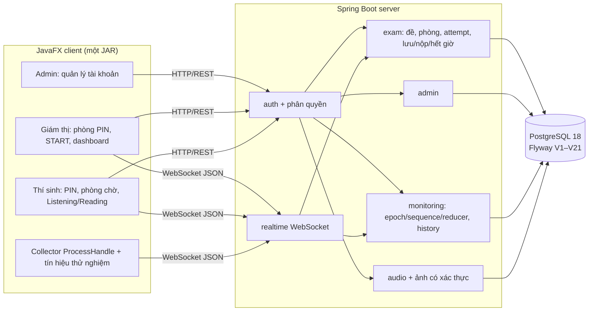

# Kiến trúc — TOEIC Monitor

Một Server Spring Boot, một ứng dụng JavaFX cho ba vai trò, PostgreSQL. Chi tiết wire format: [PROTOCOL.md](PROTOCOL.md); API: [BACKEND_API.md](BACKEND_API.md); schema: [DATABASE_SCHEMA.md](DATABASE_SCHEMA.md); quy tắc nghiệp vụ: [plan-v1/02_HOP_DONG.md](plan-v1/02_HOP_DONG.md).

## Module Maven

| Module | Nội dung | Owner |
|---|---|---|
| `protocol` | DTO dùng chung: auth, admin, exam/rich, audio, monitoring/signal, envelope WS, error code | A/C |
| `server` | `auth`, `admin`, `exam` + `exam/rich` (đề V2, phòng, ACCOUNT_PIN, START/deadline), `audio`, `monitoring` + `monitoring/signal`, `realtime` | A (exam/auth), C (monitoring) |
| `client` | `LoginPane`/`ToeicClientApplication` (điều hướng theo role server trả), `admin`, `proctor/redesign` (dashboard giám thị, Điều khiển ca), `exam/rich` (phòng chờ, 7 Part), `audio`, `monitoring` (collector, tín hiệu thử nghiệm), `realtime` | B (UI), C (collector) |
| `monitoring-spike` | Probe `ProcessHandle` độc lập, dùng lại cho collector | C |
| `tools/study4-adapter` | Chuyển export STUDY4 nội bộ sang `RichExamImportRequest` V2, offline | A |

## Luồng chính

1. **Đăng nhập**: POST `/api/v1/auth/login` → token Bearer; role do server quyết định, client chỉ chọn màn hình theo role trả về. Ẩn giao diện không thay cho phân quyền.
2. **ACCOUNT_PIN**: Giám thị tạo phòng (Session SCHEDULED, chưa có Attempt). Thí sinh dùng token tài khoản + PIN để JOIN; JOIN trong transaction tạo hoặc dùng lại đúng một Attempt và cấp token có scope attempt. PIN lưu dạng BCrypt + lookup HMAC-SHA256 với khóa của operator; không lưu plaintext.
3. **Chuẩn bị**: Client tải manifest audio/ảnh, kiểm checksum, thử loa; READY là xác nhận của server, có lease.
4. **START**: một khóa trên Session; snapshot READY, ghi một start context và **deadline chung** bằng `clock_timestamp()` sau khóa. Lệnh phát Listening gửi qua WebSocket sau COMMIT; start trùng ID không phát lại.
5. **Lưu/nộp/hết giờ**: autosave gửi toàn bộ map đáp án với `requestId`, `writerEpoch`, `answerRevision`; save/submit/timeout/takeover dùng chung khóa trên attempt, kiểm `writerEpoch` sau khóa, ACK chỉ sau commit. Bài đã chốt không đổi.
6. **Monitoring**: collector chỉ chạy ở role thí sinh, gửi full snapshot (mặc định) qua WebSocket; server giữ trạng thái hiện tại và lịch sử event tách biệt; mất heartbeat → UNKNOWN. Delta và các tín hiệu USB/focus/cửa sổ/màn hình là thử nghiệm, tắt mặc định.

## Luồng tác vụ phía client

Mạng, file, quét process không chạy trên JavaFX Application Thread; kết quả về UI qua `Platform.runLater`. Đóng màn hình/đăng xuất đóng mọi worker và timer của màn đó. Ở bản phát hành, các pane legacy (phòng V2 cũ, ca V1) không được tạo nên timer của chúng không chạy (`vn.edu.toeic.client.LegacyUi`).

## Cấu hình triển khai

Server đọc biến môi trường (`DB_*`, `TOEIC_AUDIO_ROOT`, `TOEIC_IMAGE_ROOT`, `TOEIC_ROOM_PIN_KEY`, `TOEIC_ADMIN_BOOTSTRAP_*`; chỉ khi phát triển/kiểm thử: `TOEIC_SEED_DEMO_ACCOUNTS`, `TOEIC_SEED_PASSWORD`); bundle portable nạp chúng từ `server.env`, kiểm trước khi chạy và luôn tắt tài khoản demo. Client nhận địa chỉ Server từ `-ServerUrl`/`TOEIC_SERVER_URL` (launcher portable hỏi nếu chưa có) hoặc sửa ngay trên màn đăng nhập; giá trị `127.0.0.1` chỉ là mặc định khi chạy JAR trực tiếp, không phải cách chạy LAN. Xem [DEMO-RUNBOOK.md](DEMO-RUNBOOK.md).
