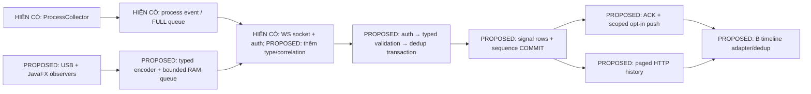

# MON-07 — Đề xuất contract monitoring đa tín hiệu

20/10/2026 — Codex technical review trên nội dung c9a5829: đối chiếu schema/capability/fixture/queue/COMMIT/cursor với slice thử nghiệm PR74. Tài liệu được phép merge như proposal; các quyết định owner vẫn PROPOSED, đặc biệt offline60s/retention30ngày. Không tạo chữ ký A/B/C hoặc approval production.

**PROPOSED — NOT IMPLEMENTED — OWNER REVIEW PENDING.** Ngày 19/10/2026.

Đề xuất chính: giữ envelope `v0`, thêm message **đề xuất** `MONITORING_SIGNAL` cho lịch sử USB/focus/window/display; một queue RAM mới dùng chung cho các tín hiệu này, cùng kết nối WS hiện có. Lưu vào bảng mới, auth trước dedup, COMMIT trước ACK; proctor phục hồi bằng history phân trang. Không dùng `PROCESS_OBSERVED` để chứa dữ liệu mới. Đây là hồ sơ để A/B/C quyết định, chưa phải contract vận hành hoặc implementation MON-07.

## 1. Baseline và điều kiện đầu vào

- Source đối chiếu/base: `origin/main@1d35b53729abade7b460d35ab07d042b6f9f3571`, fetch ngày 19/10. Checkout gốc vẫn `main@f98a37f73d8035e9386e930412a02e9e92933015`, sạch; làm trong worktree/nhánh `docs/v2-c-mon07-contract-proposal` riêng. Không lấy chuỗi commit verification làm base.
- Tìm PR mọi trạng thái theo MON-07/multisignal/multi-signal/USB và exact head, tìm remote branch và source main: chưa thấy proposal/implementation MON-07 riêng; các kết quả hiện có là kế hoạch và nhắc dependency. Nhánh proposal này tạo mới từ main.
- [PR70 BASE-03](https://github.com/AnhTaizz/Toeic-Monitoring-Realtime/pull/70): OPEN, chưa merge, head `9a97cab646af40e45871cb76ffbfcfcb861f2954`; CI đã SUCCESS. [Report đúng SHA](https://github.com/AnhTaizz/Toeic-Monitoring-Realtime/blob/9a97cab646af40e45871cb76ffbfcfcb861f2954/evidence/v2-c-base03/REPORT.md): gate **NOT_DECIDED**, FULL mặc định, LAN 0/41 NOT_RUN, B review PENDING, E2 không được phép.
- [PR71 MON-01](https://github.com/AnhTaizz/Toeic-Monitoring-Realtime/pull/71): OPEN, chưa merge, head `3b81f4929f736828d112fc5bf456b53499ff1270`, stacked trên PR70; CI đã SUCCESS. [Report đúng SHA](https://github.com/AnhTaizz/Toeic-Monitoring-Realtime/blob/3b81f4929f736828d112fc5bf456b53499ff1270/evidence/v2-c-mon01/REPORT.md): **TECHNICALLY_VERIFIED_PENDING_PHYSICAL_REVIEW**, BASE-02 approval/LAN/B review PENDING. Không biến CI hoặc báo cáo kỹ thuật thành human acceptance. Raw/artifact riêng trên ổ D không phải tài nguyên tải xuống GitHub; các report trên là evidence công bố.
- Đã đọc [entrypoint](../PLAN_V2_START_HERE.md), [CLAUDE](../CLAUDE.md), AGENTS do người dùng cung cấp, [task BASE-04, MON-01–09](plan-v2/03_TASK_CARDS.md), [kickoff](plan-v2/V2_EXECUTION_KICKOFF_20261019.md), [architecture](plan-v2/02_ARCHITECTURE_CONTRACT.md), [ownership](plan-v2/04_EXECUTION_OWNERSHIP.md), [ADR/risks](plan-v2/07_RISKS_DECISIONS.md), [hợp đồng hiện tại/phụ lục V2](plan-v1/02_HOP_DONG.md), [protocol hiện hành](PROTOCOL.md), [quyết định](QUYET_DINH.md), [tiến độ](TIEN_DO.md), [nhật ký](NHAT_KY.md). Không có AGENTS.md khác trong cây source được checkout.
- Team đã duyệt **scope V2**. `ADR-V2-04`/BASE-04 vẫn cần C+A chốt wire/schema/retention và B review consumer/lifetime. ADR-V2-05 lựa chọn Windows observer/hardware riêng; task này không lựa chọn API USB bằng suy đoán. Dòng USB exclusion cũ trong risk register là mô tả lịch sử, đã có ngoại lệ scope V2 ở CLAUDE/phụ lục; không mở rộng sang đọc file/serial hoặc khóa thiết bị.

### Review bổ sung PR #72 — 19/10/2026

Fetch lại main vẫn `1d35b53729abade7b460d35ab07d042b6f9f3571`; PR #72 Draft/OPEN ở `da89962e71c169d2ffbd0e9dfdd1ce460d00fb01`, [CI39248150270 SUCCESS](https://github.com/AnhTaizz/Toeic-Monitoring-Realtime/actions/runs/39248150270). [Reviews](https://api.github.com/repos/AnhTaizz/Toeic-Monitoring-Realtime/pulls/72/reviews), [inline comments](https://api.github.com/repos/AnhTaizz/Toeic-Monitoring-Realtime/pulls/72/comments) và [conversation comments](https://api.github.com/repos/AnhTaizz/Toeic-Monitoring-Realtime/issues/72/comments) đều rỗng lúc kiểm. PR70/71/73 cũng OPEN/chưa merge, reviews/conversation rỗng; #73 vẫn Draft ở `aa260ef`, [CI39265452789 SUCCESS](https://github.com/AnhTaizz/Toeic-Monitoring-Realtime/actions/runs/39265452789), [USB report](https://github.com/AnhTaizz/Toeic-Monitoring-Realtime/blob/aa260ef0e24b9bc5e78bfa5e1ecf5ca786e280dc/evidence/v2-c-mon02/REPORT.md) giữ 12 physical cases NOT_RUN. Probe riêng không là observer production.

**Chưa tìm thấy approval contract cụ thể.** Team-scope approval ở kickoff chỉ duyệt phạm vi V2; review này là agent review kỹ thuật, CI chỉ build/test source cũ. Không có nguồn để đánh APPROVED, nghiệm thu runtime MON-07 hoặc phần cứng. Theo nhánh A của yêu cầu phiên này, chỉ sửa proposal/fixture và chuẩn bị kế hoạch; không tạo nhánh implementation/DTO/SQL/wire.

| Phát hiện tại da89962 | Sửa trong tài liệu/fixture | Giới hạn |
|---|---|---|
| Chưa chọn eventType slice đầu; capability MOCK liệt kê cả catalog | D07-01 chọn đúng một type; thêm gói firstSlice MOCK riêng, gắn nhãn futureCatalog cho ví dụ USB/status/gap/push cũ | Không nhận là capability đang vận hành |
| 410/purge-watermark không tới được dưới ACTIVE-only + purge sau terminal; S16 vẫn đòi 410 | Bỏ 410/tombstone khỏi scope hiện tại; 403 terminal, 400 cursor; purge toàn attempt sau terminal | Không mở quyền hậu kiểm |
| Aggregate credits chưa có số; RealtimeClient chỉ reserve ACK, `heartbeat()` bỏ gửi khi writes chưa rỗng | Nêu lower bound 10 credits, guard từng dispatch và không xếp retry sau write treo; bổ sung stall/late-write tests S11/S12 | Source hiện có chưa bảo đảm fairness/deadline write mới; B phải review hook |
| Counter row chưa có quy tắc khởi tạo; auth có thể cũ sau khi chờ lock | INSERT ON CONFLICT rồi lock cùng transaction, không tiêu sequence khi rollback; yêu cầu serialization với revoke và test barrier | Không giả existing handler/auth đã bảo đảm revoke trong cửa sổ chờ |

## 2. Audit source đang chạy và ranh giới tái sử dụng

Các link source dưới đây là file tại base nêu trên. Tên class/method mới ở các mục sau đều là **PROPOSED**.

| Phần | Hiện có / có thể tái sử dụng | Cần bổ sung / chưa quyết định | Source và method đã đọc |
|---|---|---|---|
| Envelope | Record 7 field; v0, ID ASCII 1–128, requestId nếu có phải bằng messageId phía gửi | Không có generic typed signal DTO; thêm validator riêng, không chỉ gắn payload tùy ý | [MessageEnvelope](../protocol/src/main/java/vn/edu/toeic/protocol/ws/MessageEnvelope.java); [RealtimeClient](../client/src/main/java/vn/edu/toeic/client/realtime/RealtimeClient.java) `validateHeader`, `sendForGeneration`; [handler](../server/src/main/java/vn/edu/toeic/server/realtime/RealtimeWebSocketHandler.java) `handleTextMessage` |
| Encode/process queue | ID/time/payload defensive copy, retry RAM, overflow riêng process | `MonitoringMessage.observed/gap` và `MonitoringDelivery.observe` phụ thuộc process identity/baseline; không nhận USB/focus/display. Chỉ tái sử dụng nguyên tắc, chưa refactor pipeline | [MonitoringMessage](../client/src/main/java/vn/edu/toeic/client/monitoring/MonitoringMessage.java) `observed`, `gap`, `envelope`; [MonitoringDelivery](../client/src/main/java/vn/edu/toeic/client/monitoring/MonitoringDelivery.java) `observe`, `tick`, `receive`, `stop` |
| WS/ACK | Socket/reconnect do B quản lý; `send` hoàn thành khi write, không phải COMMIT; generation và forgetPending đã có | Gửi/nhận đang dispatch theo type cụ thể. Thêm type/correlation/parser/capability cùng owner; không giả interface send hỗ trợ mọi type | [MonitoringTransport](../client/src/main/java/vn/edu/toeic/client/realtime/MonitoringTransport.java) `send`, `sendForGeneration`, `forgetPending`; [RealtimeClient](../client/src/main/java/vn/edu/toeic/client/realtime/RealtimeClient.java) `sendForGeneration`, `receive` |
| Server event | Auth token mỗi message, scope trước service; transaction proxy trả về sau COMMIT; chỉ created mới warning | Handler/service/parser mới; không gọi process reducer hoặc dùng process event cache cho tín hiệu | [handler](../server/src/main/java/vn/edu/toeic/server/realtime/RealtimeWebSocketHandler.java) `handleTextMessage`; [MonitoringEventService](../server/src/main/java/vn/edu/toeic/server/monitoring/MonitoringEventService.java) `store`, `lockAndAuthorize`; [ProcessEvent](../server/src/main/java/vn/edu/toeic/server/monitoring/ProcessEvent.java) `parse` |
| Persistence/gap | V2 unique attempt/event; V8 origin/delivery; V3 unique attempt/gap; equality chuẩn hóa, FOR SHARE attempt | Bảng typed signal/cursor mới, không sửa applied migration hoặc đổi meaning `monitoring_gaps` | [V2](../server/src/main/resources/db/migration/V2__monitoring_events.sql), [V3](../server/src/main/resources/db/migration/V3__monitoring_gaps.sql), [V8](../server/src/main/resources/db/migration/V8__monitoring_event_delivery.sql); [MonitoringGapService](../server/src/main/java/vn/edu/toeic/server/monitoring/MonitoringGapService.java) `store`, `timeline` |
| HTTP/push | Assigned proctor, ACTIVE-only; push best effort sau COMMIT, revalidate token/assignment | Endpoint/push typed mới và opt-in proctor; không đổi response `/events` hiện hành | [MonitoringTimelineController](../server/src/main/java/vn/edu/toeic/server/monitoring/MonitoringTimelineController.java) `timeline`, `gaps`; [RealtimeSessionRegistry](../server/src/main/java/vn/edu/toeic/server/realtime/RealtimeSessionRegistry.java) `warnAssignedProctors`, `pushAssignedProctors`; [JdbcAttemptScopeStore](../server/src/main/java/vn/edu/toeic/server/monitoring/JdbcAttemptScopeStore.java) `canAccess` |
| History limit | Lấy 5001, chỉ trả đủ ≤5000, vượt trả **409 INVALID_STATE retryable:false** | Thông tin đầu vào nói RETRYABLE_SERVER_ERROR là trạng thái cũ; không đúng ở SHA này. API mới dùng pagination, không lỗi transient cho dữ liệu quá nhiều | [MonitoringHistoryLimit](../server/src/main/java/vn/edu/toeic/server/monitoring/MonitoringHistoryLimit.java) `requireComplete`; [ApiExceptionHandler](../server/src/main/java/vn/edu/toeic/server/auth/ApiExceptionHandler.java) `examApiException`; [MonitoringApiClient](../client/src/main/java/vn/edu/toeic/client/dashboard/MonitoringApiClient.java) `history` |
| Consumer | Event process/time/provenance, dedup attempt/event; state có serverInstanceId/revision; request generations tránh callback cũ | DTO/parser signal + model/timeline adapter B; current screen không tự có USB | [MonitoringJson](../client/src/main/java/vn/edu/toeic/client/dashboard/MonitoringJson.java) `event`, `events`, `push`; [MonitoringData](../client/src/main/java/vn/edu/toeic/client/dashboard/MonitoringData.java) `Event`; [DashboardModel](../client/src/main/java/vn/edu/toeic/client/dashboard/DashboardModel.java) `mergeEvent`; [DashboardController](../client/src/main/java/vn/edu/toeic/client/dashboard/DashboardController.java) `current`, `select`; [ProctorDashboardView](../client/src/main/java/vn/edu/toeic/client/dashboard/ProctorDashboardView.java) |
| Lifecycle | Explicit start, fresh role/scope, collector-only candidate, heartbeat lease, auto quiesce khi scope bị từ chối, stop chờ workers | Gắn observer mới vào cùng owner lifetime; đăng ký/hủy JavaFX listener do B, native worker C. Không chạy scanner/network trên FX thread | [CandidateMonitoringSession](../client/src/main/java/vn/edu/toeic/client/monitoring/CandidateMonitoringSession.java) `start`, `stop`, `close`; [ProcessCollector](../client/src/main/java/vn/edu/toeic/client/monitoring/ProcessCollector.java) `start`, `stop` |

Quan hệ các luồng: `PROCESS_OBSERVED` là lịch sử process trong PostgreSQL; FULL/DELTA là **current process state RAM** theo syncEpoch/sequence; presence là bằng chứng heartbeat/UNKNOWN và interruption server; `MONITORING_GAP` là mất event process do overflow. Typed signal mới là lịch sử độc lập. Không dùng FULL để xóa history/gap; không coi ONLINE là sensor READY; không đưa USB vào process policy hoặc sequence FULL. Listening giữ contract riêng.

## 3. Phương án wire và tương thích (tất cả PROPOSED)

**Scope slice đầu là D07-01–05:** một eventType DISPLAY_COUNT_OBSERVED, harness MOCK/no observer/no push; các mô tả USB/focus/window/status/gap/proctor opt-in và consumer dưới đây là catalog tương lai, không yêu cầu bật hoặc triển khai trong slice. Khi chưa có SIGNAL_GAP capability, overflow chỉ giữ count/times/unconfirmed cục bộ hữu hạn và báo rõ không gửi được gap; không tự encode type bị tắt.

| Lựa chọn | Đánh giá |
|---|---|
| **Chính: envelope v0 + type MONITORING_SIGNAL + payload.schemaVersion=1, opt-in capability** | Giữ process v0/FULL không đổi, dễ review từng handler. Cần client/server mới cùng hỗ trợ; v0 không có nghĩa mọi peer tự hiểu type mới |
| Nâng toàn envelope lên v1 | Đụng toàn bộ client/server dù chỉ thêm history; chưa có nhu cầu đủ để chọn |
| Nhét `details` USB vào PROCESS_OBSERVED | Loại: sai semantic, parser/process DB/policy hiện hành không tương thích |

Capability mới: `GET /api/v1/monitoring/attempts/{attemptId}/signal-capabilities`, Bearer header, no-store; CANDIDATE owner ACTIVE hoặc assigned PROCTOR ACTIVE. Response field bắt buộc: `protocolVersion:"v0"`, `schemaVersion:1`, `traceId:ID`, `attemptId:ID`, `supportedEventTypes:array` các tên mục 4, không trùng, tối đa 10 phần tử. Không có field lạ. Capability chỉ công bố type implementation đang bật, không toàn bộ catalog mục 4. Slice đầu ở D07-01 chỉ có DISPLAY_COUNT_OBSERVED; OBSERVER_STATUS/SIGNAL_GAP và USB/focus/window/activity chưa bật, request các type này bị INVALID_INPUT. Capability chỉ mô tả hỗ trợ, không thay quyền mỗi message. Không sửa payload heartbeat đang strict. Old server 404 → client ghi UNSUPPORTED, không khởi tạo observer mới; 401/403 → stop đúng scope; 5xx/network → UNKNOWN và chờ retry hữu hạn, không tự xem là hỗ trợ. MON-06 mặc định không nằm trong capability cho đến khi P1 được duyệt. Server cũng phải kiểm danh sách eventType đang bật trước lưu: type/schema chưa bật trả INVALID_INPUT retryable=false, không chỉ trông vào client làm đúng capability; không nhận activity chỉ vì payload có schema hợp lệ.

**Proctor opt-in:** dùng cùng WS endpoint và header đề xuất `X-Toeic-Signal-Schema: 1` (tối đa một giá trị, chỉ literal 1; vắng là không opt-in). [RealtimeHandshakeInterceptor.beforeHandshake](../server/src/main/java/vn/edu/toeic/server/realtime/RealtimeHandshakeInterceptor.java) hiện từ chối mọi URL query, kiểm đúng một Authorization header; giữ các rule này. B/A cần thêm custom header tại opener và validate/lưu capability trong socket attributes rồi mới gửi `MONITOR_SIGNAL` tới socket ấy. Header này không cấp quyền; credential vẫn chỉ Bearer header, không trên URL. Old server bỏ qua header mới và không có capability endpoint; old proctor không có header → không nhận type mới. Old server không có capability → new client không gửi type mới, không bật observer. Refresh capability mỗi socket/reconnect/đổi attempt; không lấy capability trên HTTP làm chứng cứ WS peer chắc chắn cùng version: deployment phải đồng bộ HTTP/WS; unknown-type INVALID_INPUT thì dừng signal lane, hiển thị incompatibility, giữ process lane. Không tự downgrade event thành process. Quyết định này cần A/B review deployment, custom header/opener và handshake validation; không nới quy tắc cấm query hiện tại.

### 3.1 Quy tắc chung

JSON UTF-8 strict: decoder báo lỗi byte sequence sai, không thay bằng replacement character; reject lone surrogate kể cả dạng JSON escape. Reject duplicate keys, field lạ ở mọi object, null (trừ nơi ghi rõ), enum lạ, array ngoài schema, number fractional/exponent/string giả số. Integer trong `[0,9007199254740991]` trừ bound hẹp hơn. ID = `[A-Za-z0-9_.:-]{1,128}`, không chứa thông tin người dùng; field ID nhỏ hơn có ghi riêng. Không tự trim, đổi case, điền default cho field bắt buộc. Byte bounds là byte JSON UTF-8 thực nhận/gửi, kể cả key/escape/whitespace; sender compact JSON, validate cả object lẫn serialized bytes. Max depth 6. Reject quá hạn mức trước cấp phát payload lớn; schema validator không cho metadata tự do.

Time string UTC `YYYY-MM-DDTHH:mm:ss[.ffffff]Z`, năm 0001–9999, tối đa 27 byte, 0–6 chữ số thập phân; parse hợp lệ và canonical về Instant microsecond (không nhận >6 rồi âm thầm mất precision). So instant, không so chuỗi có/không `.000000`. Client clock có thể lệch; không reject chỉ vì observedAt nằm tương lai, không lấy nó quyết định deadline hoặc suy độ trễ xuyên máy. Duration dùng monotonic clock cùng client run.

### 3.2 Envelope gửi candidate

| Field | Kiểu / required | Nguồn và lúc freeze | Validation |
|---|---|---|---|
| protocolVersion | string, có | encoder, tạo event | literal `v0` |
| type | string, có | encoder, tạo event | literal `MONITORING_SIGNAL` |
| messageId | ID, có | client random lúc tạo | = requestId; không đổi khi retry |
| requestId | ID, có | client random lúc tạo | cùng quy tắc v0 gửi hiện có; không tái dùng cho event khác |
| traceId | ID, có | client random lúc tạo | frozen qua retry; chỉ correlation, không auth/dedup key |
| attemptId | ID, có | fresh scope server cấp | candidate sở hữu ACTIVE; envelope là nơi duy nhất chứa attempt trong request |
| payload | object, có | encoder deep copy lúc tạo | đúng mục dưới; envelope ≤8192 byte; payload ≤4096 byte |

### 3.3 Payload chung

| Field | Kiểu / required | Nguồn/freeze | Validation |
|---|---|---|---|
| schemaVersion | integer, có | encoder/create | literal `1` |
| eventId | ID, có | random client/create | stable; DB key `(attemptId,eventId)`; không dùng requestId làm khóa DB |
| observerSessionId | ID, có | C tạo random tại explicit start | shared cho các observer mới trong run; không phải process syncEpoch, writerEpoch hay quyền; restart/start mới tạo ID mới |
| observationSequence | integer, có | C tăng 1/run tại tạo event | 1..9007199254740991, frozen; chỉ giúp thứ tự quan sát nội bộ, không dùng làm DB cursor; exhaustion dừng run có lỗi |
| eventType | enum string, có | typed emitter/create | đúng bảng mục 4, ≤64 byte |
| source | enum string, có | adapter/create | đúng mapping mục 4, ≤32 byte; chỉ là nguồn client khai, không attestation |
| metadataQuality | enum string, có | emitter/create | COMPLETE/PARTIAL/UNREADABLE/UNSUPPORTED, ≤16 byte; quy tắc mục 4 |
| observedAt | time string, có | UTC client/create | không đổi khi resend; không là server time |
| observationContext | enum string, có | transport đọc khi tạo | CONNECTED/OFFLINE/UNSPECIFIED, ≤16 byte |
| observationConnectionId | ID, tùy chọn | connection ID từ ACK heartbeat hiện có/create | chỉ có và bắt buộc khi context CONNECTED; OFFLINE/UNSPECIFIED phải bỏ field, không null; không đổi sang socket mới khi retry |
| details | object, có | emitter/create | exact fields theo eventType; ≤1024 byte; không free-text/map/string tùy ý |

Không nhận `receivedAt`, `timelineSequence`, `deliveryStatus`, username/role, sessionId ca, điểm hoặc serverInstanceId trong request. Server tự gán các field mục 7. `collectorSessionId` process không đổi và không bắt buộc thêm vào tín hiệu; C giữ liên kết observer run với CandidateMonitoringSession trong RAM, không suy quyền từ tên run.

## 4. Typed details và metadata (PROPOSED)

Mọi field liệt kê là required trừ dấu `?`; key vắng khác null. Không có field ngoài bảng. Bounds nhỏ dưới đây nằm trong bound UTF-8 chung.

| eventType (tên đề xuất) | source | details: type/bound/semantic |
|---|---|---|
| USB_STORAGE_PRESENT_AT_START | WINDOWS_USB_STORAGE | `deviceClass:"USB_MASS_STORAGE"`, `storageCount:int 1..64`, `deviceRef?:ID ≤64 byte`. Một event baseline tổng số storage phân loại được; không có USB thì không phát PRESENT, dùng status READY; không suy từ thiếu event |
| USB_STORAGE_CONNECTED | WINDOWS_USB_STORAGE | `deviceClass:"USB_MASS_STORAGE"`, `storageCount:int 1..64` sau thay đổi, `deviceRef?:ID ≤64 byte` |
| USB_STORAGE_REMOVED | WINDOWS_USB_STORAGE | cùng fields, storageCount 0..64 sau thay đổi; deviceRef là ref từng biết nếu có |
| EXAM_FOCUS_CHANGED | JAVAFX_EXAM_FOCUS | `focused:boolean`, `context:INITIAL/EXAM_INTERNAL_DIALOG/OTHER_OR_UNKNOWN`, `lostDurationMillis?:int 0..86400000` chỉ khi focused=true, context khác INITIAL và có monotonic start/end cùng run |
| EXAM_WINDOW_STATE | JAVAFX_EXAM_WINDOW | `minimized:boolean`, `fullscreen:boolean`, `reason:INITIAL/CHANGED`; chỉ property của cửa sổ thi, không giả khởi đầu non-fullscreen là exit |
| DISPLAY_COUNT_OBSERVED | JAVAFX_DISPLAY | `count:int 0..32`, `reason:INITIAL/CHANGED`; count là OS/JavaFX report, count=0 chỉ khi scan thành công thực sự trả 0; lỗi không encode thành 0/1 |
| EXAM_ACTIVITY_SUMMARY (P1, chưa bật) | EXAM_LOCAL_ACTIVITY | `intervalMillis:int 1000..60000`, `navigationCount:int 0..100000`, `answerActionCount:int 0..100000`, `idleMillis:int 0..86400000`; chỉ tổng hợp action trong app, không question/answer text; interval khi sleep/clock gap không đo được → status UNKNOWN |
| OBSERVER_STATUS | một trong 5 nguồn sensor trên | `status:READY/UNKNOWN/UNSUPPORTED/ERROR`, `reason:INITIAL/RECOVERED/NO_DATA/API_UNAVAILABLE/PERMISSION_DENIED/SCAN_FAILED/PAUSED_OFFLINE`; READY chỉ INITIAL/RECOVERED, UNKNOWN chỉ NO_DATA/PAUSED_OFFLINE, UNSUPPORTED chỉ API_UNAVAILABLE, ERROR chỉ PERMISSION_DENIED/SCAN_FAILED |
| SIGNAL_GAP | CLIENT_SIGNAL_DELIVERY | `reason:"QUEUE_OVERFLOW"`, `droppedCount:int 1..9007199254740991`, `firstDroppedAt:time`, `lastDroppedAt:time`; first ≤ last theo min/max client wall time; không khẳng định đồng hồ monotonic. Gap chỉ lane signal, không bao gồm process/heartbeat |

Signal giá trị chỉ gửi quality COMPLETE hoặc PARTIAL (USB thiếu ref/phân loại chỉ một phần); PARTIAL phải hiển thị hạn chế, storageCount khi PARTIAL là số **quan sát/phân loại được**, không tổng thiết bị chắc chắn có. Các sensor khác dùng COMPLETE khi đo thành công, nếu không dùng OBSERVER_STATUS thay vì đoán boolean/count. OBSERVER_STATUS READY quality COMPLETE; UNKNOWN/ERROR quality UNREADABLE; UNSUPPORTED quality UNSUPPORTED; SIGNAL_GAP quality COMPLETE (count drops đã biết, không phải đảm bảo đầy đủ lịch sử).

`deviceRef` random trong một observerSessionId, không hash serial/path/hardware ID và không tồn tại qua run. Nếu chỉ biết tổng số hoặc arrival/remove không thể correlate an toàn, bỏ ref, PARTIAL. Debounce cùng transition tại emitter; không xóa các transition khác nhau khi delivery, không phát lại ở mỗi poll. Startup/own-dialog có context rõ để người xem không coi mọi focus loss là thao tác ngoài app. Khi USB classification không xác định, gửi OBSERVER_STATUS UNKNOWN, không gắn mouse/keyboard thành storage. API OS/debounce cụ thể và cách lấy count cần ADR-V2-05/hardware evidence sau này.

## 5. Quyền và vòng đời (PROPOSED trên bất biến hiện có)

1. Chỉ role CANDIDATE từ fresh `/auth/me`, chọn đúng attempt trong scope ACTIVE, sau thông báo rõ tín hiệu/giới hạn/retention và explicit start. Capability dương + scoped heartbeat ACK trên socket hiện tại rồi mới bật signal observers; không collector trên proctor. Disclosure UI do B review, không thêm quyền bằng checkbox client.
2. Trước START: hiện tại ACTIVE attempt có thể ở ca SCHEDULED, monitoring được chạy từ explicit start, như hợp đồng hiện hành. Đề xuất các tín hiệu mới cũng chỉ trong phiên monitoring ACTIVE đã thông báo này; không tự yêu cầu proctor START và không coi chuẩn bị là đang làm bài. QD-21 deadline vẫn bắt đầu theo takeover hiện có; observer start/status không takeover, không đặt deadline. Nếu owner muốn đổi cửa sổ capture thì cần ADR riêng, regression rồi mới đổi.
3. Mỗi WS request: token còn hiệu lực → parse envelope có bound → role → owner/ACTIVE scope trong transaction dưới attempt FOR SHARE → validate typed payload → dedup. Service không tin cached attemptScope ở client. Không đọc/return stored duplicate trước auth; sai role/foreign/unknown/đã chốt dùng FORBIDDEN chung. Lỗi token UNAUTHORIZED đóng socket và yêu cầu login; không trả stored row/details.
4. Stop khi SUBMITTED/TIMED_OUT/CLOSED, logout, explicit stop/đóng view/app hoặc mất quyền đã xác nhận. Invalidate run generation trước, hủy JavaFX/native listeners, polling/timers, ngăn enqueue/send/callback, đóng subscriptions/heartbeat lease, forget pending correlations, chờ worker termination ngoài FX. Hiển thị số event/gap chưa xác nhận bị bỏ; không flush sang attempt mới hoặc sau quyền bị từ chối.
5. Offline không chứng minh quyền đã bị thu hồi tức thì: đề xuất signal observers chỉ tiếp tục tối đa **60 giây monotonic từ scoped heartbeat ACK thành công gần nhất**, sau đó pause capture và hiển thị UNKNOWN/PAUSED_OFFLINE; không ảnh hưởng collector process/Listening hiện có. Giới hạn mới này cần A/B/C duyệt. Giữ RAM event cũ đến stop; reconnect fresh auth/scope/capability + heartbeat trước flush và resume. Không gửi bù nếu lượt đã kết thúc/revoked. Có thể mất dữ liệu khi stop/crash; không tuyên bố server đã biết mọi drop.
6. Chỉ assigned PROCTOR ACTIVE đọc history/nhận push; revalidate token/role/assignment mỗi lần kể cả cursor/duplicate và trước push. Không tự mở quyền history sau submit chỉ vì DB còn row; nhu cầu hậu kiểm là ADR riêng cho A. Không dùng endpoint exam history có scope rộng hơn để lách monitoring scope.
7. Callback mang `(attemptId,observerSessionId,runGeneration,connectionGeneration)`; run/socket cũ không enqueue, gửi, ACK pending, hủy listener hoặc stop run mới. Reconnect giữ event/run identity khi cùng phiên còn hợp lệ; attempt/start mới có run ID mới. Transport plan cũ phải bị chặn trước write trên socket thay thế. Không dùng syncEpoch FULL để loại history cũ còn đúng scope.

## 6. Delivery và idempotency

### 6.1 Giới hạn đang có so với đề xuất

| Tham số | Default source hiện tại | Đề xuất riêng cho signal, CHƯA ÁP DỤNG |
|---|---|---|
| Process event queue / in-flight | MonitoringDelivery.Settings: 500 / 4 | Giữ nguyên |
| Process retry | ACK 5s, maxAttempts 5; backoff 1/2/4/8s, pump 25ms; maxObservedProcesses 10000 | Giữ nguyên |
| RealtimeClient | heartbeat 2s; reconnect maxRetries 4, backoff 1..8s; maxMessageChars 65536 và kiểm UTF-8; maxPendingAcks 500, giữ một slot heartbeat | Giữ nguyên defaults; kiểm đủ aggregate budget trước enable lane |
| Server WS | max-message-bytes 65536 | Message mới ≤8192 byte, typed payload ≤4096, details ≤1024; không nới global limit |
| Signal queue | Chưa có | 256 data/status events, tổng serialized bytes ≤1MiB kể cả in-flight/FAILED/EXHAUSTED; full khi đạt một bound |
| Signal flight/retry | Chưa có | Tối đa 2 tổng (gap cũng tính); ACK timeout 5s tính từ dispatch, write treo cũng bị timeout; maxAttempts 5; backoff 1/2/4/8s, pump 25ms; chưa benchmark |
| Signal reserve | Chưa có | Một frozen gap ngoài data queue ≤8192 byte + một accumulator cố định; gap ưu tiên nhưng cùng max 2 flight. Tổng RAM serialized ≤1MiB+8192, object overhead hữu hạn theo số entry |

Queue mới chia sẻ giữa USB/focus/window/display/status/activity; tách khỏi queue process để USB burst không đổi process baseline/overflow/evidence. Tái sử dụng socket, auth, reconnect và correlation của adapter, không tạo kết nối hay reconnect implementation thứ hai. C/B phải kiểm capacity thực cấu hình: lower bound **10 ACK credits = process 4 + state/control 3 (OPEN/FULL/CLOSE có overlap khi stop) + signal 2 + heartbeat 1**; default 500 giữ nguyên. Đây là bound admission của lane mới, không chứng minh mọi legacy pending/write luôn ≤10; test phải gồm pending còn từ timeout/CLOSE. Nếu không đủ thì lane mới không bật, hiển thị CONFIGURATION_ERROR, không chiếm heartbeat hoặc sửa default process. Không sửa admission/retry của process để lấy credit. Transport chỉ nhận signal khi còn credit dành cho legacy + heartbeat; thiếu credit thì signal chờ trong queue hữu hạn. RealtimeClient hiện reserve một ACK slot nhưng `heartbeat()` bỏ gửi khi writes chưa rỗng và writeTail nối tuần tự: tăng maxPendingAcks không chữa head-of-line stall. Đề xuất signal giữ tối đa 2 write chưa hoàn tất, không thêm retry của entry khi write cũ chưa kết thúc; mỗi dispatch có guard riêng vô hiệu hóa lúc timeout/stop để write chưa bắt đầu không gửi muộn. Write đang ở OS không thể thu hồi chắc chắn: không coi timeout là đã hủy; giữ write credit tới completion/socket close, đánh lane UNKNOWN và giữ RAM. Không tự mở reconnect thứ hai hoặc đổi process behavior; heartbeat có thể vẫn UNKNOWN khi socket treo. B review/test hook write/correlation trước code; không hứa bảo đảm heartbeat trong socket stall. Không gửi mạng trong queue lock/FX thread.

Enqueue freeze **toàn bộ** envelope và typed details (deep immutable copy), UTC observedAt, sequence, origin và IDs. Retry sau timeout/DB retryable hoặc reconnect dùng nguyên eventId/messageId/requestId/traceId/payload/time; connection hiện tại chỉ là transport, không sửa origin. Socket disconnect không reset attempts; mỗi dispatch thực sự tiêu thụ một lượt, không tăng lượt chỉ vì tick offline. ACK đúng protocol/schema/request/trace/attempt/acknowledgedType/eventId, server fields hợp lệ và generation hiện tại mới giải phóng; write completion không phải ACK. Late ACK đúng event cùng run có thể kết thúc entry nếu chưa stop, nhưng callback từ socket generation cũ bị bỏ và retry sẽ dedup server.

ERROR retryable=true chỉ cho transient DB/server; retry hết 5 lượt → EXHAUSTED giữ entry chiếm bound, cảnh báo số unconfirmed, không tự loop vô hạn. INVALID_INPUT/CONFLICT → FAILED, không đổi payload/ID để né lỗi. Manual retry chỉ sau người vận hành chọn, cùng frozen content, budget 5 mới và trạng thái rõ. UNAUTHORIZED/FORBIDDEN stop theo mục 5, không trả success giả. Adapter phải forgetPending khi timeout/exhaustion/stop để không rò correlation.

Overflow: drop **event mới** khi queue/bound byte đầy, tăng count/times trong accumulator; không đẩy mất in-flight/failed và không đánh dấu ACK. Khi reserve trống, freeze accumulator thành SIGNAL_GAP có ID/sequence/time riêng, reset accumulator; drop phát sinh sau đó vào accumulator khác, không sửa gap đang retry. Không tính gap vào droppedCount của data. Accumulator chỉ count + min/max time (constant memory), giới hạn số nguyên an toàn; nếu count/sequence tràn thì dừng lane báo COUNT_LIMIT. Gap failed/exhausted vẫn giữ và cảnh báo, không sinh vô hạn gap reserve. Crash/stop làm mất RAM/accumulator: chỉ báo unconfirmed/unreported cục bộ; heartbeat interruption server là dấu không xác nhận được monitoring, không bịa count/timestamp của event chưa nhận. Không disk queue.

### 6.2 Canonical equality, transaction và lỗi

DB unique `(attempt_id,event_id)`. Canonical content gồm attemptId và **mọi field payload** sau typed validation/normalization (time về microsecond, field optional absence rõ), gồm observerSessionId, observationSequence, source/quality/details/origin. JSON key order/whitespace không có ý nghĩa. Không so raw JSON hoặc chỉ hash mà bỏ kiểm equality; không bỏ qua metadata. messageId/requestId/traceId dùng correlation, không nằm trong business equality; C vẫn bắt buộc freeze chúng qua retry. receivedAt/deliveryStatus/timelineSequence do server sinh không tham gia so client content.

- Trong transaction: lock/authorize attempt → lock counter lane của attempt (mục 7) → tìm eventId; bằng canonical thì trả stored result (created=false); khác → CONFLICT, không overwrite; chưa có thì cấp sequence và insert. Unique DB bảo vệ cuối cùng; mọi writer dùng cùng lock order; lỗi race/deadlock transient không biến thành accepted.
- Transaction proxy COMMIT thành công rồi handler mới gửi ACK và, chỉ created=true, push. Duplicate nhận cùng receivedAt/sequence/deliveryStatus gốc, không thêm row/sequence/push. ACK response messageId mới của server được phép khác, requestId/traceId của request được echo.
- Rollback/COMMIT failure: không success ACK, không push, không row/counter tăng đã commit; trả ERROR RETRYABLE_SERVER_ERROR retryable=true khi socket còn gửi được. Nếu COMMIT outcome không rõ do mất kết nối DB/ACK, client retry cùng frozen event; uniqueness + equality giải quyết, không tự nhận thất bại chắc chắn hay tạo ID mới.
- Sau COMMIT push thất bại không rollback row hoặc báo chưa lưu; ACK và push không có thứ tự nhận toàn mạng bảo đảm. Không outbox/broker mới trong proposal này; consumer phục hồi bằng HTTP.

## 7. Persistence, history và handoff cho B (PROPOSED)

Flyway tại source base đã có **V1–V12**, mới nhất [V12__require_content_block_media_type.sql](../server/src/main/resources/db/migration/V12__require_content_block_media_type.sql). Chỉ nêu hướng: append migration sau khi fetch lại main và A chọn version chưa dùng; không đặt số migration tiếp theo hoặc tạo SQL trong PR proposal.

Chọn bảng mới `monitoring_signal_events` vì bảng process có pid/processName/policy NOT NULL và meaning đã cố định; tránh nullable cột giả process/backfill. Định hướng cột:

| Cột/field server | Type / rule |
|---|---|
| attempt_id, event_id | VARCHAR(128), FK attempt, UNIQUE đôi; primary key có thể chính đôi này |
| Payload client | Cột typed common fields như mục 3; details JSONB chỉ sau strict validation và check giới hạn; không lưu raw envelope/credential |
| timeline_sequence / timelineSequence | BIGINT 1..9007199254740991, unique `(attempt_id,timeline_sequence)`; không lấy IDENTITY làm commit order |
| received_at / receivedAt | TIMESTAMPTZ UTC server `clock_timestamp()` sau locks khi insert; immutable, không tự gọi là thời điểm COMMIT chính xác |
| delivery_status / deliveryStatus | LIVE nếu origin CONNECTED và connectionId trùng socket nhận; BUFFERED_OFFLINE nếu OFFLINE; PREVIOUS_CONNECTION nếu CONNECTED khác socket; UNSPECIFIED còn lại; frozen lúc first insert, giống nguyên tắc V8 |

Một bảng nhỏ mới `monitoring_signal_counters(attempt_id PK/FK,last_sequence)` dùng row lock theo attempt, trong cùng transaction insert. Sau auth, khởi tạo last_sequence=0 bằng INSERT ON CONFLICT DO NOTHING, rồi SELECT FOR UPDATE; hai writer đầu tiên chờ cùng row, không dùng SELECT-then-INSERT hoặc transaction khởi tạo riêng. Row counter và event commit/rollback cùng nhau. Chỉ tăng khi event mới. Lock này tuần tự hóa **signal append**, không khóa toàn server; không sửa counter FULL/revision/answer. Index unique attempt/eventId + attempt/timelineSequence đủ cho dedup và keyset; không thêm index eventType trước khi có truy vấn. A review lock order với submit/timeout, token revoke và assignment revocation, constraint schema và cost trước code. Auth handler trước service hiện có không tự bảo đảm quyền còn đúng sau thời gian chờ counter: service mới phải kiểm lại token/owner/ACTIVE trong transaction sau khi lấy locks; read/push phải kiểm assignment hiện tại. Mutator revoke/assignment và reader/writer phải dùng khóa tương thích trong một thứ tự được A duyệt để không COMMIT accepted sau revocation đã thắng lock. Recheck đơn thuần không đóng được race revoke giữa check và COMMIT. Chưa sửa auth dùng chung; nếu hook không đạt invariant này thì blocker trước slice, không tuyên bố đã được source cũ bảo đảm. S06/S07/S14 phải dùng barrier kiểm cả revoke thắng/trễ và rollback.

Lý do counter: IDENTITY có thể được cấp trước khi transaction khác COMMIT; đọc cursor `after=id` có thể bỏ sót row commit muộn có ID thấp. Giữ lock counter tới COMMIT bảo đảm sequence đã thấy là committed prefix; rollback counter và row cùng nhau. HTTP lấy counter committed trong transaction đọc nhất quán làm `throughSequence`, sau auth; query cùng snapshot/transaction và lock order không tạo upper bound giả. Không dùng observedAt/receivedAt làm cursor không ổn định do clock lệch/trùng.

### 7.1 Record server và ACK/push

Server record shape: **các field payload mục 3.3 + `attemptId`, `timelineSequence`, `receivedAt`, `deliveryStatus`**; tất cả required, ngoại trừ observationConnectionId theo rule cũ. Same record dùng HTTP items và push. Không đưa user ID/serial/path vào record. Byte record ≤4608 (payload 4096 + server fields có bound); max push/ACK 8192 byte. B phải giới hạn parser/body riêng, không gọi `MonitoringJson.event` process để parse record mới.

ACK envelope giữ v0, type ACK, server random messageId, echo requestId/attemptId/traceId. Payload exact required: `status:"ACCEPTED"`, `acknowledgedType:"MONITORING_SIGNAL"`, `eventId:ID`, `schemaVersion:1`, `timelineSequence:int`, `receivedAt:time`, `deliveryStatus:enum trên`, `duplicate:boolean`. duplicate=true chỉ exact canonical stored; status ACCEPTED không có nghĩa không mất sensor event trước enqueue.

ERROR envelope giữ v0, type ERROR, server random messageId, requestId/attemptId/traceId correlation nếu parse đáng tin (requestId và attemptId có thể null khi lỗi header/auth trước parse; traceId server random khi chưa biết). Payload exact `code:string ≤32 byte`, `message:string ≤256 byte` an toàn cố định, `retryable:boolean`. Mã đề xuất dùng lại nhóm hiện có INVALID_INPUT, CONFLICT, UNAUTHORIZED, FORBIDDEN, RETRYABLE_SERVER_ERROR; không echo nội dung sai/row của người khác. Không thêm status ACCEPTED trong ERROR. ACK/push/error mới cần strict branch parser C/B review, không tự cho rằng RealtimeClient hiện tại đã hỗ trợ.

Push type **đề xuất** `MONITOR_SIGNAL`; requestId=null, attemptId trùng record, traceId correlation original, messageId server random; payload là server record. Chỉ socket PROCTOR có opt-in X-Toeic-Signal-Schema:1 và assignment ACTIVE hiện tại. Duplicate retry không phát push mới. B dedup bằng `(attemptId,eventId)`, so record canonical; cùng key khác record → hiển thị lỗi consistency, fresh HTTP, không silently overwrite.

### 7.2 API phân trang và recovery

`GET /api/v1/monitoring/attempts/{attemptId}/signals?limit=100&after=0` (PROPOSED), Bearer/no-store, assigned PROCTOR ACTIVE. Chỉ query keys `limit`, `after`, `through`; lặp/không biết key →400 INVALID_INPUT retryable=false. `limit` default100, 1..100; `after` default0 và `through` optional là decimal integer 0..9007199254740991, không dấu/exponent; không phải token cấp quyền. Through lần đầu server lấy committed counter, lần sau client giữ nguyên. after≤through≤current committed counter; invalid →400, không tự sửa cursor. Không phát sinh cursor secret mới.

Response exact required `{protocolVersion:"v0",schemaVersion:1,traceId:ID,attemptId:ID,items:[serverRecord],afterSequence:int,throughSequence:int,nextAfterSequence:int|null,hasMore:boolean}`. `afterSequence` echo lower bound, items tăng sequence trong `(after,through]`. Query LIMIT limit+1 phát hiện hasMore, không load toàn lịch sử. nextAfterSequence = sequence cuối trang khi hasMore, còn lại null; trang có hasMore không được rỗng. Fixed through làm finite snapshot: hoàn tất qua mọi trang rồi checkpoint **through**; event mới >through lấy bằng request after=through, bỏ through để nhận upper bound mới. Không dùng sequence lớn nhất từ push làm checkpoint HTTP vì có thể nhận push đảo thứ tự/thiếu push ở giữa.

Response body tối đa **512KiB UTF-8**, record≤4608, limit≤100; serialize tối đa limit items (row limit+1 chỉ làm look-ahead), nếu vượt bound trả 500 consistency/server error, không cắt items rồi hasMore=false. History >5000 vẫn phân trang. 400 INVALID_INPUT retryable=false cho cursor/range; 401 token; 403 FORBIDDEN cho wrong role/assignment/terminal; 503 RETRYABLE_SERVER_ERROR retryable=true cho transient DB. Auth trước đọc counter/cursor. **Không có 410/purged-cursor/tombstone trong scope này:** không purge khi ACTIVE, terminal bị 403 trước lookup; purge toàn attempt sau terminal không để lại retained window cho endpoint ACTIVE-only. Nếu sau này mở quyền terminal hoặc purge khi còn readable, phải duyệt contract retention/cursor mới. Dùng ApiErrorResponse hiện có; không retry mù 400/403.

B subscribe WS trước/đồng thời HTTP, buffer tối đa256 record/1MiB cho selected attempt; dedup HTTP/push, giữ checkpoint của **HTTP snapshot đã hoàn tất**. Reconnect/refresh lấy fresh scope rồi các trang từ checkpoint; nếu buffer overflow hoặc có sequence hole → hiển thị STALE/thiếu dữ liệu và bắt buộc HTTP catch-up, không tô healthy. Push mất hoàn toàn và không có push kế tiếp vẫn được phát hiện bằng **HTTP catch-up mỗi 15s khi selected/connected** (đề xuất, worker nền, tối đa một chuỗi request đang chạy); không dựa duy nhất push kế tiếp. Row limit UI không có nghĩa xóa history DB; B chọn tải thêm/lọc và ghi rõ cửa sổ hiển thị. Đổi attempt/logout/reconnect invalidate request generation, không nhận response cũ.

B render: loại/source/quality/context, observedAt **client**, receivedAt **server**, deliveryStatus, observer run, gap count/khoảng; timelineSequence là thứ tự nhận/lưu của signal lane, không thứ tự hành vi vật lý. Unified view process/presence/Listening dùng adapter riêng và stable tie-break `(serverTime,channel,id)` để hiển thị, không khẳng định thứ tự tổng tuyệt đối giữa các pipeline. Current sensor display nếu B suy từ history phải label last-known/stale theo observer status + presence; không có typed current-state authoritative endpoint trong proposal này. UNKNOWN/UNSUPPORTED/ERROR hiện riêng, không thay bằng false/0; READY là observer sẵn sàng, không chứng minh không có USB hoặc không mất event. Máy không có capability không bị coi sạch tín hiệu.

## 8. Fixture MOCK và ví dụ xuyên suốt

[Fixture JSON đầy đủ](mon07-proposal/mock-exchanges.json) có gói `firstSlice` chỉ DISPLAY_COUNT_OBSERVED với 7 exchange MOCK (accepted/duplicate/conflict/foreign/COMMIT-failure/unsupported type/malformed details), record/page, capability một type và no push. Các field `futureCatalog*` giữ 19 case và record/push/page/capability USB/focus/display cũ để review catalog tương lai, chưa bật trong slice. Các request USB/focus/display, first ACK, exact duplicate request/ACK, conflict request/error, invalid metadata request/error, foreign-attempt denial, commit-failure error, gap, observer-unsupported, push và history page. Tất cả identity/time đều **MOCK**; chưa gửi tới server, không là runtime evidence. Các object `request`, `response`, `record`, `page`, `capabilities` trong fixture là wire đề xuất; `caseId`, `context`, `expected`, nhãn gói fixture là chú thích ngoài wire. Các case schema trong futureCatalogCases độc lập, không phải một timeline sensor liên tục; lostDurationMillis của focus-restored là monotonic MOCK độc lập, không lấy chênh wall-clock giữa hai case. USB baseline dùng eventId `mock-usb-1`, request/message `mock-request-usb-1`; duplicate giữ nguyên request. Conflict cố tình đổi storageCount cùng eventId; validation cố tình thêm field cấm.

**Kịch bản catalog tương lai dưới đây không phải scope slice đầu D07-01.**

1. Candidate explicit start monitoring ACTIVE trước hoặc sau START theo quyền hiện tại; thông báo trước, auth/capability/scoped heartbeat thành công. C tạo observer run `mock-observer-1`. FULL process vẫn mở epoch riêng, không phụ thuộc typed event.
2. USB đã cắm: tạo USB_STORAGE_PRESENT_AT_START storageCount=1; focus/window/display baseline/status tạo một lần/run. Freeze envelope USB; queue giữ immutable message, attempts/state/deadline retry, không giữ file/serial.
3. Rời cửa sổ: EXAM_FOCUS_CHANGED focused=false/context OTHER_OR_UNKNOWN; không thu tên app bên ngoài. Mất mạng: presence server sẽ UNKNOWN theo heartbeat; signal event trong cửa sổ offline 60s vào RAM với origin OFFLINE, sau đó pause có nhãn, không giả quan sát liên tục.
4. Reconnect cùng run: fresh auth/capability/heartbeat, nếu ACTIVE thì gửi nguyên queued USB/focus IDs và payload cũ, không sửa observedAt/origin theo thời gian gửi bù. FULL mở epoch/full mới riêng. Nếu SUBMITTED/revoked thì stop/discard có số unconfirmed, không gửi vào attempt khác.
5. Server kiểm quyền, unique attempt/event, canonical compare trong transaction; row/counter COMMIT → ACK ACCEPTED → chỉ event mới được push assigned opt-in proctor. ACK USB mất thì retry `mock-request-usb-1`/`mock-usb-1`: duplicate=true, cùng sequence/receivedAt, một row/một push.
6. Proctor nhận push/HTTP overlap, dedup và catch-up checkpoint; hiển thị client observedAt tách server receivedAt và BUFFERED_OFFLINE/PREVIOUS_CONNECTION nếu có. History không đổi current process state; heartbeat ONLINE không xóa gap/UNKNOWN trước đó. Khi stop/attempt end, listener/worker được dọn và callback cũ không chạm run mới.

## 9. Privacy, disclosure và retention cần duyệt

Chỉ capture trong phiên candidate đã được phân quyền và thông báo. Notice trước explicit start phải nói loại tín hiệu, có monitoring lúc chuẩn bị trước START, giới hạn quyền/clock/offline/unsupported, ai đọc, retention và cách báo lỗi. Đề xuất hiện banner đang monitoring + trạng thái sensor/queue, stop dọn worker; không giả có khả năng giám sát bí mật sau logout. Không biến việc stop/thiếu data thành phạt tự động.

Không đọc file USB, serial, volume label/path cá nhân, screenshot, phím gõ, clipboard toàn hệ thống, URL/window-title/app foreground ngoài app thi. Ref thiết bị ngẫu nhiên ngắn hạn, chỉ class mass-storage; mouse/keyboard không là storage. Không gửi free-text exception OS/stacktrace vào details. Không giữ raw event thật trong public Git/fixture. Client là nguồn quan sát có thể thiếu/bị can thiệp, không anti-cheat bảo đảm.

**Đề xuất retention:** signal metadata server giữ tối đa **30 ngày từ lúc attempt kết thúc**, purge cả signal rows/counter theo job A quản lý, hỗ trợ yêu cầu xóa sớm theo policy owner. ACTIVE attempt chưa có endedAt không được purge theo suy đoán; A phải duyệt terminal timestamp/abandoned attempt policy và cách xóa backup/export. Không tự gán retention 30 ngày cho bảng process cũ. RAM queue chỉ tới stop/crash, không lưu đĩa; sanitized operational log chỉ count/code/correlation cần thiết, không payload/identity thiết bị. Backup/export access và thời gian xóa theo cùng policy phải được A/nhóm chốt trước lưu dữ liệu thật. 30 ngày/notice/60s offline đều **PENDING**, không tuyên bố đã có đồng thuận hoặc cơ chế purge.

Một USB/focus/display event không tự kết luận gian lận, hủy bài hoặc trừ điểm; MON-08 chưa làm. MON-06 P1 chỉ giữ slot schema để review; chưa capture activity. Missing metadata/unsupported không được suy thành thiết bị vắng hoặc tập trung liên tục.

## 10. Ma trận kiểm thử implementation — toàn bộ NOT_RUN

Đây là expected để viết test sau duyệt; kiểm JSON/docs trong lượt này không làm các hàng thành PASS. Nhãn REAL PG/WS đòi server/PostgreSQL/socket thật, vẫn phân biệt sensor MOCK; PHYSICAL đòi thiết bị/máy thật và người thao tác.

| ID | Lớp | Kịch bản | Expected cụ thể | Trạng thái |
|---|---|---|---|---|
| S01 | UNIT + REAL PG/WS | valid type được duyệt | slice đầu DISPLAY_COUNT_OBSERVED: 1 row/time/sequence, ACK sau COMMIT, 0 push; future catalog/push test riêng khi bật | NOT_RUN |
| S02 | UNIT + REAL PG/WS | cùng eventId/canonical; key order/time spelling khác | 1 row/counter không tăng, duplicate ACK trả stored server fields; không push thêm | NOT_RUN |
| S03 | UNIT + REAL PG/WS | cùng ID đổi source/time/details/origin | CONFLICT false, original không đổi; không row/push mới | NOT_RUN |
| S04 | UNIT + REAL WS | malformed/duplicate key/unknown field/type/version, null/fraction/exponent | INVALID_INPUT false; không row, bounded memory; client khác vẫn hoạt động | NOT_RUN |
| S05 | UNIT + REAL WS | UTF-8 multibyte/escape/body8192,payload4096,details1024 tại/qua bound | đúng bound nhận, +1 byte reject; không đo bằng char count; depth reject | NOT_RUN |
| S06 | REAL PG/HTTP/WS | sai role/foreign/unknown/assignment mất | FORBIDDEN không leak, trước duplicate/cursor lookup/push; không DB mutation | NOT_RUN |
| S07 | REAL PG/HTTP/WS | token expire/revoke, kể cả exact duplicate | UNAUTHORIZED, không cached success/data; socket stop; heartbeat denial đúng run | NOT_RUN |
| S08 | REAL PG/WS | trigger deferred COMMIT fail + rollback | không ACK ACCEPTED/push/row/counter commit; retryable error hoặc disconnect, retry same ID sau gỡ fault chỉ 1 row | NOT_RUN |
| S09 | REAL PG/WS + simulated ACK loss | COMMIT rồi mất ACK | retry frozen identity/content, duplicate ACK; 1 row/1 initial push | NOT_RUN |
| S10 | UNIT + REAL PG/WS | offline/reconnect socket mới/capability mất | flush chỉ sau auth/cap/heartbeat; old origin/time giữ; PREVIOUS_CONNECTION/BUFFERED đúng; FULL epoch riêng | NOT_RUN |
| S11 | UNIT + GUI | queue count/byte full, reserve gap retry cùng lúc drop tiếp | drop-new có exact count/minmax, frozen gap không đổi; reserve hữu hạn, UI unconfirmed; admission credit đúng; socket stall phải UNKNOWN, không hứa heartbeat vẫn đi qua | NOT_RUN |
| S12 | UNIT | ACK timeout/write treo/exhaustion/manual retry | tối đa 5 dispatch, backoff đúng, guard write muộn, không overlap retry khi write chưa kết thúc, offline không reset; EXHAUSTED visible/retained, forget correlation; manual same ID | NOT_RUN |
| S13 | UNIT + GUI | old observer/socket/HTTP callbacks sau đổi run/attempt | không enqueue/ACK/stop/render nhầm run mới; không deadlock FX/queue/transport | NOT_RUN |
| S14 | REAL PG/WS + GUI | submit/timeout/close/revoke/logout/exit | serialize auth với terminal change; không accepted sau mất scope; listeners/threads/timer chấm dứt, số unconfirmed rõ | NOT_RUN |
| S15 | REAL PG/HTTP/WS | >5000 rows, concurrent transactions commit đảo, push mất/đảo/HTTP overlap | bounded trang/counter không skip; checkpoint chỉ sau complete through; 15s catch-up; dedup one row UI | NOT_RUN |
| S16 | REAL PG/HTTP + GUI | cursor invalid/terminal/body cap/buffer overflow | 400 cursor/403 terminal, không 410; không partial-as-complete; STALE/HTTP catch-up; auth trước counter | NOT_RUN |
| S17 | UNIT + GUI | UNKNOWN/UNSUPPORTED/ERROR/permission denied metadata | label riêng; không đổi false/count0; thông báo limitation, không phạt | NOT_RUN |
| S18 | REAL WS + GUI | old/new server/client/proctor kết hợp | capability404 → no new type/observer; old proctor không nhận MONITOR_SIGNAL; process vẫn chạy v0 | NOT_RUN |
| S19 | UNIT + GUI | offline >60s, sleep/clock jump, preSTART | pause theo monotonic, UNKNOWN; không sửa QD21/deadline; duration thiếu không đoán | NOT_RUN |
| S20 | PHYSICAL Windows USB | storage cắm sẵn/cắm/rút/duplicate/không admin, mouse/keyboard | baseline/count/change đúng phạm vi; không đọc file/serial; coverage/unknown thật được ghi | NOT_RUN |
| S21 | GUI + PHYSICAL Windows display | alt-tab/own dialog/minimize/fullscreen/non-fullscreen initial/display cắm rút | context/reason đúng, debounce, lifecycle cleanup; màn hình MOCK không thay hardware acceptance | NOT_RUN |
| S22 | UNIT + REAL PG/WS + GUI | PROCESS_OBSERVED/FULL/DELTA/presence/gap/Listening regression | auth/ID/ACK/baseline/UNKNOWN/epoch/overflow giữ; FULL default, DELTA gate không tự PASS; Listening không autoplay | NOT_RUN |

Mỗi run tương lai phải ghi source SHA, OS/JDK/config/devices, run ID, input MOCK/REAL, expected/actual, fault SIMULATED, log/hash và operator/reviewer. Không E1/E2 hoặc performance claim từ fixture. MON-01 physical/review vẫn cần được xử lý riêng.

## 11. Năm quyết định để owner xác nhận

Tất cả **PROPOSED**, chưa có nguồn approval contract ở review/comment hoặc quyết định repository lúc kiểm. Các mặc định sau chưa áp dụng production. Xác nhận phải nêu D07-01–05/phiên bản tài liệu cụ thể; CI xanh hoặc agent review không thay chữ ký owner.

| Mã | Phương án chính / default cụ thể | Lý do và tác động | Owner | Trạng thái / nguồn |
|---|---|---|---|---|
| D07-01 | Envelope v0, MONITORING_SIGNAL/schemaVersion1; slice MOCK chỉ **DISPLAY_COUNT_OBSERVED**, capability đúng một type. **Không MONITOR_SIGNAL push**, không proctor opt-in header trong slice; history HTTP kiểm bằng harness PROCTOR. Type/header/push catalog khác deferred | Count MOCK nhỏ, kiểm trọn network/DB mà không phụ thuộc USB API/FX observer hay consumer mới. Không quảng cáo type chưa code; bật push sau consumer/opt-in review riêng | C+A; B review parser/transport | PROPOSED; chưa có approval cụ thể |
| D07-02 | Candidate owner ACTIVE + fresh auth/capability/scoped heartbeat + notice/explicit start; trước/sau START cùng scope; QD21 không đổi. Stop/forget/invalidate generation khi terminal/logout/revoke; chỉ assigned PROCTOR ACTIVE đọc | Không suy quyền từ capability/run ID; không mở terminal history. Slice chỉ harness MOCK, **không hook observer production**; auth/revoke barrier phải qua trước integration | A+C; B lifetime | PROPOSED; hiện hữu chỉ là bất biến quyền/QD21, chưa duyệt lane mới |
| D07-03 | RAM256/1MiB, 2 flight/write, ACK5s/5attempts/backoff1/2/4/8s, 25ms; drop-new; frozen IDs/content/origin; COMMIT trước ACK. Admission ≥10 credits, không overlap retry sau write treo. **Slice chưa phát SIGNAL_GAP/OBSERVER_STATUS**; chỉ accumulator drops/unconfirmed cục bộ hữu hạn, không giấu mất data | Một queue/cùng socket, không sửa process queue; gap reserve8192 và status wire chỉ bật sau duyệt type tương ứng. Slice không chứng minh đầy đủ gap/physical coverage. Write timeout không đồng nghĩa OS write đã hủy | C; B transport; A ACK | PROPOSED; chưa có approval cụ thể |
| D07-04 | Bảng signal + counter attempt transaction/row-lock, unique attempt/eventId và attempt/sequence, canonical conflict; history100/page max100, body512KiB, fixed through/checkpoint, auth trước lookup, không410 | Không skip late commit; counter init atomic. Migration version kiểm lại main trước code; A chốt locks token/assignment/terminal, không dựa check trước counter wait | A+C | PROPOSED; chưa có approval cụ thể |
| D07-05 | Offline capture tối đa60s monotonic từ ACK gần nhất, sau đó pause; notice trước cả preSTART; server metadata tối đa30ngày từ terminal, purge toàn attempt/counter + backup/export policy, không disk queue | Đều là policy đề xuất, chưa consent/retention implementation. Slice chỉ dữ liệu MOCK trên DB TEST cách ly, xóa theo fixture teardown; không capture/lưu tín hiệu thật. A phải chốt abandoned attempt/terminal timestamp và B/nhóm duyệt notice trước integration | A+nhóm; B/C review | PROPOSED; 60s/30ngày chưa được thông qua |

### 11.1 Kế hoạch slice sau khi đủ approval

1. Fetch lại main/PR72/dependency; nếu proposal chưa merge tạo `feat/v2-c-mon07-signal-pipeline` stacked từ HEAD PR72 và base PR nhánh proposal; nếu đã merge dùng main mới. Không tự merge để lấy base. Approval chỉ cho phần ghi rõ; BASE-02/MON-01 physical/B acceptance vẫn pending, không là blocker cho MOCK cô lập nếu owner cho phép phạm vi đó.
2. `protocol/.../monitoring`: typed signal/parser/canonical + bounded encoder một type. Unit strict fields/duplicate keys/UTF-8 malformed/lone surrogate, bounds/time normalization, immutable retry và không nhận catalog chưa hỗ trợ.
3. `client/.../monitoring`: SignalMessage/SignalDelivery RAM riêng; `client/.../realtime/RealtimeClient` + MonitoringTransport hooks do B review cho type/ACK correlation/admission/guard write. Fake clock/transport kiểm timeout/late ACK/write stall/stop/reconnect/overflow; không gắn CandidateMonitoringSession/JavaFX observer và không consumer/push mới.
4. `server/.../monitoring`: SignalService/parser/capabilities/history; `server/.../realtime/RealtimeWebSocketHandler` dispatch có auth; auth/revoke hooks A review; append Flyway version còn trống sau fresh audit. PostgreSQL TEST thật với barrier kiểm counter init/concurrent commit, authorization kể cả duplicate, dedup/conflict, deferred COMMIT rollback. ACK chỉ sau proxy COMMIT; không push.
5. Harness MOCK → REAL WS/PG → ACK → paged HTTP, SIMULATED ACK loss + reconnect, revoke/stop/old callback; baseline/focused/build/regression process/FULL/presence trên exact SHA. Case gap/status/push/GUI/physical còn deferred NOT_RUN, không gọi toàn matrix PASS. Cập nhật PROTOCOL khi contract được duyệt và code thật; giữ FULL mặc định, BASE-03 NOT_DECIDED, MON-07 chưa DONE.

[Biên bản kiểm tài liệu](mon07-proposal/VALIDATION.md) phân biệt validation fixture với implementation tests. Không sửa production Java/DTO/SQL/dependency/config/PROTOCOL, QUYET_DINH thành APPROVED hoặc backlog/tracker trong lượt review này. Dừng ở PR72 Draft chờ owner, không tạo implementation PR khi chưa đủ approval.
