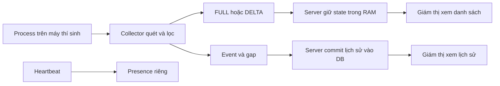

# T3-C5 — Bản nháp báo cáo đồng bộ monitoring và giới hạn

Đối chiếu source tại main `f97c081ed87184ff80e0778e2d4f9a9133f9c6b0`, ngày 13/10/2026. Đây là bản nháp để B review (đọc và góp ý), chưa được B xác nhận. FULL vẫn mặc định; gate (mốc quyết định nghiệm thu delta) ngày 20/10 là **NOT_DECIDED**, mức nghiệm thu **PARTIAL**. Các con số kiểm thử bên dưới thuộc phiên cũ có ghi SHA (mã phiên bản Git), không phải kết quả chạy lại trên main này.

## 1. Mục tiêu và phạm vi

Monitoring là theo dõi những chương trình được quan sát trên máy thí sinh. Client là ứng dụng JavaFX trên máy người dùng; server là ứng dụng Spring nhận dữ liệu và gửi cho giám thị. Process là một tiến trình đang chạy; một ứng dụng như Edge có thể tạo nhiều process.

Collector là bộ quét định kỳ bằng Java `ProcessHandle`. Mặc định quét mỗi 1.000 ms, lọc theo policy (quy tắc chọn) `process-policy-v1`: Chrome, Edge, Firefox, Zalo, Teams, Discord, AnyDesk, TeamViewer. Notepad không thuộc tập này. Collector chỉ chạy khi thí sinh bắt đầu giám sát lượt thi được phép; máy giám thị không chạy collector. Xem [nguồn quét: scan()](../client/src/main/java/vn/edu/toeic/client/monitoring/ProcessHandleSnapshotSource.java), [bộ quét: start()/poll()/stop()](../client/src/main/java/vn/edu/toeic/client/monitoring/ProcessCollector.java) và [phạm vi policy](MONITORING_BASELINE_METHOD.md#1-hệ-thống-theo-dõi-cái-gì).

Polling nghĩa là quét từng đợt. Process mở rồi đóng giữa hai lần quét có thể bị bỏ sót. PID là số hệ điều hành cấp cho process, có thể được dùng lại. Danh tính gồm `collectorSessionId` (một lần chạy collector), PID và thời điểm bắt đầu nếu đọc được. Metadata là thông tin như tên/thời điểm bắt đầu/chất lượng đọc. Thiếu tên có thể không lọc được; thiếu thời điểm bắt đầu làm phân biệt PID yếu hơn. Vì vậy chỉ nói “quan sát thấy”, không kết luận gian lận hay máy hoàn toàn sạch.

## 2. Bốn loại dữ liệu đi đâu?

Snapshot là danh sách chụp lại tại một lần quét. ACK là thông điệp xác nhận; phải đọc rõ nó xác nhận việc gì. RAM là bộ nhớ tạm, mất khi tiến trình server dừng. DB là cơ sở dữ liệu PostgreSQL; commit là hoàn tất một giao dịch ghi vào DB.

| Dữ liệu | Câu hỏi trả lời / ví dụ | Nơi giữ và giới hạn |
|---|---|---|
| Current state — trạng thái gần nhất | Lần quét gần nhất thấy Chrome và Zalo? | RAM server; ACK FULL/DELTA xác nhận đã chấp nhận vào RAM. Có nhãn độ mới, không bảo đảm sống qua restart. |
| Event — sự kiện lịch sử | Đã quan sát Zalo xuất hiện lúc nào? | DB; `eventId` giữ nguyên qua gửi lại. ACK sau commit; Zalo vẫn chạy không tạo thêm event mỗi lần quét. |
| Presence — tình trạng liên lạc | Máy thí sinh còn liên lạc không? | Heartbeat là tin báo liên lạc định kỳ; ONLINE là đang liên lạc, UNKNOWN là không đủ thông tin. Lịch sử gián đoạn lưu riêng; ONLINE không chứng minh collector còn quét. |
| Gap — khoảng thiếu lịch sử đã biết | Hàng đợi event đầy nên bỏ bao nhiêu event mới? | `MONITORING_GAP` ghi số bị bỏ, ACK sau commit. Khác gián đoạn heartbeat: gián đoạn không cho biết số event bị mất. |

FULL mới không xóa event/gap/gián đoạn và không tái tạo lịch sử đã bỏ lỡ. Quét thành công thấy rỗng khác lỗi quét: lỗi phải giữ dữ liệu cuối với nhãn cũ, không báo máy không còn process.

Dữ liệu được đẩy qua WebSocket (kết nối trao đổi hai chiều); HTTP (yêu cầu rồi nhận phản hồi) dùng đọc lại trạng thái/lịch sử. Xem [protocol đang dùng](PROTOCOL.md), [MonitoringEventService.store()](../server/src/main/java/vn/edu/toeic/server/monitoring/MonitoringEventService.java), [MonitoringGapService.store()](../server/src/main/java/vn/edu/toeic/server/monitoring/MonitoringGapService.java) và [RealtimeWebSocketHandler.handleTextMessage()](../server/src/main/java/vn/edu/toeic/server/realtime/RealtimeWebSocketHandler.java). Handler chỉ gửi ACK event/gap khi lời gọi giao dịch đã commit; rollback (hủy giao dịch do lỗi) không được báo đã lưu.

## 3. FULL, DELTA và các số nhận diện

FULL gửi cả tập process, làm baseline (mốc đầy đủ) và đường phục hồi. DELTA gửi phần thêm/bớt so với **state đã được ACK**, không so với lần vừa ghi ra mạng. Ghi ra kết nối thành công chưa chứng minh server đã áp dụng.

| Trường / cơ chế | Nghĩa trong ví dụ |
|---|---|
| `attemptId` | Lượt thi được phép giám sát. Không phải ID một kết nối. |
| `syncEpoch` | Thế hệ đồng bộ do server cấp khi OPEN; ví dụ E. Phân biệt dữ liệu trước/sau kết nối lại. Khác `writerEpoch` của phần ghi đáp án. |
| `sequence` | Số thứ tự state trong E: FULL1, DELTA2. Epoch mới bắt đầu bằng FULL1. |
| `baseSequence` | Số state gốc của DELTA; DELTA2 dựa trên state1. Chỉ nhận khi base bằng số server đang giữ và sequence bằng base + 1. |
| Dedup — chống trùng | Nhớ message ID và nội dung chuẩn hóa (không phụ thuộc thứ tự viết các trường), cùng loại FULL/DELTA. Cửa sổ RAM tối đa 64 ID; bản cũ ngoài cửa sổ bị STALE, không áp lại. |
| `revision` và `serverInstanceId` | Revision là số phiên bản cập nhật server, instance là ID lần chạy server. Giúp giám thị tránh lấy thông báo đến trễ đè dữ liệu mới; không đồng nhất với sequence của client. |

Server kiểm đăng nhập, role (vai trò), scope (phạm vi lượt được phép), collector/kết nối/epoch **trước cả chống trùng**. Các thao tác đổi state được khóa để không cùng sửa một lúc. Reducer là phần áp thông điệp vào danh sách: [MonitoringStateReducer.full()/delta()](../protocol/src/main/java/vn/edu/toeic/protocol/monitoring/MonitoringStateReducer.java). [MonitoringStateService.open()/full()/delta()](../server/src/main/java/vn/edu/toeic/server/monitoring/MonitoringStateService.java) quản lý quyền, RAM và phiên bản; gửi ra mạng ngoài khóa state.

## 4. Ví dụ xuyên suốt và khi gặp lỗi

Tên Edge/Chrome/Zalo dưới đây viết tắt cho process có đầy đủ danh tính, không chỉ so tên ứng dụng.

1. Thí sinh bắt đầu. Client gửi OPEN; server cấp epoch E. Collector thấy Edge + Chrome. Client gửi **FULL1**. Server giữ cả tập trong RAM, trả ACK1 và gửi state cho giám thị. Client nhận ACK đúng mới lấy tập này làm base.
2. Edge đóng, Zalo mở. Scan (lần quét) mới thấy Chrome + Zalo. Client gửi **DELTA2/base1**, bỏ Edge, thêm Zalo. Server kiểm đủ điều kiện, áp thành Chrome + Zalo, trả ACK2. Luồng event riêng ghi việc quan sát Zalo vào DB.
3. ACK2 không tới bộ gửi. Retry nghĩa là gửi lại: client gửi **nguyên ID, epoch, sequence và nội dung DELTA2**. Server nhận ra trùng, ACK lại, không áp hai lần, không tăng revision hay làm dữ liệu cũ thành mới. Nếu dùng lại ID/sequence nhưng đổi nội dung, trả **CONFLICT** (nội dung mâu thuẫn), không ghi đè. Đây không phải lời mời sửa nội dung rồi giữ ID cũ.
4. Để minh họa mất base, bài thử cố ý đưa **DELTA4/base3** tới server đang giữ state2. Server không biết state3, giữ Chrome + Zalo và chuyển **UNSYNCED** (chưa đồng bộ), yêu cầu **RESYNC** (đồng bộ lại bằng FULL). Không ACK rằng DELTA4 đã được áp. Đây là tình huống lỗi được tạo có kiểm soát; bộ gửi bình thường chờ ACK trước khi tiến base, không tự nhảy từ 2 sang 4.
5. Client nhận RESYNC đúng yêu cầu đang chờ, bỏ base/pending (thông điệp chờ xác nhận), chờ scan mới thành công. Nếu đã thử sequence4 và server còn current2 trong E, gửi **FULL5** chứa toàn tập hiện tại. Server thay toàn tập, chuyển **SYNCED** (đã đồng bộ), ACK và cập nhật giám thị. Lịch sử/gap vẫn giữ nguyên.

Nếu server chưa có base (`currentSequence=0`) hoặc epoch đã hết hiệu lực, client mở epoch mới rồi FULL1. Retry một FULL từng áp khi đang UNSYNCED không tự phục hồi: server có thể ACK việc cũ kèm yêu cầu RESYNC. [FullSnapshotDelivery.observe()/pump()/receive()/requestFull()](../client/src/main/java/vn/edu/toeic/client/monitoring/FullSnapshotDelivery.java) thực hiện luồng này; [DeltaSnapshotDelivery](../client/src/main/java/vn/edu/toeic/client/monitoring/DeltaSnapshotDelivery.java) dùng chung cơ chế gửi.

Mặc định tối đa 5 lần thử mỗi message, chờ ACK 5 giây/lần và có khoảng nghỉ tăng dần. Với delta, hết số lần thử thì bỏ base, chờ scan mới rồi OPEN/FULL1; không đoán server đã nhận hay chưa. Trong lúc chờ ACK chỉ giữ snapshot chờ mới nhất cho state. [MonitoringDelivery.observe()](../client/src/main/java/vn/edu/toeic/client/monitoring/MonitoringDelivery.java) vẫn nhận các snapshot để tạo event riêng; việc bỏ state trung gian không tự xóa event tương ứng. Hàng đợi event RAM mặc định 500, tối đa 4 event đang gửi; tràn hàng đợi được báo bằng gap.

## 5. Dữ liệu còn mới không?

Trong delta thử nghiệm, scan mới không đổi tập có thể bỏ qua gửi ngay. Sau mặc định 2 giây tính từ ACK state cuối, một scan mới cho phép gửi **delta rỗng** (không thêm/bớt, ID/sequence mới) để xác nhận vẫn quét. FULL đối soát mặc định 30 giây từ ACK FULL cuối cũng cần scan mới, phải chờ message đang gửi được xử lý. Thông tin phụ thay đổi trên cùng danh tính process cũng buộc gửi FULL.

Không dùng lại snapshot quá tuổi làm scan mới; lỗi/treo bộ quét không tạo refresh (làm mới độ tươi). Server đánh dấu **STALE** (dữ liệu đã cũ) sau ngưỡng mặc định 6 giây, vẫn giữ danh sách cuối. State đang UNSYNCED do thiếu base giữ nhãn đó cho đến phục hồi hoặc hết hạn. **TTL** là thời gian giữ entry trong RAM: mặc định 5 phút từ lần chạm hợp lệ cuối, sau đó xóa và thông báo không có state đồng bộ. Heartbeat và retry trùng không kéo dài độ mới này.

[MonitoringStateMaintenance](../server/src/main/java/vn/edu/toeic/server/monitoring/MonitoringStateMaintenance.java) có worker (luồng làm việc nền) riêng, gọi `MonitoringStateService.maintain()` mặc định mỗi 500 ms và dừng khi server đóng. Không cần giám thị bấm đọc lại để tác vụ chạy. Các mốc là cấu hình/ngưỡng xử lý, không phải cam kết mọi phản hồi mạng đến chính xác vào thời điểm đó. Chi tiết: [reducer và độ mới](MONITORING_DELTA_REDUCER.md).

## 6. Kết nối lại, khởi động lại, thu hồi quyền và dọn tài nguyên

- Reconnect là nối lại mạng: xóa base/capability cũ, OPEN lấy epoch mới, quét mới và FULL1 trước DELTA. Capability là xác nhận server hỗ trợ delta trên kết nối hiện tại, không cấp quyền truy cập. [RealtimeClient.deltaCapability()/receive()](../client/src/main/java/vn/edu/toeic/client/realtime/RealtimeClient.java) kiểm phản hồi đúng yêu cầu và phiên kết nối. Callback là hàm được gọi khi phản hồi đến; callback phiên cũ không được sửa/dừng phiên mới.
- Restart client (đóng rồi mở lại ứng dụng) tạo collector mới; hàng đợi RAM chưa xác nhận không tự phục hồi. Restart server làm mất state RAM, tạo instance/epoch mới; lịch sử đã commit trong DB vẫn còn. Không dựng lại “state hiện tại” bằng cách gom event cũ.
- Thu hồi quyền: server kiểm lại quyền trước xử lý cả retry và trước gửi dữ liệu cho giám thị. FORBIDDEN/UNAUTHORIZED là không đủ quyền/không còn xác thực. Khi nhận lỗi đúng phiên, [CandidateMonitoringSession.start()/stop()/close()](../client/src/main/java/vn/edu/toeic/client/monitoring/CandidateMonitoringSession.java) dừng bộ quét và luồng gửi; lỗi DB tạm thời không được coi là thu hồi quyền.
- Stop/logout (dừng/đăng xuất) tháo hàm nhận thông báo, dừng heartbeat giám sát và worker, chờ kết thúc trước lần Start mới. Hard kill (buộc dừng tiến trình) có thể không kịp gửi CLOSE hay ghi cuối log. Server phải dựa vào timeout; queue RAM bị mất, không được báo đã gửi hết.

Main mới đã thêm quyền đọc bài thi sau chốt qua `canReadExam()`. Điều đó **không mở scope monitoring sau chốt**: [JdbcAttemptScopeStore.canAccess()/canReadExam()](../server/src/main/java/vn/edu/toeic/server/monitoring/JdbcAttemptScopeStore.java) tách hai quyền, monitoring vẫn yêu cầu ACTIVE. Báo cáo này không nghiệm thu luồng Listening của A.

## 7. Bằng chứng có đến đâu?

**REAL** là thành phần thật đã chạy; **MOCK** là dữ liệu/đối tượng giả; **SIMULATED** là lỗi hoặc cách giao dữ liệu được chủ động mô phỏng; **NOT RUN** là chưa chạy. Test thuần kiểm logic riêng. **REPLAY** là phát lại quan sát đã ghi; local integration kiểm nhiều thành phần nối với nhau trên máy thử. GUI là giao diện có cửa sổ thật, có thể được chương trình điều khiển; khác người dùng kiểm thủ công. LAN hai máy là chạy qua mạng nội bộ giữa hai máy thật.

| Bằng chứng lịch sử | SHA runtime / môi trường | Kết quả và giới hạn |
|---|---|---|
| [T3-C1: encoder — bộ tạo thông điệp](../evidence/t3-c1/2026-10-11-verification.md) | `7041c6e`; Windows 11, Temurin 21.0.10+7, Maven 3.9.15; hồi quy FULL có PostgreSQL 18 | Package 531 test PASS. Logic ACK/retry và replay có MOCK/SIMULATED. Hồi quy FULL GUI dùng nguồn thật; chưa phải live delta. Một số hồi quy khác ở `33828d4`, xem report gốc. |
| [T3-C2: reducer và mạng](../evidence/t3-c2/2026-10-12-verification.md) | `4042b1c`; Windows 11, cùng JDK/Maven trên, PostgreSQL 18 | Java 554/Python 10 PASS; Spring/HTTP/WS/DB, RESYNC callback và tự STALE/TTL thật. Dữ liệu process trong delta smoke là MOCK; base sai SIMULATED. |
| [T3-C3: phát lại lỗi](../evidence/t3-c3/2026-10-12-verification.md) | `d813cb1`; Windows 11, Temurin 21.0.10+7, Maven 3.9.15; campaign không cần DB | Java 569 PASS; 72 ca dương, phát hiện 4 ca cố ý sai, kết quả lặp lại giống byte. Ba workload (kịch bản quan sát) MOCK; có capture ProcessHandle REAL riêng, truyền dữ liệu vẫn REPLAY. |
| [T3-C4: tích hợp ứng dụng](../evidence/t3-c4/2026-10-13-verification.md) | `d9475eb`; một Windows 11 host, cùng JDK/Maven trên, PostgreSQL 18.6; hai candidate JVM (hai tiến trình Java) và proctor Application | Java 579 PASS, 42 assertions (điều kiện được kiểm, không phải 42 kịch bản độc lập). GUI/ProcessHandle/Edge/HTTP/WS/DB thật; pause nguồn, đổi base, ẩn ACK là SIMULATED. LAN và người B review NOT RUN. |

Oracle là phần tính đáp án độc lập từ quan sát gốc; checkpoint là điểm đối chiếu trên cùng quan sát. Đọc kết quả replay theo [mô hình lỗi C3](MONITORING_DELTA_FAULT_REPLAY.md):

- PASS có thể vẫn thiếu event đúng theo lịch drop (cố ý không giao message). Điều đó chứng minh mô hình dự đoán đúng phần mất, không chứng minh lịch sử đầy đủ.
- `NO_COMMON_SYNC_CHECKPOINT` nghĩa là không có điểm cả FULL và DELTA cùng đồng bộ; chưa chứng minh hai state bằng nhau trong ca đó. Cùng seed (số khởi tạo lịch lỗi) cũng không bảo đảm state của hai mode chịu lỗi giống nhau.
- RESYNC được ghi trong replay không phải vòng callback mạng thật. C2/C4 có bằng chứng mạng riêng. Replay C3 không mô hình hóa ACK-loss/retry, quyền, heartbeat, TTL hay DB commit.
- Hai JVM candidate trên một host không thay LAN hai máy. Observer cố ý ẩn ACK ở C4 là mất ACK **SIMULATED**, không đo mất gói vật lý.
- C4 bị kill có log thiếu bản ghi cuối: tổng 12 endpoint ghi đo/140 nhóm là **INCOMPLETE**; nhóm còn khỏe được định nghĩa riêng có 11 endpoint/128 nhóm COMPLETE. Không đổi nhãn toàn lượt thành COMPLETE. Ca giữ Edge ít nhất 31 giây không đóng băng process nền; không quy mọi FULL quan sát được cho riêng bộ đếm 30 giây.

Chưa có kết luận đo độ trễ, CPU, bộ nhớ hay tiết kiệm byte. E1 (phép đo khả năng quan sát) và E2 (so chi phí FULL/DELTA) chưa chạy. [Phương pháp baseline](MONITORING_BASELINE_METHOD.md), [trace — nhật ký quan sát](MONITORING_TRACE.md) và [cách ghi phép đo](MONITORING_MEASUREMENTS.md) mô tả cách chuẩn bị; không thay số liệu thực nghiệm. [Kiểm tra tài liệu T3-C5](../evidence/t3-c5/2026-10-13-verification.md) chỉ kiểm source/link/nội dung, không chạy lại Java/smoke.

## 8. Gate và việc còn lại

FULL là mặc định: server `toeic.state.delta-enabled=false`, client `toeic.realtime.delta-experimental=false`. DELTA chỉ chọn khi người chạy bật thử nghiệm ở cả hai đầu và ACK heartbeat hợp lệ xác nhận hỗ trợ trên kết nối hiện tại. Một lần Start giữ mode (chế độ truyền) đã chọn. Chưa biết/không hỗ trợ thì FULL; đang DELTA mà mất hỗ trợ thì dừng, Start mới mới chọn lại FULL. Xem [cách chạy và checklist live gate](MONITORING_DELTA_LIVE_GATE.md).

Gate 20/10 **NOT_DECIDED / PARTIAL**. Cần LAN hai máy thật và B review trước quyết định giữ/cắt; A cần rà các điểm quyền/kết nối/bảo trì. Đối chiếu MT02–MT06 trong [kế hoạch kiểm thử](../Ke_hoach_LT_Mang_5_chang/03_KIEM_THU_VA_THUC_NGHIEM.md): retry không áp trùng, mất chuỗi phục hồi đúng, chặn epoch cũ, restart không dùng base mất, FULL/DELTA khớp state và quy tắc event ở điểm so sánh hợp lệ.

Nếu đủ bằng chứng và nhóm chốt qua gate: giữ DELTA như lựa chọn cấu hình, FULL luôn là đường dự phòng; lợi ích hiệu năng vẫn phải đo riêng. Nếu không đạt tính đúng: giữ/tắt delta mặc định, lưu ca lỗi và ổn định FULL. Hiện thiếu môi trường/review không đồng nghĩa delta thất bại. Merge bản nháp không phải B approval (xác nhận duyệt), không chốt gate và không bật delta. [QD-19](QUYET_DINH.md#qd-19--candidate-delta-opt-in-và-bàn-giao-live-gate-chưa-chốt) ghi bàn giao C4; QD-10 đã dùng cho presence, không tái dùng số đó cho quyết định mới. Dừng ở T3-C5; chưa làm chặng 4/E1/E2.
