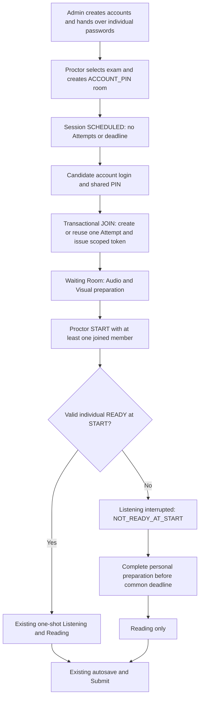

# ACCOUNT_PIN — implementation and verification

Implementation is on `feature/account-pin-20261024`, based on Phase 4.5 checkpoint `185e1b3c5318062f41d94f9f7fb85e7cc77e8975`. Production source is checkpoint `c767cf83848c1a78cc068b5e44a162162d4c2263`; implementation and legacy GUI-navigation checkpoints are `9f6316b` and `88bf034`. Existing local data, unrelated changes and historical release artifacts are retained. Main is not merged or pushed.

The existing Server image-root environment fix is kept separately in checkpoint `d49da88`. The implementation file inventory is [FILES.txt](FILES.txt); unrelated README additions, local launch menus, datasets, acceptance files and line-ending-only changes remain outside the implementation checkpoint.

## Implemented contract

`ACCOUNT_PIN` is an admission mode; Session contract remains `PROCTORED_V2`. Legacy rooms and non-room attempts retain their authentication and all-READY START policy. Account tokens cannot access room attempts before or after JOIN. Scoped tokens remain restricted by candidate, assigned attempt and membership/session binding for HTTP and WebSocket monitoring.

## Changes and security invariants

- **Protocol:** `CreatePinRoomRequest`, redacted `CreatedPinRoom` and `JoinPinRoomRequest`; optional `roomMode`/`readyForExam` on preparation and `roomMode`/`canStart` on readiness. Original constructors remain compatible; `allReady` still means every member is READY.
- **Room/session:** `ExamRoomService`, `ExamRoomController`, `RichSessionService` create an empty Session, transactionally create membership/Attempt on first JOIN, preserve writer/epoch/readiness/answers/deadline on repeated JOIN, cap membership at 100 and reject new membership after START. Session locks serialize JOIN/START/rotate; membership is re-read after acquiring locks. Failed inserts roll back the Attempt too.
- **PIN:** new `RoomPinCodec`, application config and launcher environment loading. SecureRandom five-digit PIN, BCrypt verification, HMAC-SHA256 lookup with operator-supplied persistent key, unique lookup index. Persisted account-level failed-PIN window survives login/restart. Rotation only before START revokes room admission tokens and changes only room credential; the old PIN cannot issue new tokens.
- **Admin:** `AccountProvisioner`, Admin service/controller/client/view issue one-time distinct Candidate passwords on the new UI. Old API calls without the optional flag retain compatibility. Candidate-only reset follows Session→account lock order, rejects active exams, changes only password hash and revokes all tokens; it does not enable an account or change its role.
- **START/preparation:** `AudioService`, `VisualReadinessService`, `V2SessionPolicy`, `RichImageService`, `ExamService` select the policy from persisted room mode. START verifies actual media, snapshots valid receipts/token/writer/epoch/lease under locks and records one start context/common deadline. Non-ready members are interrupted before COMMIT and excluded from existing post-COMMIT playback delivery. Retry cannot arm late members. Pending personal preparation has restricted image access; exam/save/Submit are guarded on the server. Late attestation commits the individual visual manifest without resetting Listening, deadline or epoch. Exact successful late-attestation retry is supported.
- **Client:** Candidate account-login PIN page; Proctor shared-PIN creation tab, one short START warning only when needed, scoped roster/monitoring refresh; existing legacy tabs retained. Audio/visual coordinators permit narrow late preparation, then enter Reading. Existing media player, autosave, Submit, writer and monitoring infrastructure are reused. One-time PIN/password fields and credential DTO strings are redacted/cleared; sensitive successful responses use `Cache-Control: no-store`.
- **Verification tools:** existing room-UX runner includes ACCOUNT_PIN suites. Existing benchmark supports optional `-AccountPin`; existing portable packager supports a release name and runbook. No new benchmark infrastructure or external service.

## API and migration

| API | Authorization / behavior |
|---|---|
| POST `/api/v2/pin-rooms` | PROCTOR; `{examId,durationMinutes?}`; default 120 minutes; Session and one-time common PIN |
| GET `/api/v2/pin-rooms` | Assigned PROCTOR only; existing cursor page, no credential |
| POST `/api/v2/pin-rooms/join` | CANDIDATE account token only; `{pin,requestId}`; principal supplies identity; scoped admission response |
| POST `/api/v2/pin-rooms/{sessionId}/pin/rotate` | Assigned PROCTOR, SCHEDULED only; one-time new PIN and token revocation |
| POST `/api/v2/admin/accounts/{id}/password/reset` | ADMIN; Candidate only, no active exam; random one-time password and all-token revocation |
| POST `/api/v2/admin/accounts` | Existing API plus optional boolean `issueLoginPassword`, default false; Admin UI sends true |
| Existing START endpoint | Same request/response shape; policy chosen by DB room mode, retries preserve start context |

Migration **V21__account_pin_admission.sql** adds admission mode/shared hash/shared lookup and shape/uniqueness constraints, permits NULL personal member PIN for the new mode and adds the persisted per-account JOIN limit table. V1–V20 are unchanged. A populated V20 upgrade test compares existing account/session/attempt/member data and migration checksums before/after upgrade; legacy room mode defaults to `LEGACY_PIN`.

## Verification record

Historical Phase 4.5 counts are not counted as results of this implementation. These independent invocations overlap and must not be added together. The full run is the pre-timeout-fix baseline; the final narrow timeout patch was then verified with the affected regression and production GUI suites.

Checkpoint gates completed (independent invocations, not an additive total):

| Run | PASS | FAIL / ERROR | SKIP | Scope |
|---|---:|---:|---:|---|
| `core/room-ux-20261024T105008Z-31149c7b` | 121 | 0 / 0 | 0 | New client/GUI login tests, crypto and 16 real PostgreSQL ACCOUNT_PIN cases including collision, capacity, races, migration and restart |
| `gui-focus/room-ux-20261024T104458Z-5e4d92cb` | 3 | 0 / 0 | 0 | Production Admin, Proctor and two Candidate applications; 2/2, 1/2 and 0/2 READY; pre/post-START transport reconnect; media playback, Reading, Monitoring, autosave and Submit |
| `backend/room-ux-20261024T100631Z-274c2a7a` | 78 | 0 / 0 | 0 | Legacy admission/authentication/Admin/V2 lifecycle regression plus the earlier new-case set |
| `scope/room-ux-20261024T110934Z-dadd0710` | 6 | 0 / 0 | 0 | Legacy scope guard explicitly enters retained legacy route after account login; new PIN-entry GUI cases also pass |
| `full/room-ux-20261024T111254Z-08ded180` | 1688 | 0 / 0 | 20 | All 1708 JUnit cases completed at `88bf034`; Maven subsequently failed at Windows JAR rename during repackage, not during tests |
| `timeout/room-ux-20261024T120705Z-536978c3` | 1 | 0 / 0 | 0 | Real PostgreSQL: disabled joined Candidate finalizes/scored TIMED_OUT exactly once; old tokens remain denied |
| `postfix/room-ux-20261024T120936Z-e335001a` | 110 | 0 / 0 | 0 | After narrow timeout fix: 17 ACCOUNT_PIN cases, legacy runtime/lifecycle/Admin/authorization/scheduling and new/legacy production E2E |
| `full/room-ux-20261024T110340Z-3b50fce4` | 1055 | 1 / 0 | 4 | Initial full run stopped in Client at the old scope-navigation harness; server suites were not run in this invocation; corrected and targeted rerun passed above |
| `gui/room-ux-20261024T102733Z-5a7f3041` | 102 | 3 / 0 | 0 | Historical debug run: legacy E2E 2/2 passed; three ACCOUNT_PIN harness cases failed and were subsequently fixed and rerun above |

Run roots are `target/account-pin/runs/` (junction to the owned Windows QA output). Raw XML and environment-bearing logs remain in `.private` folders; reviewed result/case lists are in [validation](validation/), with a byte-level [evidence index](validation/evidence-sha256.json). Legacy assertions were retained.

The 20 SKIP cases are listed individually in [skipped-tests.json](validation/skipped-tests.json): two Windows symlink-privilege assumptions, two externally hosted GUI configurations, two installed/packaged-client scenarios, one optional reserved V13 migration script, seven optional monitoring-timeline integration cases, five USB integration cases and the opt-in benchmark case. The benchmark was subsequently run explicitly and passed; its SKIP in the full invocation remains recorded. None of these SKIP cases is counted as PASS or silently disabled.

Initial failed runs are retained for diagnosis: PostgreSQL exposed Instant binding errors in the new PIN-limit/START updates; explicit `java.sql.Timestamp` binding fixes those paths. A legacy START–disable race exposed an incorrect 403 when an assigned candidate was disabled; that internal START validation now returns INVALID_STATE/409 while preserving candidate access denial. ACCOUNT_PIN transport reconnect now preserves confirmed audio preparation and does not invalidate the preparation epoch; legacy reconnect behavior is retained. GUI harness needed real credential-dialog closure, a non-null return marker for custom-content dialogs, selection of the actual active tab and waits for enabled controls/server READY receipts before clicking START; assertions were not relaxed or disabled. A stale joined count in the room catalog is refreshed from existing presence polling.

Final lifecycle review found that `timeoutAttempt()` reused an enabled-account guard: an ACCOUNT_PIN member disabled before START could be started as non-ready but then remain ACTIVE after deadline. The minimal fix adds a trusted internal `lockForTimeout()` inspection and changes only the timeout caller. Disabled-account inspection is allowed only for ACCOUNT_PIN; HTTP/WebSocket and legacy guards are unchanged. The new real PostgreSQL test verifies scoring/idempotence and unchanged writer/deadline/answers/disabled state/Listening interruption. This patch was tested by the final 110-case affected regression and E2E invocation after the full baseline; the full baseline count is not presented as a full rerun of the post-fix source. The runner also correctly accounts for `Class#method` selectors instead of silently counting zero XML cases.

The full Maven invocation returned exit 1 because Windows refused renaming `server/target/server-0.1.0-SNAPSHOT.jar` to `.jar.original` after all tests passed. No running user Server or unrelated artifact was killed/deleted to overcome this. Release binaries are built separately from the verified checkpoint in a clean detached worktree; that package-only build is recorded separately and is not acceptance evidence.

The isolated `mvn --batch-mode --no-transfer-progress -Duser.timezone=UTC -DskipTests package` completed with exit 0 ([build record](validation/isolated-build.json)). This is a successful package build, not an additional test run. The first portable-packaging attempt could not auto-discover Windows SDK `mt.exe`; the rerun supplies the existing x64 SDK tool explicitly, retaining the Unicode-runtime requirement and the incomplete first attempt for diagnosis.

## ACCOUNT_PIN benchmark

Run `phase4-benchmark-20261024T123422Z-42871e1b`: **1 PASS, 0 FAIL/ERROR, 0 SKIP**, PostgreSQL cleanup left zero owned schemas and stopped successfully. The existing harness was reused with `-AccountPin`; only admission/account setup changes. Source, operation samples and resource snapshots are in [benchmark](benchmark/), including unmodified [raw.csv](benchmark/raw.csv), [resources.csv](benchmark/resources.csv), [environment.json](benchmark/environment.json), and the derived [summary](benchmark/summary.json).

Three rounds at every level completed with no recorded failed operation. HTTP p95 includes measured setup, polling and exam requests; operation-specific distributions are in [operations.csv](benchmark/operations.csv). At all levels combined, 114 JOIN and 114 Submit operations, 15 START operations and 342 monitoring deliveries succeeded. These are generated protocol clients on one Windows host, not JavaFX capacity or LAN acceptance. READY is simulated; no audio is played by this benchmark. The 60-second visual lease is a declared benchmark fixture setting; production GUI E2E uses the normal 6-second lease.

| Concurrent simulated Candidates | HTTP samples | HTTP p95 (ms) | Monitoring p95 (ms) | Disconnect detection p95 (ms) | Server working-set snapshot max (MiB) |
|---|---:|---:|---:|---:|---:|
| 1 | 567 | 69.00 | 51.82 | 6539.59 | 223.87 |
| 2 | 1142 | 41.85 | 18.35 | 6540.14 | 253.16 |
| 5 | 2777 | 70.43 | 59.05 | 6461.55 | 259.54 |
| 10 | 5819 | 96.80 | 32.39 | 6563.42 | 267.93 |
| 20 | 10927 | 137.55 | 171.26 | 6688.34 | 349.81 |

Quantiles use nearest rank over actual successful samples. RAM values are endpoint working-set observations, not peak memory. Disconnect detection includes the existing heartbeat/expiry policy. There is no claim of a guaranteed 20-machine classroom capacity from this experiment.

Reproduce with the existing `scripts/verify-phase4-benchmark.ps1 -AccountPin` runner, supplying PostgreSQL/JDK/Maven paths as in [RUNBOOK.md](RUNBOOK.md), then `python scripts/analyze-phase4-benchmark.py <run-directory>`. Use an already packaged same-version Server JAR; the runner creates its own PostgreSQL cluster and never uses the application DB.

## Release artifact and final acceptance

- Production checkpoint: **`c767cf83848c1a78cc068b5e44a162162d4c2263`** on **`feature/account-pin-20261024`**. Final documentation/tooling checkpoint follows this source commit; the artifact records its actual production-source SHA, not a later documentation SHA.
- Portable Client + Server + Java 21 runtime: **`toeic-account-pin-20261024T152103Z-81263ff6.zip`**, available through `target/account-pin/runs/distribution/`. [Download local ZIP](../../target/account-pin/runs/distribution/toeic-account-pin-20261024T152103Z-81263ff6.zip).
- ZIP SHA-256: **`1fd33ec99c3fa88ef1d6af009e8c233456725a597782dc5e8c519bbafd38f21c`**. The reviewed [artifact record](validation/artifact.json) contains size and individual file hashes. Its production-working-tree-patches list is empty. Package auditing compares compiled class inventory/bytes and migration resources; no test classes, DB, exam datasets or operator credentials are included.

| Acceptance category | Actual result | Evidence / boundary |
|---|---|---|
| Full automated JUnit baseline | 1688 PASS / 0 FAIL / 0 ERROR / 20 SKIP | At `88bf034`; the original Maven command later failed at Windows repackage rename |
| Final affected PostgreSQL + new/legacy GUI regression | 110 PASS / 0 FAIL / 0 ERROR / 0 SKIP | Final timeout fix, production applications and 17 ACCOUNT_PIN PostgreSQL cases; not another full-suite count |
| Clean isolated package build | Exit 0 | `-DskipTests`; build evidence only |
| Portable ordinary-path launcher/login/audio QA | 9 PASS / 0 FAIL | [portable-1.json](validation/portable-1.json); eight inner audio checks are recorded separately, not added as JUnit cases |
| Portable Unicode-path launcher/login/audio QA | 9 PASS / 0 FAIL | [portable-2.json](validation/portable-2.json), real bundled runtime |
| Portable Server + own PostgreSQL | 5 PASS / 0 FAIL | [portable-server.json](validation/portable-server.json); actual launcher/runtime startup, auth, catalog and successful V21 probe; cluster stop exit 0 |
| ACCOUNT_PIN simulated benchmark | 1 PASS / 0 FAIL / 0 ERROR / 0 SKIP | 15 rounds; protocol clients, loopback, simulated READY, no playback |
| Two physical Windows machines over LAN | **NOT TESTED** | Device access unavailable; [checklist](RUNBOOK.md#checklist-lan-và-nghe-vật-lý) prepared |
| Human listening through physical speakers/headphones | **NOT TESTED** | Automated MediaPlayer completion and speaker-test confirmation do not prove hearing |

The reused portable-Server smoke retains an old `...-v19` case identifier in its raw JSON, but its executed SQL checks version **21**; scope and [harness metadata](validation/portable-server-harness.json) state the actual probe. The full packaged exam flow has not been repeated as a separate packaged two-client desktop test: that flow is verified with production applications/classes in the same-machine PostgreSQL GUI suite, with package class-byte equivalence and portable launch/audio checks recorded separately.

Demo evidence is captured from actual final GUI runs with self-authored MOCK content, not fabricated images: [Admin accounts](screenshots/admin-accounts.png), Proctor roster at [2 READY](screenshots/account-pin-ready-2-no-pin.png), [1 READY](screenshots/account-pin-ready-1-no-pin.png) and [0 READY](screenshots/account-pin-ready-0-no-pin.png), [normal submission](screenshots/account-pin-2-candidate-0-submitted.png) and [late-preparation Reading submission](screenshots/account-pin-0-candidate-1-submitted.png). PINs are hidden; no credential dialog is published. Assertions and actual flow milestones are in [2-ready](validation/e2e-ready-2.txt), [1-ready](validation/e2e-ready-1.txt) and [0-ready](validation/e2e-ready-0.txt) records. See [RUNBOOK.md](RUNBOOK.md) for the complete Admin → Proctor → two Candidate demo and legacy entry.

Verdict: **CONDITIONALLY READY for a supervised same-machine demo**. No failing automated gate remains after the recorded fixes; the original packaging failure is addressed by the clean build. A final full-suite rerun at the timeout-fix commit, real LAN, human audio, and a separate packaged full-exam desktop run remain outside the completed evidence. Do not describe these as PASS. Upgrading/restarting the operator's actual Server and applying V21 to its actual DB is an operator action, not something performed by QA. No additional feature phase is started.

## Limits and rollback boundary

- Physical LAN on two Windows machines and direct human hearing: **NOT TESTED** without the devices. Same-host JavaFX/MediaPlayer and simulated benchmark READY are separate evidence categories.
- No audio catch-up or replay; a candidate without valid READY at START loses Listening for that attempt and uses the remaining common time for Reading.
- PIN namespace has 90,000 values. Lookups remain reserved after START/restart; automatic room cleanup/PIN reuse is deferred. Shared key must be retained; key loss/rotation is an operator recovery issue, not an automatic startup action.
- New account/password/PIN credentials are shown once. Lost create response is recovered from the assigned-room list and pre-START PIN rotation; the client never silently recreates a room. An uncertain create outcome blocks further creation in that view until recovery or a fresh login.
- The portable bundle does not contain a DB, exam media, passwords or HMAC key. Both binaries must be upgraded together. Operator application DB has not been migrated by the isolated verification runs.
- The local workspace `.env` was provisioned once with a random 32-byte persistent PIN key, without printing/committing it or changing existing DB/media settings. This does not restart the running application or migrate its DB. Other deployments must provision their own persistent key as described in the runbook.
- Checkpoints include only tested implementation files. No reset, rollback, merge, push, destructive file cleanup or down migration. A fallback demo must use the historical binary/artifact with a separate pre-upgrade test DB, not overwrite live exam data or assume old-binary/new-schema compatibility.
