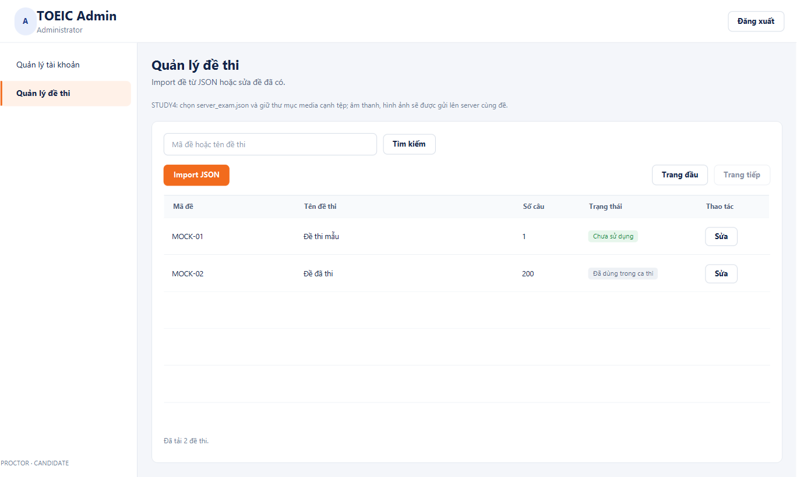
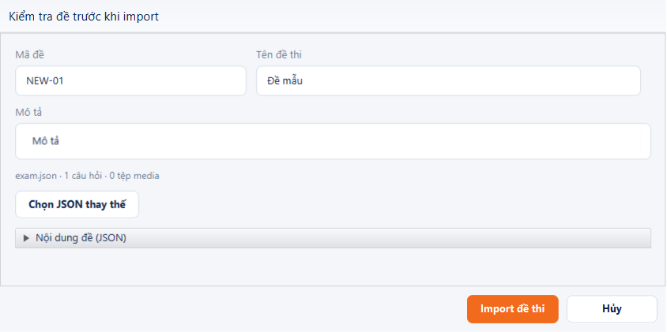
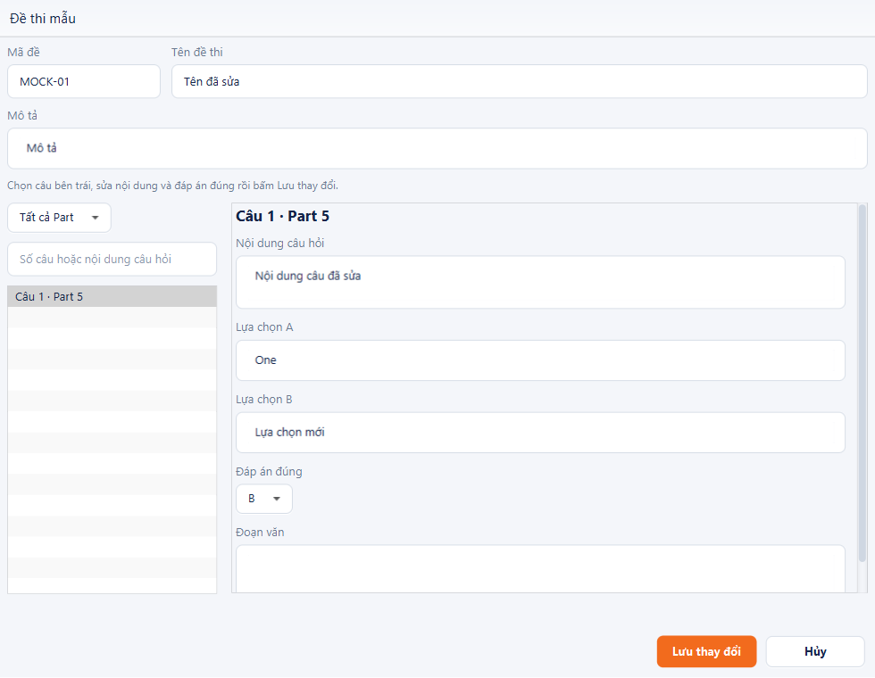

# Quản lý đề thi: Import JSON và Sửa

Đăng nhập ADMIN → **Quản lý đề thi** dưới **Quản lý tài khoản**. Màn hình chỉ có **Import JSON** và **Sửa**; không có form tạo đề thủ công hoặc nút xóa.

## Import từ STUDY4

1. Giữ nguyên `server_exam.json` và thư mục `media` đã crawl trong cùng thư mục đề. Những đường dẫn như `media\audio\...mp3` và `media\images\...jpg` trong JSON phải trỏ tới các tệp có thật.
2. Bấm **Import JSON**, chọn `server_exam.json`. Không chọn `client_exam.json` vì tệp này không có đáp án đúng. Không cần có bản client export cạnh JSON.
3. Ứng dụng chuyển cấu trúc STUDY4 sang đề thi, chuẩn bị media và hiển thị mã đề, tên, số câu, số tệp sẽ gửi. Có thể đổi mã đề, tên/mô tả trước khi import. Khi đổi mã đề mới, ứng dụng tự đổi thư mục media trong gói gửi lên cho khớp mã mới; không thay đổi tệp crawl gốc. Mã đề của một đề đang sửa vẫn giữ nguyên.
4. Bấm **Import đề thi**. Client gửi JSON cùng âm thanh/hình ảnh lên server; bạn không cần tự sao chép media sang máy server. Server kiểm tra toàn bộ đề/media trước khi xác nhận thành công.

Khi import, phần JSON là bản xem trước chỉ đọc. Dữ liệu gửi được dựng trực tiếp từ đề đã đọc và các ô mã/tên/mô tả tại thời điểm bấm Import, không đọc ngược từ ô xem trước. Muốn thay nội dung đề nguồn, chọn JSON thay thế. Sau khi import, chọn **Sửa** để chỉnh từng câu bằng các ô nhập.

Chức năng không tải đường dẫn web. Nếu chỉ có URL trong JSON, cần crawl/tải media về đúng các đường dẫn tương đối trước. Không thay nội dung tệp crawl gốc.

Ảnh WebP (kể cả được lưu với đuôi `.jpg`) được tự chuyển thành PNG trong gói gửi lên server. Không cần tự đổi định dạng ảnh trước khi import.

JSON nội bộ v1/v2 vẫn được hỗ trợ. Nếu chọn `rich-import.json`, media phải đã được provision trên server theo cơ chế cũ; chuyển cả bộ crawl bằng `server_exam.json` là luồng tự gửi media.

## Sửa đề có sẵn

1. Chọn **Sửa** tại đề cần sửa. Lọc theo Part hoặc tìm số/nội dung câu hỏi ở bên trái.
2. Sửa **Nội dung câu hỏi**, **Lựa chọn A/B/C/D** (Part 2 chỉ có A/B/C) và chọn **Đáp án đúng**. Các ô cập nhật ngay vào bản nháp; chuyển câu rồi quay lại vẫn giữ nội dung vừa nhập.
3. Với Part 6/7, có thể sửa tiêu đề và nội dung đoạn văn chung. Thay đổi đoạn văn áp dụng cho mọi câu thuộc cùng nhóm; ID câu/nhóm và tham chiếu media được giữ nguyên.
4. **Đề chưa sử dụng:** bấm **Lưu thay đổi** để cập nhật cùng mã đề.
5. **Đề đã dùng trong ca thi:** mặc định **Lưu thành đề mới**. Nhập mã đề mới rồi lưu; server sao chép media đã kiểm chứng sang đề mới. Không cần tải lại JSON hoặc media từ máy cá nhân. Đề gốc, các ca thi và kết quả cũ giữ nguyên. Khi tạo ca thi sau đó, chọn mã đề mới.
6. Nếu chỉ đổi tên/mô tả của đề đã dùng, bỏ chọn **Lưu thành đề mới…** rồi bấm **Lưu tên và mô tả**; phần câu hỏi bị khóa trong chế độ này.

Màn hình sửa không yêu cầu sửa JSON. Media hiện có được giữ nguyên; thay toàn bộ bộ media bằng một lần import JSON với mã đề mới. Lỗi lưu giữ lại bản nháp để sửa/thử lại. Không tự gửi lại yêu cầu ghi khi mất mạng. Bộ lọc trùng lựa chọn ở cuối câu hỏi cũng được áp dụng trước khi sửa để lựa chọn cũ không xuất hiện lại sau khi thay nội dung A/B/C/D.

## Giải thích lỗi và cấu trúc dữ liệu

`Không tìm thấy tài nguyên API` là phản hồi 404 khi server chưa có route quản lý đề, không phải lỗi ràng buộc DB. Phải cập nhật **cả server và client** của nhánh này hoặc chọn đúng địa chỉ server. Client mới hiển thị hướng dẫn cập nhật server và khóa Import khi chưa tải được danh sách.

Lỗi cú pháp JSON có dòng/cột nếu bộ đọc cung cấp vị trí; thiếu mã, tên hoặc danh sách câu hỏi được báo riêng. Lỗi trả từ API có tiền tố `Server (HTTP ...)` để phân biệt với lỗi đọc tệp/form trên client.

DB lưu nhiều đề theo `exam_id`; nội dung không bị gắn cứng vào một đề mẫu. Tuy nhiên bộ đọc TOEIC v2 yêu cầu đủ 200 câu, đúng phân bố Part 1–7 (6/25/39/30/30/16/54), nhóm câu, đáp án và media hợp lệ. Có đủ 200 câu trong JSON crawl chưa có nghĩa JSON đó đã là schema import nội bộ. Bộ chuyển STUDY4 xử lý bước này; v1 dành cho đề ngắn vẫn dùng schema v1.

Import và sửa đề không yêu cầu reset DB hoặc xóa lịch sử thi. Tính năng soạn tay bổ sung migration V22; Flyway tự áp dụng khi khởi động server mới.

## Tạo đề bằng tay và lưu pending

Trong **Quản lý đề thi**, chọn **Tạo đề bằng tay**. Form có sẵn 200 vị trí theo 7 Part, phân bố 6/25/39/30/30/16/54; Part 2 có ba lựa chọn A–C, các Part khác có A–D. Mã câu và Part cố định. Có thể lọc Part, tìm số câu hoặc nội dung và nhập các câu theo thứ tự tùy ý.

Nhập mã đề, tên đề rồi bấm **Lưu đề** bất kỳ lúc nào, kể cả chưa hoàn thiện câu nào. Câu hoàn thiện cần nội dung, tất cả lựa chọn và đáp án đúng; Part 6–7 cần đoạn văn. Danh sách hiển thị số câu hoàn thiện trên 200 và trạng thái **Pending · Đang soạn**. Bấm **Sửa** để tiếp tục, các trường nhập dở được giữ nguyên. Đóng form có thay đổi chưa lưu sẽ yêu cầu xác nhận bỏ thay đổi.

Server tự tính tiến độ và trạng thái, không nhận trạng thái do client gửi. Đủ 200 câu thì lưu thành **READY** và ghi nội dung vào bảng câu hỏi/đáp án thông thường trong cùng transaction. Xóa nội dung bắt buộc ở đề chưa dùng sẽ đưa đề về **PENDING**. Đề pending không tạo được ca thi, được chặn tại API và trigger DB. `revision` ngăn admin ghi đè bản đã được người khác cập nhật. Đề đã dùng vẫn tuân theo quy tắc tạo bản mới khi sửa nội dung.

Phạm vi nhập tay hiện tại là nội dung văn bản theo schema v1, đoạn văn riêng từng câu và tên tệp audio đã có trên server. READY ở đây biểu thị hoàn thiện nội dung. Chức năng này chưa tạo nhóm câu dùng chung, tải ảnh/audio hoặc sinh graph media V2; phòng PIN/PROCTORED_V2 tiếp tục yêu cầu đề rich đã xác minh qua luồng import. Các trường hợp đó vẫn hiện lý do chặn trong catalog.

API bổ sung (ADMIN, `no-store`, JSON tối đa 2 MiB):

| Phương thức | Đường dẫn | Công dụng |
| --- | --- | --- |
| POST | `/api/v2/admin/exams/manual` | Tạo đề soạn tay, `revision=0` |
| GET | `/api/v2/admin/exams/manual?examId=...` | Đọc toàn bộ khung và các trường nhập dở |
| PUT | `/api/v2/admin/exams/manual?examId=...` | Lưu cùng mã, với `revision` vừa đọc |

Body/response dùng `ManualExamDraft`: `examId`, `title`, `description`, `revision`, `questions` (200 phần tử). Các trường câu hỏi tương ứng v1 nhưng được phép trống; ID bắt buộc `q1`–`q200`, `orderIndex` 1–200, Part/section/lựa chọn theo khung. Response tăng revision sau commit. HTTP 409 nếu mã đã tồn tại, revision cũ hoặc đề đã sử dụng. Danh sách admin có thêm `authoringStatus`, `completedQuestions`, `manual`; đề import cũ mặc định READY.

## API và tính nhất quán

Các route dùng Bearer token ADMIN, phản hồi `no-store`:

| Phương thức | Đường dẫn | Công dụng |
| --- | --- | --- |
| GET | `/api/v2/admin/exams?search=...&afterExamId=...` | Danh sách tối đa 20 đề |
| GET | `/api/v2/admin/exams/item?examId=...` | Đọc đề để sửa |
| POST | `/api/v2/admin/exams?version=1` hoặc `version=2` | Import JSON nội bộ |
| PUT | `/api/v2/admin/exams/item?examId=...&version=1` hoặc `version=2` | Thay nội dung đề chưa sử dụng |
| POST/PUT | `/api/v2/admin/exams/bundle` (PUT có `examId`) | Gói JSON + media, `application/zip` |
| PATCH | `/api/v2/admin/exams/item?examId=...` | Sửa `{title, description}`, kể cả đề đã dùng |
| POST | `/api/v2/admin/exams/revision?examId=...&version=1/2` | Tạo đề mới từ bản chỉnh sửa, sao chép media trên server |

Client tự tạo ZIP từ crawl, người dùng chỉ chọn JSON. Server chỉ nhận `rich-import.json` và media được JSON tham chiếu; kiểm đường dẫn, số lượng, dung lượng, hash và định dạng. Giới hạn giải nén: JSON 2 MiB, mỗi audio 64 MiB, mỗi ảnh 8 MiB, tổng 322 MiB, tối đa 200 media. Proxy/tunnel phía trước server cũng cần cho phép dung lượng gói thực tế.

Import media và ghi đề được điều phối dưới khóa theo mã đề; lỗi ghi DB/kiểm media khôi phục lại các tệp cũ và rollback đề. Đề đã dùng bị kiểm tra lại trên server trước khi đổi bất kỳ media nào.

API revision chỉ dành cho ADMIN, yêu cầu mã đề khác nguồn và cùng phiên bản nội dung. Với v2, metadata media phải trùng đề nguồn; server đọc và kiểm tra hash/định dạng từng tệp trước khi đóng gói, rồi dùng lại luồng upload có rollback. Client và server phải cùng được cập nhật để dùng **Lưu thành đề mới**; server cũ vẫn hỗ trợ lưu câu hỏi của đề chưa sử dụng.

## Kiểm thử

`AdminExamImportTest` kiểm chuyển JSON STUDY4 200 câu với media cạnh tệp, thiếu media, JSON sai và không phụ thuộc client export. `AdminExamGuiTest` kiểm hai thao tác trên giao diện, đồng bộ metadata/JSON, sửa đề đã dùng và thông báo server thiếu API.

`AdminExamPostgresTest` chạy với `TOEIC_PG_INTEGRATION=true` cùng các biến `DB_*`, `TOEIC_SEED_PASSWORD`; dùng schema/media tạm riêng. Kiểm upload, rollback tệp + DB, đường dẫn không hợp lệ, phân quyền và sửa metadata. Khi `TOEIC_STUDY4_SOURCE` trỏ tới `server_exam.json` thực tế, chạy thêm toàn bộ luồng chuyển và upload bộ crawl đó. Các tệp crawl thật không được commit vào Git.
