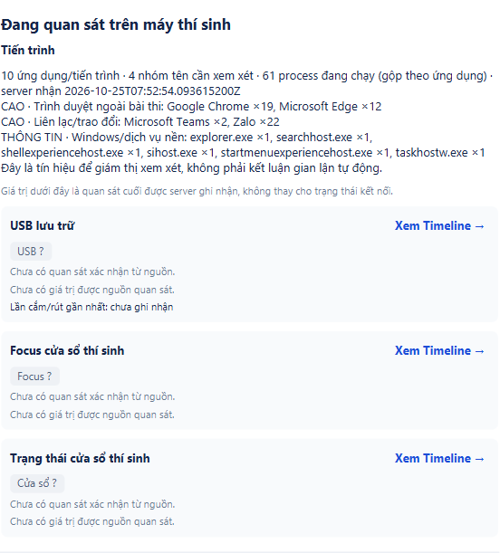

# Bỏ tám process dễ nhầm — 25/10/2026

Theo yêu cầu người dùng, bỏ đúng powershell.exe, pwsh.exe, cmd.exe, msedgewebview2.exe, conhost.exe, runtimebroker.exe, dllhost.exe, svchost.exe khỏi nguồn thu mới. Danh sách hiện hành31tên, vẫn gồm Teams/browser/chat/remote/document và15tên Windows khác (chỉ state/history, không tự cảnh báo). Không suy rộng yêu cầu thành bỏ mọi process Windows.

## Hành vi

Thêm process-policy-v3/current31, giữ v2/39 và v1/8 để đọc raw cũ đúng membership. Full/delta/event/trace mặc định cùng policy3, cap256 nhưv2 và không đổi policy trong epoch. Không đổi schema field/endpoint/DB hoặc OSquery. Summary/danh sách chung/count/recent widgets/MON08 review không dùng8tên kể cả khi inputv2 có chúng. Raw DB/API/Timeline gốc vẫn giữ để đối chiếu; mô tả dòng Timeline cũ nói rõ tên đã loại. Review contract trước sửa ở [runbook](../../docs/PROCESS_GROUPS.md), không là owner signoff.

## Kiểm chứng

- Focused81PASS/0FAIL/ERROR/SKIP (overlap full), gồm v3 rejects8tên, v2 raw vẫn parse, Teams vẫn có; full/delta/state3 roundtrip/epochguard; defaultcollector/trace/harness và GUI đọc legacyv2. Fixture GUI9event gồm8tên bỏ+Teams vẫn giữ raw9, nhưng chỉ1dòng Teams trong commonhistory/alert/count; summary không chứa8tên và báo đãẩn8.
- Full Maven verify7module GUI bật: **1464PASS/154SKIP/0FAIL/0ERROR**,1618test/155suite. STUDY4 không testsource. XML mới chép riêng dưới raw verify; không cộng repeated focused runs.
- Owned PG/WS/HTTP/JavaFX/CIM: **2method PASS/0FAIL/ERROR/SKIP**, run usb-3a87b1bc48e14992. Stage native ProcessHandle mặc định có61process/2Teams ở state/history/commonfeed, policy3 và tất cả thuộc current31 nên không có8tên bỏ. Stageprocess-only dùng MOCK account/đề; các process ở ảnh là native, không là owned chrome fixture. USB/focus/window cards ở scopeprocess-only chưa có observation là đúng; hai stage còn lại kiểm coordinator USB/window/stop-restart/entry/reconnect như trước.
- CIM thật0; không hotplug hoặc AltTab vật lý mới. Window đổi qua JavaFX Stage API. Cleanup0schema/clusterstop0/PIDabsent, không reset DBTEST8080/oldattempt/deadline hoặc đóng app người dùng.
- Không lượt test thất bại trong sửa filter này. Không human approval/benchmarkv3/LAN/installer/hardwareH01–H12/CI mới; không trackerDONE/hours.

## Artifact

Client SHA-256 1da46078eaaa3d9e6454bafcf910ee5f9fd4f38aa7080f83bbb74dfd00e6fef8,544class/resource match. Server server/target/server-process-filter-20261025.jar SHA-256 b7f73f3bed65dd267fc5882f79a2f0fed0d6a7fc53cb33a2a7e108328be66a18,168entries (167class/resource + protocol JAR nested) match. HaiJAR được build bằng fullverify; PG dùng đúng outputclasses, không lấy kết quả cũ làm bằng chứng bản mới. Baseee20a27/sourceDirty=true; source-manifest.json pin14code/testfiles thay đổi. Raw/JAR/log/XML/DBconfig không commit.

Cần mở lại cả server/candidate/proctor bằng JAR mới. Script server chọn -ServerJar .\server\target\server-process-filter-20261025.jar để tránh lấy JAR mặc định cũ; client dùng all-JAR hiện hành. Chỉ đổi proctor có thể ẩn8tên cũ nhưng candidatev2 vẫn gửi chúng, vì vậy phải đổi candidate để ngừng thu. [Hướng dẫn](../../docs/PROCESS_GROUPS.md). Không tự dừng phiên hiện tại. Theo ủy quyền trước: push nhánh hiện tại, không PR/merge; opt-out codex-with-chatgpt giữ.

Loại theo tên cũng bỏ terminal do người dùng tự mở; không chỉ bỏ helper của app. Không tự diễn giải các process đã loại thành bằng chứng máy sạch.
