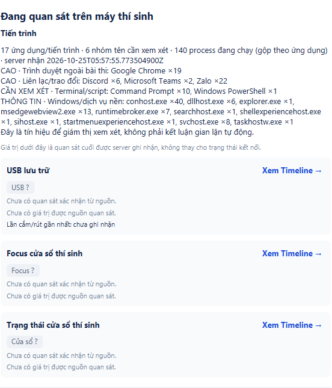

# Mở rộng process theo sáu nhóm và sửa nhận Teams — 25/10/2026

Người dùng yêu cầu nhận các nhóm browser/chat-Teams/remote/document-PDF/terminal/Windows nền. Catalog mới39tên được liệt kê tại [runbook](../../docs/PROCESS_GROUPS.md), không phải thu mọi exe. Trước sửa, Get-Process và Java ProcessHandle đều thấy2ms-teams.exe trên máy nhưng policyv1 chỉ nhận teams.exe. Không cần đổi sang nguồn quét OS khác để sửa trường hợp này.

## Hành vi và tương thích

- Candidate mặc định process-policy-v2, tên so không phân biệt hoa/thường. Full/delta/event dùng cùng ProcessPolicy. Snapshotv2 tối đa256 thay vì128; thực tế lượt này139process nên giới hạn mới có tác dụng. Quá giới hạn không cắt tập rồi coi đầy đủ.
- Server/client mới đọc v1 cũ (8tên/128process) và v2. Process DTO union được kiểm lại membership/giới hạn theo policy trên full/delta/state. Reducer không cho đổi policy giữa epoch. Trace/replay v1 giữ khả năng đọc và kiểm theo policy cũ; không sửa raw/fixtures lịch sử hoặc gán lại E1/E2. Không field/endpoint/migration mới; review kỹ thuật trước thay đổi được ghi trong runbook, không giả owner signoff.
- Windows/background hiện trong process state và lịch sử, không vào Cảnh báo/count/recent-alerts/MON08 review. Các nhóm còn lại là quan sát cần xem xét, không tự kết luận gian lận.
- Loại đúng PID app và helper CIM bằng PID/start; registry128helper gần nhất bao gồm tombstone để tránh race khi child vừa thoát. Thiếu start chỉ khớp child còn sống. Không bỏ qua toàn bộ powershell.exe/java.exe; terminal bên ngoài vẫn được thu. Truy vấn/đóng child USB đang sở hữu không thay; không đọc arguments/username/path hoặc nội dung tài liệu.

## Kết quả đã chạy

- Full Maven verify7module, GUI bật: **1458PASS/154SKIP/0FAIL/0ERROR**,1612test/155suite. STUDY4 không có test source. XML mới được chép riêng trong raw verify; không cộng các lượt focused trùng nhau.
- Focused policy/reducer/helper/collector/trace/history PASS, GUI process groups1PASS, AlertRules29PASS; đều overlap full. Kiểm frame256process dưới64KiB, v1 membership/limit, delta overflow không mutate, đổi policy trong epoch bị từ chối, child owned vs external/PID reuse và Java vẫn ngoài catalog.
- Owned PostgreSQL/WS/HTTP/JavaFX/CIM **2method PASS/0SKIP/0lỗi**; trong method manual có thêm stage REAL_PROCESS_GROUPS dùng CandidateMonitoringSession mặc định/ProcessHandle thật. Run usb-40e4867ba1464ba5, sourceDirty=true. State đầu139process/policyv2;2Teams thật được ghi history và thấy trong common review feed. System background không vào review. Ảnh summary chụp sau có140process vì snapshot tiếp theo, không đồng nhất hai thời điểm.
- Scope/account/đề là MOCK, không gửi sang phiên người dùng8080; stage mới chỉ bật process nên USB/focus/window ở summary này chưa có quan sát. Hai stage USB khác vẫn kiểm baseline/stop-restart/run reuse/entry/reconnect; CIM0, không hotplug vật lý mới. Các process ở ảnh mở rộng là native máy đang chạy; khác ảnh process fixture chrome.exe trước đây. Có terminal của runner TEST đang chạy, không suy người thi mở terminal.
- Cleanup0schema/clusterstop0/postmasterPIDabsent. DBTEST8080/oldattempt/deadline/server/app người dùng giữ nguyên. Không GUI auth automation.
- Lượt verify đầu chưa đạt1test TestTracePolicyTest còn assert8tên default; giữ log/XML thất bại, cập nhật default39 và thêm assert legacy FullSnapshotPayload.EXECUTABLES vẫn8. Không sửa production để ép qua test. Verify cuối PASS.
- Hai cấu hình script server mặc định và -ServerJar mới ValidateOnly PASS, không đọc .env/khởi động server trong validation.

## Artifact và chạy đúng bản

Client all-JAR SHA-256 94b3c138d60c94655d27da45bc4f5e0f82910316f082344bb96609539267f827;544class/resource khớp output client/protocol/windows-observer. Server server/target/server-process-groups-20261025.jar SHA-256 a666c2c4dd4615460696a0c1411b67e34ff4d0572c2f3618143dc5750ca42d57;167class/resource server cùng1protocol JAR nested khớp build. Không commit JAR/raw/token/DB config. Source-manifest pin từng file code/test/script của bản này, base9299075/sourceDirty=true; SHA commit cuối báo sau push.

Server cũ có thể đang khóa JAR mặc định; bản mới được đóng gói tên riêng. Cần khởi động lại server bằng script với -ServerJar .\server\target\server-process-groups-20261025.jar, rồi mở lại cả candidate/proctor bằng client JAR mới và bật giám sát đúng lượt. Script cũ không tự build; chỉ mở lại proctor vẫn không làm candidate cũ thu Teams mới. [Lệnh đầy đủ](../../docs/PROCESS_GROUPS.md). Không tự dừng phiên người dùng đang mở.

B/C và tương thích A/C cần review cá nhân; không trackerDONE/giờ công/policy gian lận/ADR/hardwareH01–H12/LAN/installer/benchmark mới. Không codex-with-chatgpt theo opt-out, không PR/merge. Không claim GitHub CI vì feature branch không có push trigger.
