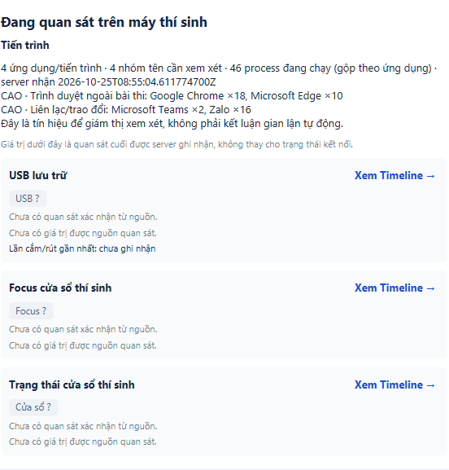
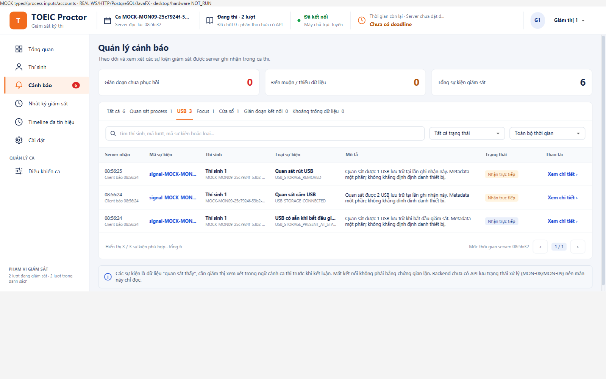

# Chỉ thu chín process, giữ nguyên USB — 25/10/2026

Theo yêu cầu người dùng, process-policy-v4 chỉ nhận **chrome.exe, msedge.exe, firefox.exe, zalo.exe, teams.exe, ms-teams.exe, discord.exe, anydesk.exe, teamviewer.exe**, không phân biệt hoa/thường. Word, Notepad, terminal và process nền Windows không được candidate mới gửi. Full/delta/event/trace mới dùng cùng tập; FULL mặc định và giới hạn 256 process giữ nguyên. Đây là chín tên executable, không phải giới hạn chín PID.

Giữ membership lịch sử v1=8, v2=39, v3=31; tách tập v3 khỏi bộ lọc UI để không đổi nghĩa dữ liệu cũ. Summary/danh sách chung/count chỉ hiện chín tên, raw DB/API/Timeline không xóa. Trong lúc kiểm tra tương thích, phát hiện TraceData vẫn chỉ cho replay production v1 dù header đã nhận các policy mới. Sửa đúng phần kiểm membership/cap và chuyển đổi production theo từng policy; TEST trace vẫn bị chặn replay mạng. Không thêm schema field, endpoint, migration, OS query hoặc thư viện.

USB không sửa: SHA-256 của **13 file** nguồn USB, hook candidate và projection/summary/accumulator đều khớp bản trước ([proof](usb-unchanged.json)). PRESENT_AT_START vẫn hiện ‘USB có sẵn khi bắt đầu giám sát’, cùng cắm/rút và focus/window như cũ. [Review trước sửa và hướng dẫn chạy](../../docs/PROCESS_GROUPS.md). Chạm catalog chung A/C, collector/trace C và consumer B; rà soát bằng agent không thay chữ ký review cá nhân của owner. Opt-out codex-with-chatgpt của người dùng được giữ.

## Kết quả đã chạy

- Focused suites: **142 PASS**, trùng phạm vi full verify. Full Maven verify bật GUI: **1.471 PASS / 154 SKIP / 0 FAIL / 0 ERROR**, 1.625 test trong 156 suite. XML chỉ lấy file mới hơn mốc bắt đầu và được lưu riêng trước khi runner PG ghi đè report. Các gate môi trường bị bỏ qua không được tính là đã nghiệm thu.
- Test exact set cả chín tên, case-insensitive; legacy v3 vẫn 31 tên; full/delta/state theo v4. Trace MOCK full/delta replay cho cả bốn policy, kiểm membership và cap v1=128/v4=256. GUI nhận raw v2 chứa 30 tên ngoài danh sách nhưng chỉ hiện/count Teams; raw vẫn giữ 31 dòng. GUI/adapter USB kiểm baseline, cắm/rút và các trạng thái kỹ thuật ẩn như trước.
- Owned PostgreSQL + HTTP/WS + JavaFX **REAL 2 method PASS**, run usb-e73c295cc08f4263: ProcessHandle thật qua default policy v4, snapshot 46 process đều thuộc tập chín tên; **2 ms-teams.exe** có trong lịch sử và feed giám thị. Ảnh thể hiện Chrome/Edge/Teams/Zalo. Tài khoản/ca/lượt là MOCK. Các ô USB/focus/window trong scope chỉ chạy process này chưa có nguồn typed nên hiển thị chưa xác định đúng thiết kế.
- Cùng lượt REAL kiểm candidate Start/Stop/restart/exam-entry giữ run chung và window transition lên cả hai recent widgets, production USB hook qua fresh capability/reconnect. CIM nhận **0 USB**; không có thao tác cắm/rút vật lý trong lượt tự động này.
- Owned PG fixture **MOCK 1 method PASS**, run usb-f80ace0a44cd4085: USB có sẵn → cắm → rút được adapter gửi qua WS/HTTP/PG lên giao diện thật. Baseline có đúng một dòng shared alert/history, giữ title/source/client time/eventId; retry/reconnect/scope/revoke và queue-drop checks vẫn qua. Raw A=19, B=1; queue drops thật trong fault fixture=3. Đây là input MOCK, không phải bằng chứng nhận USB vật lý.
- Cả hai cluster TEST dọn sạch: 0 schema còn lại, PG stop exit 0, không postmaster PID. Không ngắt server/app/DB người dùng ở 8080. Không nghiệm thu H01–H12, LAN, installer, E1/E2/benchmark mới, tracker DONE hoặc CI của nhánh.

## Bản build và áp dụng

Client all-JAR SHA-256 **453320f135268063a341601bd64072bb7ee2dbf07b3f250bf3fed1350384256c**, 545 class/resource khớp output build. Server **server-process-nine-20261025.jar** SHA-256 **d4f286fbb89751fc9d0fefe466c6fd7ec6e3290e3eb0dbc9e8a7bc1f99b329d5**, 167 class/resource khớp và protocol JAR nhúng byte-identical. [Receipt](receipt.json) ghi base d897342/sourceDirty=true; [manifest](source-manifest.json) pin byte SHA-256 working tree của 12 file code/test thay đổi. JAR, XML, log và config DB chỉ lưu local dưới target/, không commit.

Cần dùng server mới và mở lại **cả candidate lẫn proctor** từ client JAR mới; JVM đang chạy không tự nạp thay đổi. Client cũ vẫn thu theo policy cũ, server cũ không nhận v4. Dùng lệnh server -ServerJar trong runbook; giữ -ReadUsbStorage cho candidate như trước. Sau checkout ở máy khác, mvn package tạo JAR mặc định; script khởi động không tự build. Không reset DB/lượt/deadline để áp dụng bộ lọc.

Theo ủy quyền trước: commit/push nhánh hiện tại, không tạo PR hoặc merge.
