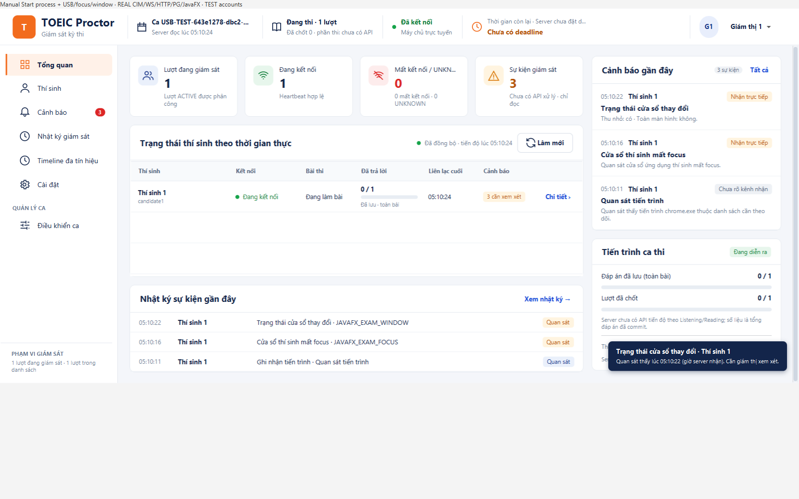

# Danh sách chung chỉ hiện hành vi đã chốt — 25/10/2026

Người dùng chốt: process được quan sát; USB cắm/rút; thay đổi focus và thu nhỏ/toàn màn hình. SignalFeedProjection/RoomFeed nay chỉ nhận các typed action tương ứng vào Cảnh báo, Nhật ký giám sát, số đếm và hai khối gần đây của Tổng quan. Không đưa READY/INITIAL, trạng thái nguồn khác, USB PRESENT_AT_START, focus/window baseline, dialog nội bộ và SIGNAL_GAP typed vào các danh sách này. Luồng process/kết nối/gap legacy vốn có giữ nguyên.

Chỉ lọc consumer hiển thị; server vẫn lưu raw typed history, Timeline đa tín hiệu và Chi tiết thí sinh vẫn có baseline/trạng thái nguồn/unknown để chẩn đoán. Không thay collector, API/wire, DB, OS approach, policy MON-08 hoặc default OFF/FULL. Con trỏ vẫn tiến qua bản ghi ẩn; USB cắm/rút tiếp theo vẫn đọc đúng sequence, không giả sự kiện cắm khi USB có sẵn.

## Kiểm chứng

- Client package kèm 6 suite **40 PASS /0 FAIL /0 ERROR /0 SKIP**, TOEIC_PROCTOR_GUI=true. Kiểm cả loại dòng kỹ thuật khỏi bốn màn/khối và số đếm, giữ CONNECTED/REMOVED/focus lost-restored/window changed, cursor qua bản ghi ẩn, paging/scope/reconnect và GUI cũ. Lượt focused39 trước đó có overlap, không cộng vào40.
- Owned PostgreSQL/WS/HTTP/CIM/JavaFX **2 PASS /0 lỗi/skip**, run usb-f6860f9929f646c6. Window change tự xuất hiện ở danh sách chung, raw history vẫn được kiểm riêng. Cleanup 0schema/clusterstop0/PIDabsent, không reset DBTEST8080 hoặc phiên người dùng.
- CIM thật báo count0; không có rút/cắm USB vật lý mới. USB change trong GUI/unit là MOCK; Stage window thay bằng JavaFX API, không claim Alt+Tab vật lý. Account/đề MOCK, ProcessHandle thật giới hạn PID workload sở hữu; tên chrome.exe thuộc fixture, không là bằng chứng browser người dùng.
- JAR client/target/client-0.1.0-SNAPSHOT-all.jar: SHA-256 dc91c420cb057b8f9169da934456aacafd531c9f9b974c2f240d4705f916569f; 538 class/resource client/protocol/windows-observer khớp output build.
- Không full verify mới cho bộ lọc hiển thị nhỏ này. Kết quả1435/154 thuộc bản4b52cdc trước, không gán lại cho bản này. Không CI feature branch, hardware H01–H12/LAN/installer/policy/human owner approval/DONE mới.

Base4b52cdce00ad0f868ed4f5ad350ae6b3418586ce/sourceDirty=true; source-manifest.json pin5code/testfiles của lượt này. receipt.json giữ XML summary/JAR/run/cleanup; raw/XML local ignored tại target/proctor-actions-only-20261025 và target/proctor-actions-real-20261025. Không commit secret/configDB/JAR. Cần đóng/mở client đang chạy để nạp bản build mới; server đang bật signal không cần đổi. USB cắm sẵn không tạo dòng cắm mới; thử rút/cắm sau khi Bắt đầu giám sát. B/C cần review theo quy trình nhóm; theo ủy quyền trước, commit/push nhánh hiện tại, không PR/merge, không codex-with-chatgpt.
