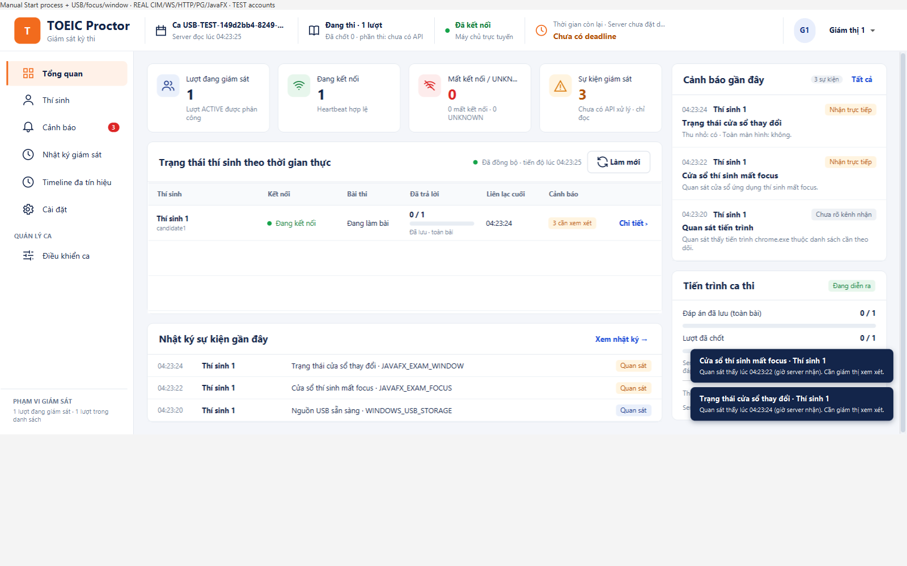
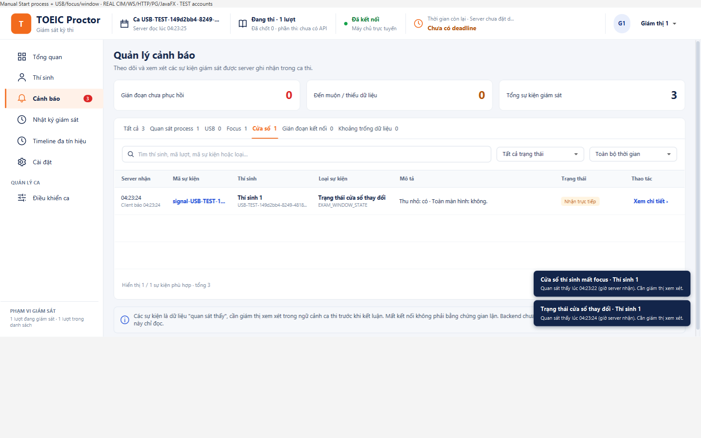

# Nối USB/focus/cửa sổ vào Cảnh báo và Nhật ký chung — 25/10/2026

Nguyên nhân: thay đổi trước chỉ nối typed signals vào Chi tiết thí sinh và Timeline. RoomFeed của Cảnh báo/Nhật ký/hai khối gần đây còn đọc process, interruption và gap cũ. Bản này bổ sung consumer cho lịch sử typed đã commit, không suy sự kiện từ chỉ báo hiện tại.

## Kết quả hiển thị

- Cảnh báo có các bộ lọc USB, Focus, Cửa sổ; dùng chung danh sách, số đếm và drawer chi tiết với process.
- Nhật ký giám sát và Nhật ký sự kiện gần đây giữ cả baseline/status nguồn. Cảnh báo gần đây lấy các quan sát cần xem xét từ cùng room model.
- Focus INITIAL/dialog nội bộ và window INITIAL chỉ là nhật ký; baseline không toàn màn hình không bị hiểu là vừa thoát toàn màn hình. USB PRESENT_AT_START/CONNECTED/REMOVED và thay đổi focus/window là quan sát để xem xét, không kết luận vi phạm hay phân loại MON-08.
- Hai khối gần đây chỉ hiện ba mục mới nhất theo server received time. Dùng danh sách đầy đủ/bộ lọc/Timeline nếu sự kiện đã cũ.
- READY không chứng minh có USB hoặc USB bằng 0; trạng thái nguồn chưa xác định/lỗi/unsupported và gap được ghi rõ. Drawer giữ eventId gốc, client/server time, source, quality và delivery; không giả trạng thái đã xử lý.

RoomFeed đọc tăng dần theo watermark từ CandidateSignalsController có sẵn sau fresh scoped read, không thêm timer/socket. Fixed-through, page100, tối đa3page/lượt tải, hai attempt đồng thời; tối đa500 dòng liên quan mới nhất/lượt, có thông báo giới hạn/thiếu/lỗi/unsupported. Callback cũ không tái đưa dữ liệu attempt đã mất scope vào model. Không đổi API/wire/DB/OS observer; repository mặc định OFF/FULL giữ nguyên.

## Kiểm chứng đã chạy

| Lượt | Kết quả | Giới hạn |
|---|---|---|
| Focused sau sửa test fixture | 42 PASS, 0 lỗi/skip | Bộ cũ và mới có overlap; không cộng vào full |
| Bộ mới RoomFeedSignals/Projection/GUI | 15 PASS, 0 lỗi/skip | JavaFX thật, history MOCK |
| Maven verify 7 module, GUI bật | **1435 PASS /154 SKIP /0 FAIL /0 ERROR**,1589test,152suite | Những test cần env riêng được skip; không nói toàn bộ PG đã chạy |
| Owned PostgreSQL + candidate app controls + CIM/WS/HTTP/JavaFX | **2 PASS /0 SKIP /0 lỗi** | run usb-6855e6d147f2413a; baseline CIM count0, không hotplug mới |
| Client all-JAR | 538 class/resource khớp output build | SHA-256 bên dưới |

Lượt PG kiểm Start/Stop/restart/run reuse/exam activity và window minimize COMMIT. Không bấm refresh: history chung tự nhận USB status/focus/window; cả hai khối gần đây hiện window mới và filter Cửa sổ có dòng. Khi count>0 test kiểm thêm USB baseline ở Cảnh báo; lần này count0 nên không dựng USB event. GUI MOCK riêng kiểm chắc chắn cả USB/focus/window ở hai khối và từng filter.

Ảnh dưới là giao diện thật của lượt PG riêng: account/đề MOCK; ProcessHandle thật chỉ theo PID workload do test sở hữu, tên chrome.exe trong fixture không chứng minh browser người dùng. Window được đổi bằng JavaFX Stage API, không phải nghiệm thu Alt+Tab/rút cắm vật lý. Nguồn USB CIM thật báo count0; dòng Nguồn USB sẵn sàng chỉ là status.

## Tái lập và bằng chứng

Base 11252dc9910cc0ec13660d730ecbf4124f001397, sourceDirty=true; source-manifest.json pin từng file code/test của bản kiểm thử. Không gán kết quả cho commit base chưa có thay đổi. receipt.json giữ run/result/cleanup và SHA JAR. Full verify raw cùng XML mới được chép tại target/proctor-feed-verify-20261025; PG raw tại target/proctor-feed-real-20261025-3. Raw local ignored, không commit secret/config DB hoặc JAR.

Giữ nguyên các lần thử chưa đạt: testCompile sai tên constant trong fixture (target/signal-feed-testcompile-failed.log), hai PG đầu (target/proctor-feed-real-20261025 và -2) kỳ vọng USB alert khi máy thực tế count0; chẩn đoán cho thấy history/feed đã cập nhật, chỉ có USB READY nên đúng là chưa có USB alert. Sửa kỳ vọng theo hardware count và giới hạn ba mục gần đây; production không đổi sau hai lượt đó. Các cluster riêng đều cleanup0schema/stop0/PID absent; DB TEST8080/phiên người dùng không bị reset.

Lệnh full: set TOEIC_PROCTOR_GUI=true&& mvn.cmd --batch-mode --no-transfer-progress -Dtoeic.server.artifact-name=server-feed-20261025 verify

Lệnh PG: powershell.exe -NoProfile -ExecutionPolicy Bypass -File scripts/demo-usb-integrated.ps1 -Mode Real -ReadUsbStorage -Timeline -ViewSeconds 0 -OutputDirectory <thư mục mới dưới target>

Client JAR: client/target/client-0.1.0-SNAPSHOT-all.jar, SHA-256 **72e124c45dbf80a993289e0011d07fb8b7ca4d022701035e290ca8ed157d3d6a**. Đóng/mở lại JVM client cũ để nạp bản mới; server đã bật signal không cần đổi vì bản này chỉ sửa consumer client.

Phạm vi B/C; cần review owner theo quy trình nhóm, không thay chữ ký cá nhân bằng tự review. Không tracker DONE/giờ công/ADR/policy/H01–H12/LAN/installer acceptance mới. Không codex-with-chatgpt theo opt-out; không PR/merge theo yêu cầu. GitHub workflow không trigger push feat nên không claim CI; Git SHA cuối được báo trong trả lời sau push.
