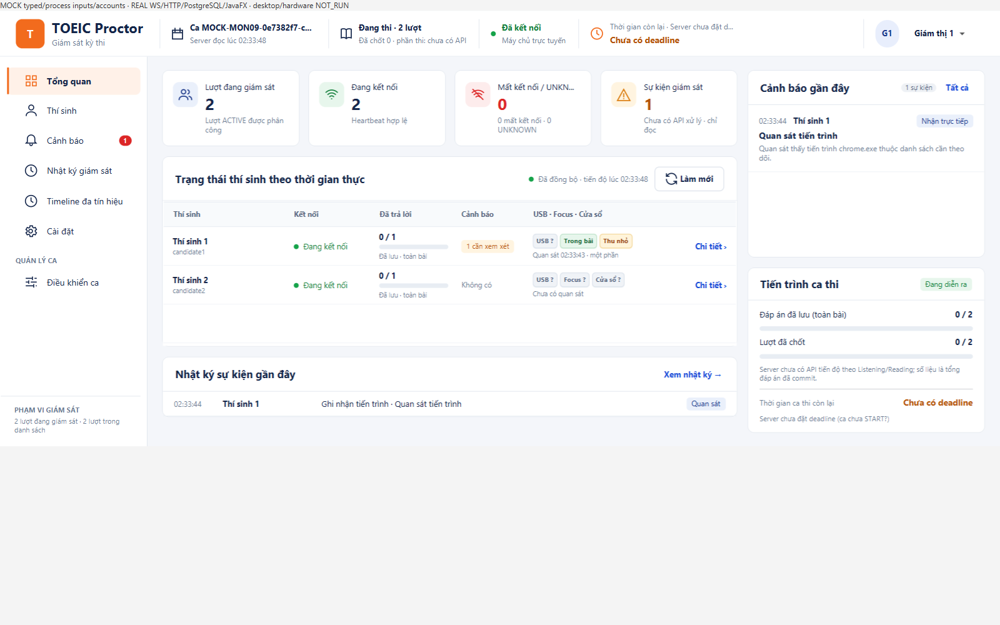
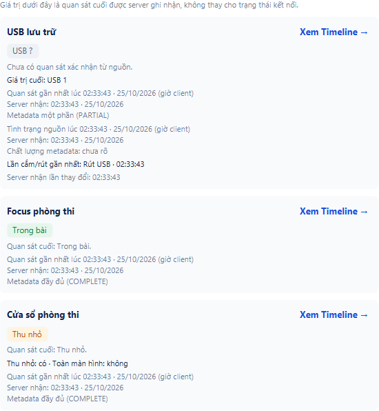

# Tổng quan và Chi tiết thí sinh: USB, focus, cửa sổ

Triển khai theo thiết kế người dùng chốt ngày 24/10; kiểm tra cuối ngày **25/10/2026**. Nhánh `feat/usb-app-integration-20261024`, nền `acc1f82ed64410ae3759c572813cb80dcc6de8f4`; các lượt kiểm chạy trên working tree có thay đổi. [Receipt và hash raw](receipt.json), [manifest nguồn làm việc](source-manifest.json), [hướng dẫn sử dụng](../../docs/PROCTOR_SIGNAL_SUMMARY.md).

## Kết quả giao diện

- Tổng quan có ba chỉ báo từng lượt thi và giờ quan sát; bấm mở đúng Chi tiết thí sinh.
- Giữ Process đang quan sát. Khối Giám sát mở rộng ngay dưới có USB/count/last change, focus, thu nhỏ/toàn màn hình, giờ client và server nhận; từng nguồn có nút Xem Timeline đúng attempt/source.
- Thiếu observation, lịch sử chưa đọc đủ, gap, lỗi, mất kết nối hoặc run chưa xác nhận không được coi là bình thường hay USB bằng 0. Chuyển thí sinh/run hoặc thu hồi quyền không dùng lại dữ liệu của người trước.
- Reader xác thực scope mỗi cycle, fixed-through, bộ nhớ cố định/lượt, hai request history tối đa kể cả future cũ từ chối hủy. Ưu tiên drawer, luân phiên phần roster còn lại; một thí sinh OFFLINE không làm các thí sinh ONLINE mất chỉ báo.

Ảnh dưới dùng **MOCK observations/accounts**, qua WebSocket/HTTP/PostgreSQL và JavaFX thật. Không phải bằng chứng rút/cắm USB vật lý mới. Khối chi tiết được xuất trực tiếp từ JavaFX Node để không bị vùng cuộn của cửa sổ cắt mất thẻ nguồn; không ghép hoặc vẽ lại dữ liệu. Đồng hồ GUI test chạy UTC.

## Kiểm chứng thực tế

| Lượt | Kết quả |
| --- | --- |
| Toàn reactor `mvn verify`, GUI bật | **1.396 PASS / 172 SKIP / 0 FAIL / 0 ERROR**, tổng 1.568 test từ 149 suite XML. Cả 7 module build thành công; STUDY4 không có test source trong module. |
| Focused trước bản vá permit cuối | 33 PASS / 0 SKIP; có overlap với full verify, không cộng hai lượt. |
| `CandidateSignalsPendingLimitTest` | 1 PASS, nằm trong full verify; old A/B từ chối cancel không vượt hai request khi chuyển C/D. |
| MOCK → real WS/HTTP/PG/Scene | `mixedMockDeliveryReachesTwoAttemptDashboard` PASS; hai attempt, 19/1 dòng, gap do ba queue drop thật, reconnect, auth/revoke, overview → drawer → Timeline. Chạy lại cùng case để xuất ảnh; không tính thành test nghiệp vụ khác. |
| REAL CIM → production candidate → PG/Scene | `productionUsbObserverReachesDashboard` PASS; 8 history rows/8 ACK, shared collector, fresh reconnect và nguồn lên khối chi tiết. Local baseline count 0, chỉ có READY nên UI không tự hiển thị USB 0. Không thao tác hotplug vật lý trong lượt tự động này. |
| Package cuối, skipTests | PASS; tên client mặc định để launcher hiện có dùng được. 13 class/resource trong JAR byte-identical với output đã kiểm; SHA-256 `9b929c508a4df4d5ac25a47796d9707df5d387fae5aa71a6fdfecf703d289f39`. |
| Cleanup TEST | Các cluster riêng stop exit 0, 0 schema còn lại, postmaster PID absent. DB TEST đang dùng trước đó không bị reset. |

Full verify dùng tên thin client/server riêng để tránh xung đột artifact; Maven Shade vẫn xuất client `-all.jar` mặc định. Đã bỏ tùy chọn đổi tên thin client không cần thiết và package lại cuối; chỉ tên artifact/POM và helper xuất ảnh thay đổi sau full verify, production Java/CSS giữ nguyên. Test PG xuất ảnh chạy lại với helper cuối.

Lượt compile đầu lỗi cách truyền `-D` qua PowerShell, chưa vào compile. Hai lượt GUI ban đầu đọc ScrollPane control trước layout/pulse (một test mới, một test cũ); đã sửa fixture chờ/dựng layout và chạy lại PASS. Giữ các log lỗi cùng checksum, không xóa hoặc báo các lượt đó PASS.

## Phạm vi bàn giao

Commit kèm các thay đổi USB của các lượt trước trong cùng nhánh vì UI mới cần shared provider/candidate binding và các sửa lỗi Timeline/preview để demo chạy được ở máy khác. Không thêm wire/schema, thư viện ngoài, quyền đọc USB file/serial hoặc mặc định thu thập. Nguồn USB vẫn opt-in; FULL và các experiment mặc định OFF giữ nguyên. Không sửa `AGENTS.md` cá nhân, không đổi tracker/DONE hoặc giả chữ ký reviewer B/C.

GitHub workflow hiện chỉ nhận push `main`/`stabilize/**` hoặc PR; nhánh `feat/**` này không tự có lượt CI. Người dùng yêu cầu **commit/push, không PR, không merge**. Kết quả trên là kiểm local; không tuyên bố GitHub CI PASS, H01–H12/LAN/installer/policy/ADR/human acceptance mới. Các lần người dùng xác nhận rút/cắm trước đó nằm trong report USB lịch sử riêng.
