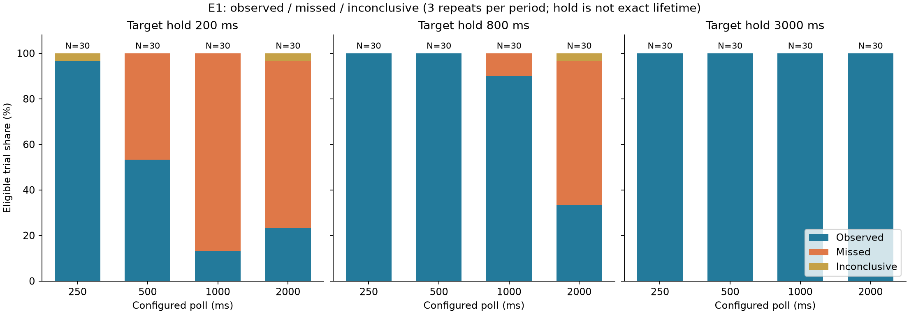
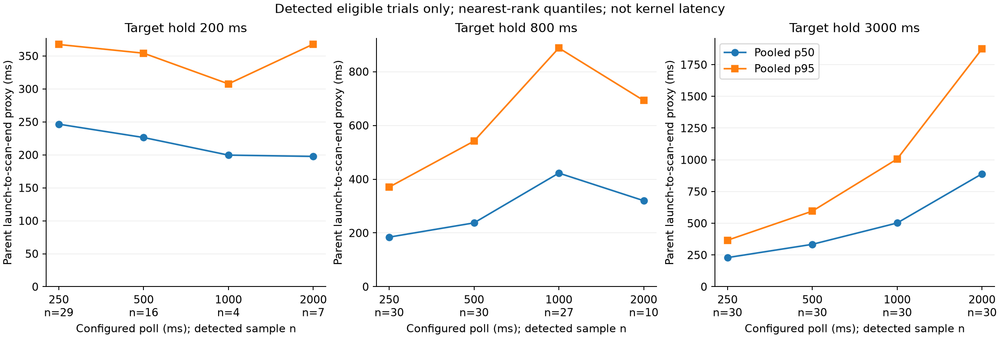
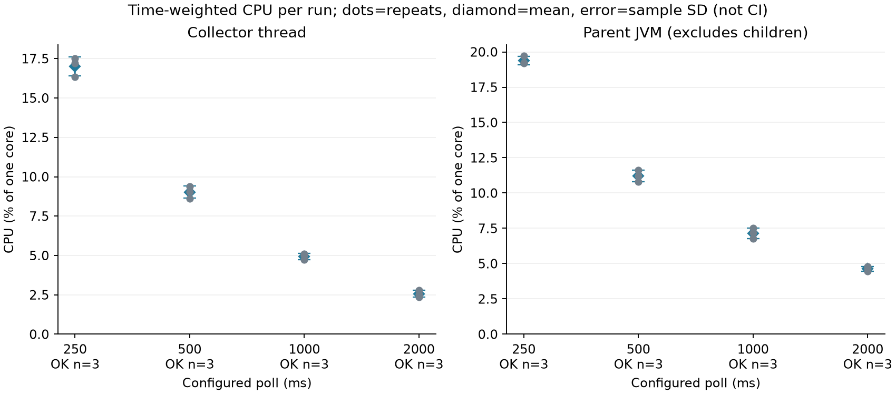
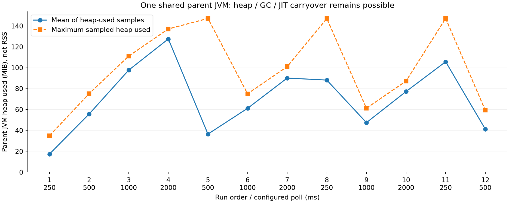

# QA-05/E1 — chiến dịch polling mới 21/10/2026

**COLLECTION_AND_REPRODUCTION_VERIFIED; HUMAN_METHOD/QA_ACCEPTANCE_PENDING.** Chỉ task QA-05/E1 theo ủy quyền người dùng: chuẩn bị/review kỹ thuật Codex, đủ12 lượt, phân tích/publish/merge khi CI/quy định đạt. Không chữ ký B, không sửa tracker DONE/gate hoặc chuyển task.

## Nguồn, build và môi trường

- Source đo sạch `a9ab6609a995132e8059e132022d328e1852a94d` (main đã fetch); JAR client SHA256 `002d0de35d40e5b78fe884252c1cc5f8d62839b849d28030f14653b8d99b3c4a`. Không đổi Java/runner/joiner/analyzer/công thức trong chiến dịch. Build Maven E1-focused89PASS/0SKIP, Python trước đo27PASS; sau bổ sung exporter30PASS, exporter3test trên renderer ổn định PASS.
- Temurin21.0.10+7; Maven3.9.15; analyzer Python3.15.0b3 stdlib. Máy alias **QA05-LAB-A**, Intel(R) Core(TM) Ultra 5 125H,14core/18logical, Windows11 Pro build26200, RAM 15.61GiB. JDK khác dòng khóa lịch sử được ghi đúng actual, không gán kết quả này cho Oracle21.0.8.
- Token thường, Balanced trước/sau; battery báo charging91%→99%. Không thay power/quyền hoặc dừng ứng dụng của người dùng. Process count context trước424/sau441, không thu tên app; tải nền/thermal không được kiểm soát hoặc đo liên tục. Không suite khác được Codex chạy trong cửa sổ đo.
- Thời gian **20:35:36–21:03:01 UTC+7**, 1644.628s. Một parent JVM cho12run; mỗi run collector/window mới, có carryover heap/GC/JIT.
- Seed1234; poll250/500/1000/2000ms×3 theo xoay250→500→1000→2000;500→1000→2000→250;1000→2000→250→500. Mỗi run10child cho từng target hold200/800/3000ms, maxConcurrent2, READY3000ms, exit slack1500ms, maxRun180000ms; warmup15s (chỉ scan), đo[15s,135s], sampler500ms, heap JVM mặc định.
- Nguồn **ProcessHandle REAL**, workload Java child do harness sở hữu, policy **test-owned-process-v1**. Candidate gate SIMULATED trong harness offline; không auth/server/socket/GUI/USB/LAN. Collector enumerate OS thật rồi policy chọn owned roots. Không đổi allowlist production8tên. FULL/default experiments repository giữ nguyên; CLI override delta/signal/alert=false. E1 không đo encoder/ACK/bytes hoặc CPU toàn ứng dụng.

## Review phương pháp — Codex kỹ thuật, không approval B

Đọc QA05/E1 guide, lịch E1Window/HarnessPlan, ControlledProcessHarness/child/OwnedProcessPolicy, ObservationJoiner, E1Resources, analyzer/derived/provenance và tests/evidence liên quan. Không tìm raw lịch sử. Không thấy lỗi estimator cần đổi qua review/test/preflight; không chỉnh threshold/seed để làm kết quả đẹp.
- Lịch được khóa bằng cùng seed/plan hash; fixed-delay cộng thời gian scan/callback, poll cấu hình không là scan cadence chính xác. Warmup không warm child startup; GO/READY/exit có scheduling/pipe cost. Target hold không phải tuổi thọ kernel chính xác.
- Identity exact collectorSessionId+PID+startInstant khác-null. Dữ liệu PID-only/thiếu start giữ INCONCLUSIVE. Missing chỉ khi complete/bracketed/no unresolved source failure; không ép unknown thành missed. Eligible cần trọn lifecycle proxy trong window; censored giữ riêng.
- Latency proxy=(firstScanEnd−parent launchBegin)/1e6, chỉ OBSERVED eligible, nearest-rank p50/p95. Không điền0 cho missed/unknown. Bảng dưới pooled các detected eligible của3run, không trung bình p95; bảng analyzer giữ quantile từng run. Đây không phải latency kernel; nhóm ít detected chịu selection/survivor bias.
- CPU=100×sum(deltaCPU)/sum(deltaWall) trên cặp mẫu kề, đủ2đầu trong window và counter hợp lệ; không trung bình % không trọng số, không nội suy boundary. Collector thread tách parent JVM; parent gồm harness/sampler/writer/GC, không CPU child. Một core, không phần trăm toàn máy18luồng.
- Heap mean là trung bình mẫu heap-used JVM cha; peak là cực đại lấy mẫu, không RSS/working set/peak liên tục. QC PARTIAL khi coverage<95%, gap>2×500ms, counter thiếu/giảm, heap thiếu hoặc<2mẫu. Resource PARTIAL không tự loại detection; exporter giữ số repeat PARTIAL và chỉ dùng OK cho kết luận resource.
- Phương sai mẫu dùng n−1; n<2 là thiếu. Bucket có unknown không có point missRate; báo bounds missed/N..(missed+unknown)/N trên tất cả eligible, không CI. Point mean chỉ trên số run được định nghĩa, n đó được công bố và không gọi là đủ3repeats khi n<3.

## Đủ12 lượt, không loại/chạy bù

Tất cả COMPLETE, resourcesCleaned=true, VALID và resourceStatus=OK;0FAIL/0PARTIAL measurement runs. Preflight smoke riêng3trial COMPLETE, không trộn vào360trial. D/M/U là observed/missed/inconclusive. CPU là % một core; heap MiB là mean/maximum sampled.

| # | Poll ms | D/M/U | Eligible/censored | Collector CPU | Parent CPU | Heap mean/peak MiB | CPU coverage % | Run/resource |
|---|---|---|---|---|---|---|---|---|
| 1 | 250 | 30/0/0 | 30/0 | 16.34 | 19.25 | 17.36/34.87 | 99.58 | COMPLETE/OK |
| 2 | 500 | 24/6/0 | 30/0 | 8.63 | 10.79 | 55.64/75.14 | 99.59 | COMPLETE/OK |
| 3 | 1000 | 20/10/0 | 30/0 | 4.72 | 6.77 | 97.70/111.14 | 99.58 | COMPLETE/OK |
| 4 | 2000 | 15/13/2 | 30/0 | 2.37 | 4.47 | 127.54/137.14 | 99.58 | COMPLETE/OK |
| 5 | 500 | 25/5/0 | 30/0 | 9.05 | 11.22 | 36.49/147.14 | 99.59 | COMPLETE/OK |
| 6 | 1000 | 20/10/0 | 30/0 | 5.01 | 7.52 | 61.13/75.06 | 99.59 | COMPLETE/OK |
| 7 | 2000 | 15/15/0 | 30/0 | 2.80 | 4.80 | 90.11/101.06 | 99.58 | COMPLETE/OK |
| 8 | 250 | 30/0/0 | 30/0 | 17.19 | 19.19 | 88.16/147.06 | 99.59 | COMPLETE/OK |
| 9 | 1000 | 21/9/0 | 30/0 | 5.10 | 7.19 | 47.45/61.22 | 99.58 | COMPLETE/OK |
| 10 | 2000 | 17/13/0 | 30/0 | 2.54 | 4.64 | 77.21/87.22 | 99.59 | COMPLETE/OK |
| 11 | 250 | 29/0/1 | 30/0 | 17.49 | 19.73 | 105.72/147.22 | 99.58 | COMPLETE/OK |
| 12 | 500 | 27/3/0 | 30/0 | 9.39 | 11.64 | 41.22/59.24 | 99.58 | COMPLETE/OK |

Tổng **360 eligible, 273 observed, 84 missed, 3 INCONCLUSIVE, 0 censored**. Unknown3 cùng reason PID_ONLY_MISSING_START_INCONCLUSIVE: run04 có2 (hold200/800), run11 có1(hold200). Ground truth đủ startInstant cho360child; thiếu start nằm ở observation. Không quy unknown thành miss. Resource coverage 99.57976–99.59214%, max gap 514.224–515.799ms, invalidIntervals0;3OK repeats/poll.

## Outcomes và latency trên mẫu đủ điều kiện

| Poll | Target hold ms | D/M/U (N=30) | Miss bounds % | Point-rate repeats | Detected n | Proxy pooled p50/p95 ms |
|---|---|---|---|---|---|---|
| 250 | 200 | 29/0/1 | 0.00–3.33 | 2/3 | 29 | 246.57/367.44 |
| 250 | 800 | 30/0/0 | 0.00–0.00 | 3/3 | 30 | 184.41/370.52 |
| 250 | 3000 | 30/0/0 | 0.00–0.00 | 3/3 | 30 | 229.26/366.31 |
| 500 | 200 | 16/14/0 | 46.67–46.67 | 3/3 | 16 | 226.31/354.23 |
| 500 | 800 | 30/0/0 | 0.00–0.00 | 3/3 | 30 | 237.41/541.51 |
| 500 | 3000 | 30/0/0 | 0.00–0.00 | 3/3 | 30 | 333.99/595.54 |
| 1000 | 200 | 4/26/0 | 86.67–86.67 | 3/3 | 4 | 199.64/307.67 |
| 1000 | 800 | 27/3/0 | 10.00–10.00 | 3/3 | 27 | 422.62/887.96 |
| 1000 | 3000 | 30/0/0 | 0.00–0.00 | 3/3 | 30 | 502.09/1006.50 |
| 2000 | 200 | 7/22/1 | 73.33–76.67 | 2/3 | 7 | 197.63/367.95 |
| 2000 | 800 | 10/19/1 | 63.33–66.67 | 2/3 | 10 | 320.03/692.79 |
| 2000 | 3000 | 30/0/0 | 0.00–0.00 | 3/3 | 30 | 889.72/1873.73 |




## Resource và biến thiên giữa repeat

Mean ± sample SD của3run OK; variance đầy đủ và các n ở resources-by-period.csv. Không dùng3duration của một run làm3repeat.

| Poll ms | OK/total | Collector CPU % | Parent CPU % | Heap mean MiB |
|---|---|---|---|---|
| 250 | 3/3 | 17.01 ± 0.60 | 19.39 ± 0.30 | 70.41 ± 46.78 |
| 500 | 3/3 | 9.02 ± 0.38 | 11.21 ± 0.43 | 44.45 ± 9.98 |
| 1000 | 3/3 | 4.94 ± 0.20 | 7.16 ± 0.37 | 68.76 ± 25.98 |
| 2000 | 3/3 | 2.57 ± 0.22 | 4.64 ± 0.16 | 98.29 ± 26.14 |




## Kết luận dùng trong báo cáo

Trong chiến dịch TEST trên máy QA05-LAB-A, giảm poll2000→250ms đi kèm tăng CPU collector2,57→17,01% một core và quan sát nhiều process ngắn hơn. Ở target hold200ms, poll250ms ghi29observed/0missed/1unknown (miss bounds0–3,33%); poll500ms16/14/0 (46,67% missed);1000ms4/26/0 (86,67%);2000ms7/22/1 (73,33–76,67%). Đây không đơn điệu giữa1000 và2000ms trong mẫu nhỏ; không diễn giải thành bảo đảm hoặc quan hệ nhân quả chung.
Nhóm hold800ms: poll250/500 đều30/30observed;1000ms27observed/3missed;2000ms10observed/19missed/1unknown. Hold3000ms30/30observed mỗi poll trong fixture này. Proxy pooled p95 của nhóm3000ms tăng366,31→595,54→1006,50→1873,74ms theo poll; proxy nhóm200ms không dùng riêng để chọn chu kỳ vì chỉ4detected ở1000ms và7 ở2000ms.
Dữ liệu hỗ trợ đánh đổi polling cho workload/máy đã đo; không tự chốt chu kỳ production. Heap không có xu hướng đơn điệu rõ theo poll và có carryover mạnh trong parent chung (mean giữa run17,36–127,54MiB, maximum sampled147,22MiB). Không gọi heap là RSS hoặc CPU collector là CPU toàn app. Ba repeat/period, một máy, lịch/seed duy nhất, background/thermal không kiểm soát, child startup chưa warm và sampled boundaries hạn chế suy rộng/causal inference. Không so định lượng trực tiếp với chiến dịch lịch sử khác source/JDK/máy.

## Toàn vẹn, cleanup và lỗi giữ lại

- Suite mới `E1-57b7839a-d0b9-4933-bb24-c9f8f5ddf76c`;84/84file trước/sau rejoin/analyze/plots đều cùng hash, không sửa raw. Rejoin 12/12join byte-identical; diff360trial, changed=0. Hai lần analyzer19file byte-identical; hai lần exporter18file byte-identical. Input/output/tool hash và checksum artifact ở receipt.json/CHECKSUMS.sha256.
- Parent exited0;12/12resourcesCleaned true; kiểm360child bằng PID+startInstant:0owned identity còn sống,0GT thiếu start;1PID đã được process khác tái sử dụng, không kill nhầm. Worker thuộc parent không còn sau exit. Balanced trước/sau, không tự dọn process không thuộc phép đo.
- Các lỗi lệnh điều phối trước/sau smoke được giữ log: PowerShell coi stderr java-version là error và Select-Object -Single không hợp lệ. Hậu xử lý còn có wrapper dùng tên biến automatic args làm rơi đối số; đã sửa RunExact và xác nhận số test thực chạy. Chỉ sửa capture/chọn thư mục/binding; smoke không thu lại. Không là lỗi estimator hoặc measurement run bị thay thế.
- Export đồ thị trên Python3.15.0b3+Matplotlib3.11.2 FAIL native import `_PyThreadState_Attach: non-NULL old thread state` (exit−1073740791), tái hiện bằng import độc lập không có dataset. Giữ log/output lỗi local riêng. Chưa khẳng định chính xác extension/ABI cause. Dùng renderer Python3.13.2 embeddable local+Matplotlib3.11.2/NumPy2.5.4 import/test/export PASS, không đổi Java/analyst runtime hoặc đo lại. Dependency plotting không đưa vào runtime production.

## Tái phân tích và vị trí evidence

Raw/JAR/log/runtime plotting lớn chỉ ở local ignored; không có URL GitHub giả tới raw. Từ worktree đo giữ lại, dùng JAR có SHA đúng ở build receipt, output mới chưa tồn tại:

```powershell
$suite = "target/e1-new-20261021/E1-57b7839a-d0b9-4933-bb24-c9f8f5ddf76c"
$jar = "client/target/client-0.1.0-SNAPSHOT-all.jar"
$id = [guid]::NewGuid().ToString("N")
python scripts/benchmarks/e1/derived.py $suite "target/derived-$id" --join-tool $jar
python scripts/benchmarks/e1/analyze.py $suite "target/analysis-$id" --derived-joins "target/derived-$id" --join-tool $jar
# Dùng Python ổn định có matplotlib3.11.2; renderer local đã giữ tại target/plot-python313:
.\target\plot-python313\python.exe scripts/benchmarks/e1/report.py $suite "target/analysis-$id" "target/report-$id"
```

Analyzer/rejoin stdlib không cần matplotlib. Không mkdir trước output, không root clean hoặc seal lại manifest. Tái tạo receipt byte-identical cần cùng tool bytes/Git provenance (hai lần đã kiểm tại sourcea9ab660); chạy ở HEAD khác hợp lệ sẽ ghi analyzerSourceSha mới trong receipt, không gán nó vào rawSourceSha. CSV/metric không đổi khi tool bytes/inputs không đổi. Rendering tái tạo với cùng CPython/Matplotlib/fonts; hash artifact bảo vệ bytes, không chứng minh method được nhóm duyệt.
Python renderer tải từ [Python.org3.13.2](https://www.python.org/downloads/release/python-3132/) sau phép đo; ZIP SHA2561e803610b140cbf69dfa2ceaaeb39651bef75a239c381289e827c30862a27b93, MD5 khớp bảng phát hành4c9d083e2d79c07e8d9e5e2d02127980. Không cài hệ thống. Xem [hướng dẫn E1](../../docs/E1_T4C1_MEASUREMENT.md), [run CSV](run-results.csv), [bounds/latency](outcomes-by-period-hold.csv), [resource](resources-by-period.csv).

Campaign-status giữ CANDIDATE_REVIEW_REQUIRED/humanReview NOT_ASSERTED; không human B approval hoặc tracker DONE. FULL mặc định, experiments OFF; E2/MON mới/GUI/LAN/USB/release không chạy trong task. CI/publish/merge ở PR của nhánh này; receipt giữ source đo a9ab660, không đổi thành SHA merge báo cáo.
