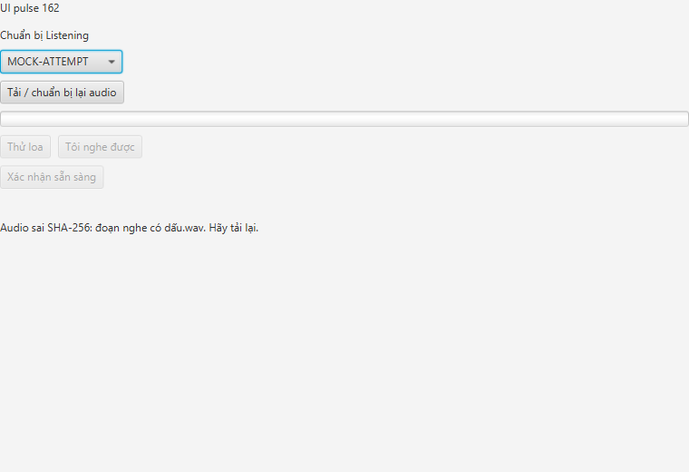
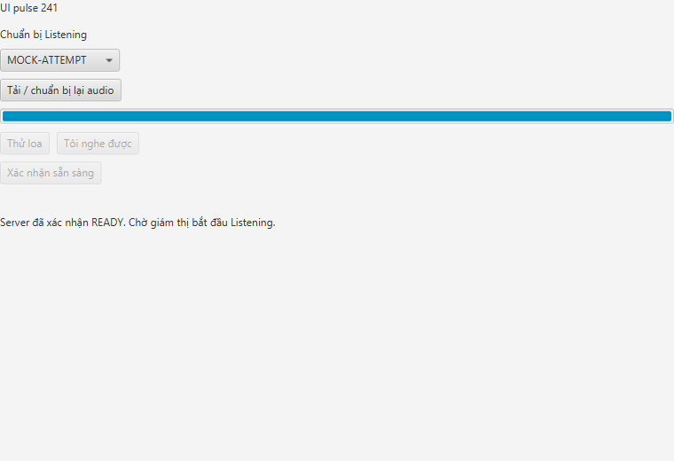
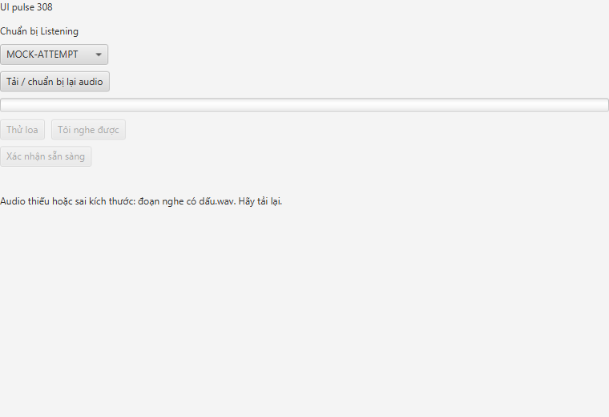

# T3-B1 · Kiểm chứng tải audio, checksum, thử loa và READY

Ngày 14/10/2026 (Asia/Bangkok), branch `feat/t3-b1-audio-download-readiness`, base main `2e784fa`, source code/test/build `89082e3d43a322c0e0e210f393cc3b4bf49bd7da`. [Hướng dẫn](../../docs/AUDIO_CLIENT_PREPARATION.md), [metadata](metadata.json), [hash source](source-manifest.json), [hash artifact](artifact-hashes.json).

Code complete. Nghiệm thu thủ công/review A/LAN/máy thứ hai chưa chạy, nên LT01/tracker giữ PARTIAL/IN_PROGRESS; không điền giờ chưa đo. Các nhánh B4/Reading chưa merge không được ghép vào branch này. Không đổi server production, protocol, migration hoặc `.env`.

## Kết quả thực chạy

| Phần | Kết quả | Bằng chứng / phạm vi |
|---|---|---|
| Maven toàn reactor | PASS657, 0fail/error/skip | Protocol43 + client413 + server200 + spike1; [transcript](maven-package.txt), [từng suite](test-results.json) |
| 27 test client mới | PASS | AudioApiClientTest5, AudioFilesTest14, AudioPreparationTest8; loopback HTTP REAL với response MOCK, filesystem REAL, media callbacks SIMULATED |
| Client → backend thật | PASS | Một case mới trong AudioRuntimePostgresTest (suite9): Spring/HTTP/Flyway/PG và cache local REAL; missing/one-byte-corrupt chặn READY/start; reload khôi phục; chuẩn bị lại xóa READY; speaker confirmation SIMULATED |
| App-image Unicode | PASS6 checks, exit0 | [Result](package-result.txt), [stdout](package-stdout.txt), [stderr](package-stderr.txt); view/cache/JavaFX WAV/runtime21.0.9 REAL, API/WS state MOCK và click xác nhận nghe SIMULATED |
| Visual QA | PASS | Đã mở ảnh kiểm lỗi file và trạng thái READY; không chữ lỗi encoding hoặc cắt mất thông báo ở component 760×520 |
| Review A / nghe thủ công / máy khác | NOT RUN | Automation không chứng minh người thật nghe được loa; không gọi localhost là LAN |

App-image chạy từ `Đóng gói audio có dấu và khoảng trắng/ToeicMonitor`; cache/mẫu nằm trong thư mục tiếng Việt có khoảng trắng. UI pulse tiếp tục khi MOCK takeover chờ 700ms. Mẫu WAV PCM riêng phát hết mới mở xác nhận nghe. Sửa một byte hoặc xóa audio đề sau tải, trước READY, tạo lỗi rõ và không gửi READY true. Tải lại và ACK đúng mới hiện READY; xóa mẫu thử loa gây lỗi Media thật và giữ khóa. Đóng view/player rồi trả khỏi main tự nhiên; script nhận exit0, không dùng System.exit(0) để che tiến trình treo.

Ảnh component với API MOCK:







## Môi trường và tái lập

OS `Microsoft Windows NT 10.0.26300.0`, Microsoft OpenJDK21.0.9, Maven3.9.16, JavaFX21.0.12, Docker `postgres:18` ở cổng5433 theo `.env`; các suite dùng schema/audio sở hữu và tự dọn. Windows SDK `mt.exe` nhúng setting UTF-8 vào manifest EXE mới sinh, giữ DPI/asInvoker và runtime21, không sửa locale/JDK/DLL.

```powershell
powershell -NoProfile -ExecutionPolicy Bypass -File scripts/verify-t3b1.ps1 -JavaHome '<JDK21>' -Postgres -PackageSmoke
# Chỉ kiểm lại package sau khi Maven package PASS:
powershell -NoProfile -ExecutionPolicy Bypass -File scripts/smoke-t3b1-package.ps1 -JavaHome '<JDK21>'
```

Lượt verify cuối chạy Maven PASS trước khi package được sửa; package được chạy riêng tới PASS bằng script thứ hai. Sau thay đổi duy nhất ở launcher TEST để tự thoát, `mvn ... -pl client -am test-compile` PASS và package smoke chạy lại PASS. Không gọi các lần package riêng là chạy lại657 test. Transcript Maven kết hợp stdout/stderr của PowerShell được decode sang UTF-8 để đọc trên GitHub, không cắt nội dung; hash transcript native trong metadata. Log có ERROR/stacktrace từ fault-injection test chủ động; kết luận theo tổng fail/error/skip và BUILD SUCCESS.

Các lỗi đã gặp và xử lý được ghi trong metadata: sandbox/cache, PS5.1 stderr, defaults DB thiếu, Docker ban đầu tắt/native PG credential khác, argv Unicode, native launcher không tìm java.dll, ReadOnly EXE và wrapper exit code. PostgreSQL của dự án đã được bật để chạy test, không reset volume hoặc đổi mật khẩu. Một cảnh báo JavaFX unnamed module còn trong stderr; PCM Media/view đã chạy thành công.

## Bàn giao

B2 cần dùng manifest/writer hiện tại và `AudioFiles.verify` ngay trước phát đề, deduplicate startId và nối event/heartbeat theo A2. Khi ghép Reading, truyền writer dùng chung, không takeover lần hai. B1 không xử lý start/resume/gián đoạn đề; cache local còn trên đĩa, mẫu thử loa được dọn khi đóng view. App-image không phải bộ cài MSI/EXE B5. Full login/candidate/proctor GUI end-to-end, MP3/M4A codec, hearing thủ công, LAN và review A vẫn NOT RUN trong task này.
