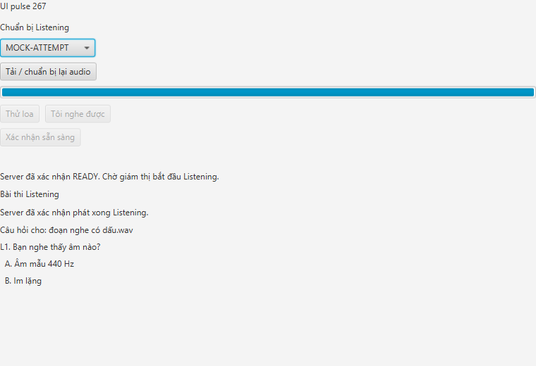

# T3-B2 · Kiểm chứng phát Listening theo lệnh server

Ngày 14/10/2026 (Asia/Bangkok), branch `feat/t3-b2-listening-playback`, parent T3-B1 `7b295f6`, base main lịch sử `2e784fa`, source code/test `987d9b27f400c339a50914de11de6d094649a271`. [Hướng dẫn](../../docs/LISTENING_CLIENT_PLAYBACK.md), [metadata](metadata.json), [hash artifact](artifact-hashes.json).

Code complete cho T3-B2. Review A, LAN/máy thứ hai và nghe thủ công chưa chạy, nên tracker giữ IN_PROGRESS. T3-B3 chưa hoàn thành: Media/network failure khóa local nhưng chưa báo INTERRUPTED và chưa render policy sau reconnect. Không nhập nhánh Reading/B3/B4, không đổi server production, protocol hoặc migration.

## Kết quả thực chạy

| Phần | Kết quả | Bằng chứng / phạm vi |
|---|---|---|
| Maven toàn reactor + PostgreSQL | PASS666, 0 fail/error/skip | Protocol43 + client421 + server201 + spike1; [transcript](maven-package.txt), [tổng hợp](test-results.json) |
| 8 test client mới | PASS | ListeningApiClient3 + ListeningPlayback4 + Realtime start parser1; HTTP loopback REAL với response MOCK, filesystem/journal REAL, media callbacks SIMULATED |
| Client → backend production | PASS | Case mới trong AudioRuntimePostgresTest suite10: production client HTTP, Spring, Flyway và PostgreSQL thật; exact writer, đề/câu hỏi, STARTED/COMPLETED và duplicate start bị chặn; Media callbacks SIMULATED |
| App-image Unicode | PASS7, exit0 | [Kết quả](package-result.txt), [stdout](package-stdout.txt), [stderr](package-stderr.txt); view/cache/JavaFX PCM WAV/runtime21.0.9 REAL, API/WS fixture MOCK |
| Journal local | PASS | [Marker](playback-started.json) ghi attempt/start/writer và `playbackStarted=true`; cùng start được gửi lại nhưng chỉ một STARTED |
| Visual QA | PASS | [Ảnh hoàn tất](screenshots/listening-completed.png) hiển thị đúng file audio, câu hỏi và lựa chọn tiếng Việt, không cắt chữ hoặc lỗi encoding |
| Review A / nghe thủ công / LAN | NOT RUN | Automation không chứng minh người thật nghe được loa hoặc đồng bộ giữa hai máy |

Full package bật `TOEIC_PG_INTEGRATION=true`; các suite PostgreSQL dùng schema/audio sở hữu và tự dọn. Dòng PASS T3-B2 trong transcript xác nhận production client ghi `playback_started_at` và `playback_completed_at` vào DB. Package smoke phát file WAV đề bằng production view/MediaPlayer, hiển thị câu hỏi theo `audioFile`, sau đó phát lại cùng envelope; số event STARTED vẫn bằng một.



## Môi trường và tái lập

OS `Microsoft Windows NT 10.0.26300.0`, Microsoft OpenJDK21.0.9, Maven3.9.16, JavaFX21.0.12, Docker `postgres:18` cổng5433. App-image chạy từ thư mục `Đóng gói audio có dấu và khoảng trắng/ToeicMonitor`; output/cache dùng đường dẫn tiếng Việt và khoảng trắng.

```powershell
powershell -NoProfile -ExecutionPolicy Bypass -File scripts/verify-t3b1.ps1 -JavaHome '<JDK21>' -Postgres -DatabasePort 5433
powershell -NoProfile -ExecutionPolicy Bypass -File scripts/smoke-t3b1-package.ps1 -JavaHome '<JDK21>' -OutputDirectory '<output mới>'
```

Script vẫn mang tên T3-B1 vì T3-B2 mở rộng cùng chuỗi client audio và package harness. Lượt package đầu sau mở rộng đã PASS phần B2 nhưng timeout ở regression B1 cuối do harness xóa mẫu loa trong thư mục view cũ. Sửa đúng path fixture của view thứ hai, chạy app-image mới và PASS7; production code không đổi vì lỗi nằm trong launcher TEST.

## Bàn giao

T3-B3 cần dùng state `BLOCKED`, dừng Media ngay khi mất connection/lỗi player, gửi INTERRUPTED với lý do tương ứng khi có thể, và đọc status sau reconnect mà không resume/autoplay. Marker reserve không được xóa để cấp replay; tổ chức lại phải dùng attempt/start mới. T3-B2 dùng HTTP production cho event/heartbeat để nhận trạng thái sau COMMIT; monitoring heartbeat không thay heartbeat Listening. MP3/M4A codec, full login GUI, human hearing, LAN/máy thứ hai và review A vẫn NOT RUN.
