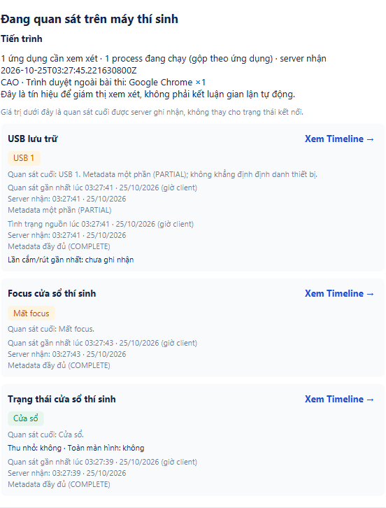
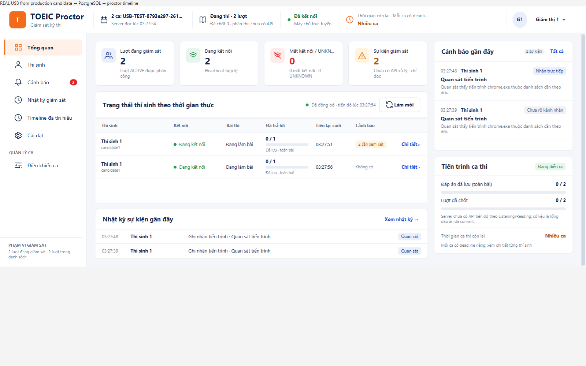

# Giám sát chung tiến trình, USB, focus và cửa sổ

25/10/2026, nhánh `feat/usb-app-integration-20261024`, nền `9c48a5c77bbe1d5a29419c26edbf4521871da642`. Thay thế bố cục cột riêng theo phản hồi mới của người dùng. [Receipt](receipt.json), [source manifest](source-manifest.json), [cách chạy](../../docs/PROCTOR_SIGNAL_SUMMARY.md).

## Nguyên nhân USB trống trong ảnh người dùng

Kiểm JVM đang chạy: server 8080 bật signal experiment; cả hai client bật signal experiment và USB. Native provider MSFT_DISK đọc được **1 USB lưu trữ**, quyền Windows STANDARD. Hai lệnh người dùng đưa đúng.

Computer Use đọc hai cửa sổ đang đăng nhập: candidate đang ở portal, chọn `DEMO-C3-A`, process FULL đã ACK; ca Reading của lượt demo tối trước đã hết giờ. Code cũ chỉ tạo `CandidateExamSignalMonitoring` sau khi vào được màn bài thi; nút **Bắt đầu giám sát** thủ công chỉ gọi process. Vì thế luồng người dùng đang chạy không tạo nguồn USB/focus/window. Không phải dữ liệu rỗng chứng minh máy không có USB.

## Sửa đã thực hiện

- Nút Bắt đầu giám sát khởi động process và typed coordinator cùng collector/run sau fresh scope; capability/heartbeat vẫn chặn gửi/khởi chạy USB trước khi được server cho phép.
- Chuyển portal → bài thi giữ nguyên coordinator/sequence/baseline; chỉ bật activity trong bài sau entry thành công. Focus/window nói về Stage ứng dụng thí sinh trong phiên giám sát, UI dùng đúng tên đối tượng này.
- Dừng đóng typed coordinator và process; nút Start chỉ mở lại sau khi cả collector và worker USB dừng. Logout/revoke/rời phiên giữ các guard cũ.
- Tổng quan bỏ cột USB/focus/cửa sổ. Chi tiết có **một khối Đang quan sát trên máy thí sinh**, gồm tiến trình và ba nguồn, giờ client/server, metadata quality, lần USB change và Timeline đúng nguồn.
- Không đổi process snapshot, wire/API/DB hoặc query/classification CIM. USB không bị biến thành process/PID. Giữ mặc định OFF/FULL và không đọc nội dung/serial USB.

## Ảnh và provenance

Ảnh là output JavaFX thật qua server/WS/HTTP/PostgreSQL TEST riêng. USB dùng **CIM thật, baseline 1**; focus/window dùng Stage thật được điều khiển bằng JavaFX property trong test. Account/đề là fixture **MOCK**; process là workload do test sở hữu, nguồn ProcessHandle chỉ đọc PID của workload đó. Tên `chrome.exe` trong ảnh thuộc fixture, không phải bằng chứng phát hiện trình duyệt Chrome của người dùng. Không nghiệm thu thao tác Alt+Tab/cắm-rút vật lý mới. Node khối chung được xuất trực tiếp để không bị viewport cuộn cắt mất nội dung; không ghép/vẽ lại ảnh. Đồng hồ GUI test dùng UTC.

## Kiểm chứng

| Lượt | Kết quả |
| --- | --- |
| Focused UI/candidate | 50 PASS, 0 FAIL/ERROR/SKIP; có overlap với full verify. |
| Full `mvn verify`, GUI bật | **1.420 PASS / 154 SKIP / 0 FAIL / 0 ERROR**, 1.574 test, 149 suite XML. Cả 7 module build/package thành công; STUDY4 không có test source trong module. |
| REAL app manual Start + CIM/WS/PG | `manualMonitoringStartsUsbFocusWindowWithProcess` PASS: chưa vào bài vẫn có typed baseline và USB 1 cùng collector process; minimize lên history; Stop dọn worker; restart đổi run; vào bài giữ object/run và mới phát activity. |
| REAL production hook/reconnect | `productionUsbObserverReachesDashboard` PASS, USB baseline 1 và 9 ACK/history rows; fresh reconnect, shared identity, không PRESENT_AT_START trùng trong cùng run; worker dừng sạch. |
| JAR | `client/target/client-0.1.0-SNAPSHOT-all.jar`, SHA-256 `c35b931a525fda5ac4d7221173785e83c8c978a1964605ff853090fcf919110d`; 10 class/resource kiểm tra byte-identical với output test. |
| Cleanup | Các cluster TEST riêng: 0 schema còn lại, stop exit 0, postmaster PID absent. Không reset DB/attempt/deadline của phiên 8080 người dùng. |

PG REAL có hai test method, chạy lại để xuất ảnh nguyên khối; không cộng repeated runs thành test khác. Lượt bằng chứng cuối `usb-1845957b86d641a6`: 2/2 PASS. Full verify xong trước thay đổi helper xuất ảnh sang Node khối chung; production Java/CSS/JAR giữ nguyên, helper cuối đã chạy lại qua PG REAL.

Giữ các lượt lỗi: helper login TEST cũ dò placeholder đã bị UI đổi nên không đi được vào candidate; sửa helper dùng stable ID và đúng owned server. Bước chụp ảnh ban đầu gặp node vừa được drawer refresh tháo ra, sửa retry chờ node gắn vào. Full GUI đầu gặp hai test đọc control trước tab layout, sửa await điều kiện có control rồi chạy lại. Không bỏ qua hoặc đánh dấu các lượt lỗi là PASS; checksum raw có trong receipt.

## Áp dụng bản mới

Server đang bật `-SignalExperiment` có thể giữ nguyên. Đóng và mở lại **cả hai JVM client** để dùng JAR mới; app đang mở giữ class cũ trong RAM. Candidate chạy bằng `-ReadUsbStorage`, đăng nhập, chọn lượt còn quyền rồi bấm **Giám sát trong phiên thi → Bắt đầu giám sát**; proctor mở **Chi tiết** cùng lượt. USB đã cắm được hiện dưới dạng PRESENT_AT_START, không nhất thiết có CONNECTED mới. Lượt hết giờ/nộp rồi không được thu tiếp hoặc kéo dài để demo.

Hai cửa sổ người dùng chỉ được đọc trạng thái, không tự đăng nhập/khởi động lại. Nghiệm thu cắm/rút vật lý mới, H01–H12, LAN/installer và phê duyệt policy/owner vẫn riêng. Không đổi tracker/DONE; không PR/merge. CI hiện không tự chạy với push nhánh feat; kết quả trên là kiểm local.
