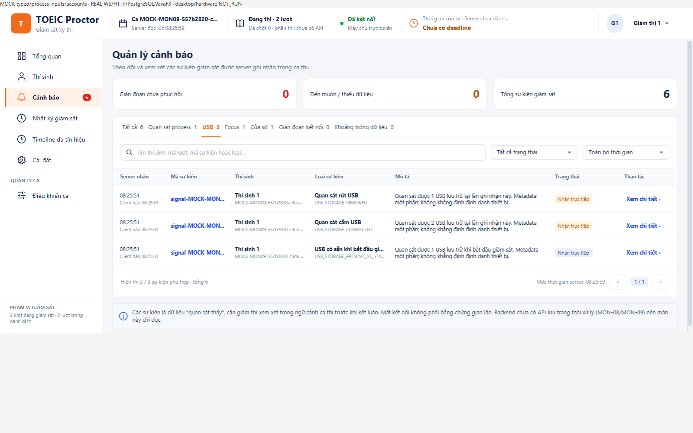

# Hiện USB có sẵn khi bắt đầu giám sát — 25/10/2026

Lượt trước mới chẩn đoán, chưa sửa. Theo yêu cầu tiếp của người dùng, khôi phục USB_STORAGE_PRESENT_AT_START ở shared projection. Cảnh báo, Nhật ký, số sự kiện và hai khối gần đây có dòng **USB có sẵn khi bắt đầu giám sát**, số USB cùng thời điểm client/server và metadata. LIVE màu thông tin; đến muộn vẫn amber/nhãn delivery. Không giả thành CONNECTED, không sửa eventId hoặc suy số USB từ READY. Focus/window INITIAL, dialog nội bộ, OBSERVER_STATUS READY/lỗi và gap typed vẫn không chen vào danh sách chung.

Chỉ đổi client consumer; collector đã có baseline nếu lần quét đầu nhận được USB, không lặp mỗi poll. Server/wire/DB/OSquery/process policyv3/31tên và bộ lọc8process giữ nguyên. Các baseline từ run trước vẫn là lịch sử, không chứng minh thiết bị đang cắm ở hiện tại.

## Kiểm chứng

- Maven client package + selected adapter/projection/feed/GUI suites: **48PASS/0FAIL/ERROR/SKIP**,6suite. GUI thật với inputMOCK kiểm baseline2USB xuất hiện trong cả2recentwidgets/Alerts/History/count/detail, READY và focus/windowINITIAL vẫn ẩn. Adapter tests kiểm baseline khi bắt đầu/không lặp polling.
- Owned PG mixed fixture **1method PASS/0lỗi/skip**, run usb-71c2ccca1771485c. UsbSignalAdapter đầu vàoMOCK có USB sẵn→cắm→rút, delivery/WS/HTTP/PG/JavaFX thật. Raw Timeline có PRESENT_AT_START; commonalert/history đúng1baseline của attemptA, title/source/clientTime/raw eventId giữ đúng. ACK/rawrowcounts và retry/reconnect/scope-revoke checks giữ nguyên; không thêm hoặc sửa fake record DB trực tiếp.
- Ảnh dưới là scope/account/inputMOCK, không bằng chứng USB vật lý. Hai khối recent chỉ3mục nên baseline của mixed fixture có thể cũ hơn3dòng; testGUI baseline-only kiểm widgets riêng.
- Cleanup0schema/PGstop0/PIDabsent. Không đụng server8080/DBTest/attempt/deadline hoặc app người dùng. Read-only query ở lượt chẩn đoán trước thấy0USB; lần này không claim đã nhận USB vật lý/hotplug/H01–H12 mới.
- Không full verify mới cho fix consumer nhỏ; số1464/154 là lịch sử bản30c7985. Không trackerDONE/LAN/installer/policyhumanapproval/CIclaim. Read-only agent review không thấy blocker, không thay owner review B/C.

Client all-JAR SHA-256 09b32ed9b8f8224852d62337dce4978d7fafdcbb744d2fbb62f3f7851214a8dc,544class/resource khớp output build. Base30c7985/sourceDirty=true; source-manifest pin5file code/test. Raw/log/XML/JAR/DB config local ignored, không commit. Chỉ cần mở lại proctor bằng client mới để đọc lại baseline đã được server lưu; không cần restart server hoặc dừng candidate cho riêng sửa UI này. Nếu candidate/provider chưa nhận USB hoặc chưa phát baseline, sửa UI không tạo ra observation. [Runbook](../../docs/PROCTOR_SIGNAL_SUMMARY.md).

Theo ủy quyền trước, commit/push nhánh hiện tại, không PR/merge; opt-out codex-with-chatgpt giữ.
